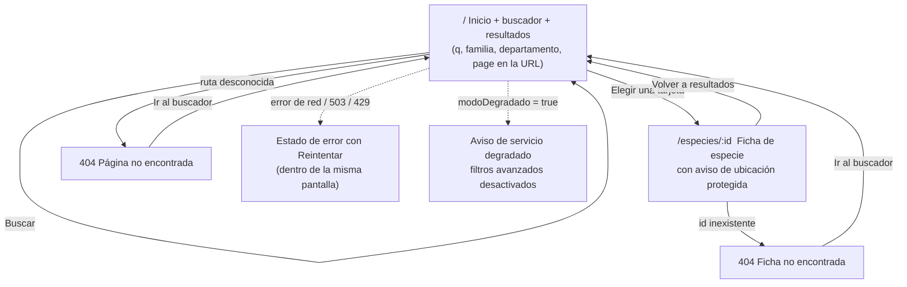
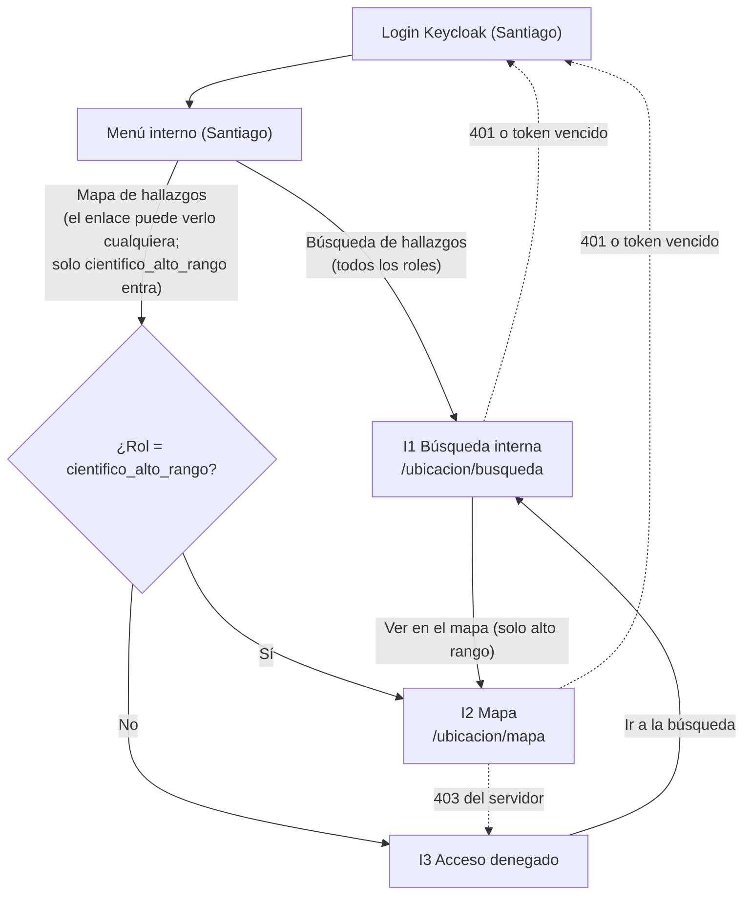

# 02 – Diseño UX/UI: parte de Juanita Mejía (web-publica y `web-interna/src/ubicacion/`)

Fecha: 2026-10-26. Estado: borrador para validación de Juanita.
Fuentes: `01-requisitos.md` (la sección 9 "Decisiones tomadas" prevalece), `03-arquitectura.md` (D14, D15, D16, D17), `fuentes/srs-biohub.md` (RNF6, RNF7, RNF13), `04-contrato-api.md` (aún sin los recursos de ubicación/consulta; los nombres de campo de la sección 9 de este documento se toman de `01-requisitos.md` 4.4 y 3.3/3.4 y deben confirmarse cuando el arquitecto los publique) y el código actual de `web-publica/src` y `web-interna/src`.

## 0. Principios y reglas que gobiernan todo el diseño

1. **Ninguna pantalla pública muestra coordenadas exactas, de ninguna especie (D14).** Ni texto, ni mapa con puntos, ni enlaces a Google Maps, ni atributos `data-*`, ni `title`, ni logs de consola. La interfaz pública trabaja con una lista blanca de campos (sección 9.1) e ignora cualquier `coordenadas`, `latitud` o `longitud` aunque el servidor las enviara por error.
2. **Una sola idea por pantalla, máximo 3 pasos por tarea (RNF6).** Los pasos se cuentan como acciones del usuario (escribir, confirmar, elegir).
3. **Mismo patrón para la misma acción.** Buscar = campo + botón "Buscar" + Enter. Reintentar = botón "Reintentar". Paginar = mismo componente en público e interno. Estado de conservación = siempre el mismo chip (texto + icono + color; el color nunca va solo).
4. **Todo el texto en español, lenguaje sencillo** (nivel de lectura de secundaria, frases de menos de 25 palabras, sin siglas sin explicar).
5. **Lo que ya existe se reutiliza:** fuente `system-ui`, fondo `#f4f8f4`, texto `#1b2a1f`, verde primario `#2e7d32`, clase `.contenedor` (centrada, 52rem, relleno 1.5rem), clases `.ok` / `.error`, patrón `role="status"` / `role="alert"` de `EstadoServicio.jsx`, botón verde de `web-interna`. Se conservan tal cual, salvo **un cambio justificado**: el anillo de foco actual de web-interna (`#81c784`) tiene contraste 2,0:1 sobre blanco y no cumple WCAG 1.4.11 (mínimo 3:1); se sustituye por `#1565c0` (5,7:1).
6. **La carpeta de Juanita en web-interna no toca el CSS de Santiago.** Los estilos de `src/ubicacion/` llevan prefijo `ub-` y variables CSS definidas en `.ub-raiz`, para no colisionar con `index.css`, el login ni el menú.

---

## 1. Mapa de navegación

### 1.1 web-publica (visitante, sin cuenta; móvil primero)

Se propone `react-router` con rutas en el historial del navegador (URL compartible; los filtros viajan como parámetros de consulta, nunca datos sensibles).



Pantallas: **P1 Inicio/Resultados**, **P2 Ficha**, **P3 404 (ficha y página)**. Los estados (cargando, vacío, error, degradado) son variantes de P1 y P2, no pantallas aparte.

### 1.2 web-interna / `src/ubicacion/` (con login; el login y el menú son de Santiago)

Santiago monta dos rutas y dos enlaces en su menú (D17). Rutas propuestas (Santiago puede cambiarlas, solo debe pasar los componentes): `/ubicacion/busqueda` y `/ubicacion/mapa`.



Pantallas: **I1 Búsqueda interna**, **I2 Mapa**, **I3 Acceso denegado**. Recomendación a Santiago (no obligatoria): mostrar el enlace "Mapa" a todos los roles para que el rechazo sea explicado por la pantalla I3 y no con un enlace que desaparece sin explicación; si prefiere ocultarlo a los demás roles, I3 sigue siendo necesaria para quien llegue por URL directa.

---

## 2. Flujos principales (pasos contados según RNF6, máximo 3)

### F1 – Buscar una especie por nombre (HU-06.2)
| Paso | Usuario | Sistema |
|---|---|---|
| 1 | Abre el portal. | Muestra el buscador con el foco en el campo; carga la primera página (20 especies, orden alfabético por nombre científico). |
| 2 | Escribe "atelopus" y pulsa Enter o "Buscar". | Estado cargando, luego tarjetas con total ("12 especies encontradas") y paginación. La URL pasa a `/?q=atelopus`. |
| 3 | Pulsa la tarjeta de la especie. | Abre la ficha. |

### F2 – Buscar con filtros (familia y departamento)
| Paso | Usuario | Sistema |
|---|---|---|
| 1 | Abre "Filtrar por familia o departamento" (en móvil el bloque está plegado; en escritorio ya está abierto). | Muestra los campos. |
| 2 | Elige departamento "Boyacá" y escribe familia "Bufonidae"; pulsa "Buscar". | Resultados que cumplen ambos. |
| 3 | Pulsa una tarjeta. | Ficha. |
Si `modoDegradado = true`, el paso 1 muestra los filtros desactivados con la explicación (ver P1, estado degradado); la búsqueda por nombre sigue disponible.

### F3 – Entender por qué no hay coordenadas (HU-06.3, RNF7)
| Paso | Usuario | Sistema |
|---|---|---|
| 1 | Abre una ficha (desde F1/F2 o por enlace directo). | Muestra, **sin que el usuario haga nada más**, la sección "Dónde se encontró" con departamento, región y el aviso "Ubicación protegida" visible (no plegado, no en tooltip, no en ventana emergente). |
| 2 | Lee el aviso. | Fin: el motivo (evitar la caza y el tráfico ilegal) está en las dos primeras frases. |
Total: 1 paso tras llegar a la ficha. La prueba de usabilidad de RNF7 se describe en la sección 10.

### F4 – Volver a los resultados sin perder la búsqueda
En la ficha, el enlace "Volver a los resultados" regresa a la URL anterior con sus parámetros (y el botón "Atrás" del navegador hace lo mismo). 1 paso.

### F5 – Búsqueda interna con filtros (HU-13.1, HU-13.3)
| Paso | Usuario | Sistema |
|---|---|---|
| 1 | Abre "Búsqueda de hallazgos" desde el menú. | Muestra los filtros vacíos y la primera página (20 hallazgos más recientes). |
| 2 | Rellena uno o más filtros (especie, fechas, investigador, departamento) y pulsa "Buscar". | Estado cargando y tabla con el total. Los filtros quedan en la URL. |
| 3 | Revisa la tabla (columna de coordenadas visible solo para alto rango; los demás ven "Restringido"). | – |

### F6 – Ver hallazgos en el mapa (HU-07.2, solo alto rango)
| Paso | Usuario | Sistema |
|---|---|---|
| 1 | Abre "Mapa de hallazgos". | Comprueba el rol; si es alto rango pide hasta 1000 marcadores y muestra el mapa centrado en Colombia. |
| 2 | (Opcional) Aplica filtros y pulsa "Aplicar filtros". | Actualiza marcadores y contador. |
| 3 | Pulsa (o con teclado, Enter sobre) un marcador. | Abre el panel de detalle con especie, fecha, investigador, departamento, estado y coordenadas exactas. |

### F7 – Saltar de la búsqueda al mapa (solo alto rango)
Desde una fila de la tabla: botón "Ver en el mapa" (1 paso) abre `/ubicacion/mapa?hallazgo=<id>`; el mapa carga con todos los filtros por defecto, abre el detalle de ese hallazgo y centra la vista **sin acercarse más del zoom 12** (ver riesgo de teselas en 7.3). El parámetro lleva solo el id, **nunca coordenadas**.

### F8 – Rol sin permiso intenta entrar al mapa (HU-07.2)
Un solo paso: abre la ruta -> pantalla I3 "No tienes permiso para ver esta información" con botón "Ir a la búsqueda de hallazgos". La UI **no hace la llamada** a `/mapa` si el rol del token no incluye `cientifico_alto_rango`.

---

## 3. Especificación por pantalla

Convenciones de los estados: **Cargando** (`aria-busy`, mensaje en `role="status"`), **Vacío**, **Error** (`role="alert"`), **Éxito**. Todos los mensajes en la sección 11.

### 3.1 P1 – Inicio, buscador y resultados (web-publica, ruta `/`)

**Propósito.** Que el visitante encuentre una especie en uno o dos pasos.
**Contenido.** Encabezado con nombre BioHub y lema; buscador; filtros; resumen de resultados; lista de tarjetas; paginación; pie con aviso de ubicación protegida general (una línea).
**Componentes.** `EncabezadoPublico`, `Buscador`, `FiltrosAvanzados` (familia, departamento), `Aviso` (degradado), `ListaResultados` > `TarjetaEspecie`, `Paginacion`, `MensajeError`, `EstadoVacio`, `Esqueleto`.
**Acciones.** Buscar (Enter o botón), limpiar filtros, cambiar de página, abrir ficha.
**Validación en cliente** (reglas de negocio 8): `q` vacío permitido (lista todo); si tiene texto, de 2 a 100 caracteres; mensaje bajo el campo, el foco permanece en el campo.

Wireframe móvil (320-599 px):
```
+--------------------------------+
| [Saltar al contenido]          |
| BioHub  Biodiversidad de       |
|         Colombia               |
+--------------------------------+
| Busca una especie              |
| +----------------------------+ |
| | Nombre científico o común  | |
| +----------------------------+ |
| [        Buscar        ]       |
| v Filtrar por familia o        |
|   departamento                 |
|   Familia  [________________]  |
|   Departamento [Todos      v]  |
|   [Limpiar filtros]            |
+--------------------------------+
| 12 especies encontradas        |
| +----------------------------+ |
| | Atelopus ebenoides (cursiva)| |
| | Rana arlequín de ...       | |
| | [En peligro]               | |
| | Familia Bufonidae          | |
| | Boyacá · Región Andina     | |
| +----------------------------+ |
| (otra tarjeta ...)             |
| [< Anterior] Página 1 de 1 [Siguiente >]
+--------------------------------+
| Por seguridad, BioHub no       |
| publica ubicaciones exactas.   |
+--------------------------------+
```

Wireframe escritorio (>= 1024 px):
```
+--------------------------------------------------------------+
| BioHub   Biodiversidad de Colombia                           |
+--------------------------------------------------------------+
|  Busca una especie                                           |
|  [ Nombre científico o común ............... ] [ Buscar ]    |
|  Familia [_____________]  Departamento [Todos v] [Limpiar]   |
+--------------------------------------------------------------+
|  12 especies encontradas                                     |
|  +----------------+ +----------------+ +----------------+    |
|  | Nombre cient.  | | ...            | | ...            |    |
|  | Nombre común   | |                | |                |    |
|  | [En peligro]   | |                | |                |    |
|  | Fam. · Depto.  | |                | |                |    |
|  +----------------+ +----------------+ +----------------+    |
|        [< Anterior]  1  2  3  [Siguiente >]                  |
+--------------------------------------------------------------+
```

**Estados de P1**

| Estado | Qué ve el usuario | Detalles técnicos |
|---|---|---|
| Cargando (primera carga o cambio de página/filtros) | 6 tarjetas "esqueleto" (sin animación si `prefers-reduced-motion`) y el texto visible-oculto "Buscando especies…". El botón Buscar queda activo pero ignora un segundo envío idéntico en curso. | Contenedor de resultados con `aria-busy="true"`; el texto va en `role="status"`. Se cancela la petición anterior con `AbortController` para que una respuesta lenta no pise a una más nueva. |
| Éxito | Tarjetas, total y paginación. | El total se anuncia en `role="status"`: "12 especies encontradas". Tras cambiar de página, el foco va al encabezado de resultados. |
| Vacío (200 con `total = 0`) | Icono de lupa, "No se encontraron especies", sugerencia "Revisa la ortografía o prueba con menos palabras." y botón "Limpiar búsqueda". Si había filtros: "Prueba quitando algún filtro." | Texto en `role="status"`. |
| Error de red / 5xx / 503 | Icono de aviso, "No pudimos cargar la información, intenta de nuevo" y botón "Reintentar" (repite la última petición). Conserva lo escrito en los campos. Si había resultados previos, se ocultan (no mostrar datos viejos como actuales). | `role="alert"`. 503 usa el mismo texto (el detalle técnico no se muestra). |
| 400 (parámetro inválido llegado por URL manipulada) | "Algo en la búsqueda no es válido. Revisa lo que escribiste." y se restablecen los parámetros incorrectos. | `role="alert"`. |
| 429 (límite de peticiones del gateway) | "Hiciste muchas búsquedas seguidas. Espera un momento e intenta de nuevo." con "Reintentar" desactivado 10 s con cuenta regresiva en texto. | `role="alert"`. |
| Servicio degradado (`modoDegradado: true`, RNF1) | Banner amarillo no descartable sobre los resultados: "Hay muchas visitas en este momento. Por ahora solo puedes buscar por nombre; los filtros de familia y departamento están desactivados." Los campos de filtro quedan `disabled` con el mismo texto enlazado por `aria-describedby`. La búsqueda por nombre y la paginación siguen funcionando. Si la URL traía filtros, se indica "Se ignoraron los filtros de familia y departamento." | Banner con `role="status"` (no interrumpe). Cuando la respuesta vuelva con `modoDegradado: false`, el banner desaparece y los filtros se reactivan sin recargar la página. |

**Tarjeta de especie (contenido fijo):** nombre científico en cursiva (`<i lang="la">`), nombre común si existe, chip de estado de conservación, "Familia X", "Departamento · Región". **No** muestra fecha ni nada parecido a una ubicación más precisa. Toda la tarjeta es un solo enlace a `/especies/:id` (un único tab stop; el nombre científico es el texto del enlace y el resto está dentro de él).

### 3.2 P2 – Ficha de especie (web-publica, ruta `/especies/:id`)

**Propósito.** Mostrar los datos públicos de una especie y explicar, sin que el usuario deba pedir ayuda, por qué no hay coordenadas.
**Contenido.** Enlace "Volver a los resultados"; nombre científico (h1, cursiva) y nombre común; chip de estado de conservación; datos (familia, tipo de espécimen, fecha de recolección); descripción; sección "Dónde se encontró" con departamento, región y `AvisoUbicacionProtegida`.
**Orden en la página:** el aviso va **inmediatamente debajo de la línea de departamento/región**, antes de la descripción larga, para que se vea sin desplazarse en móvil.

Wireframe móvil:
```
+--------------------------------+
| < Volver a los resultados      |
| Atelopus ebenoides (h1, cursiva)
| Rana arlequín ...              |
| [! En peligro]                 |
+--------------------------------+
| Dónde se encontró (h2)         |
| Departamento: Boyacá           |
| Región: Andina                 |
| +----------------------------+ |
| | (candado+pin)              | |
| | Ubicación protegida        | |
| | Por seguridad, BioHub no   | |
| | publica el lugar exacto... | |
| +----------------------------+ |
+--------------------------------+
| Datos de la especie (h2)       |
| Familia ........ Bufonidae     |
| Tipo de espécimen ... Animal   |
| Fecha de recolección           |
|   15 de marzo de 2026          |
+--------------------------------+
| Descripción (h2)               |
| Texto ...                      |
+--------------------------------+
```
En escritorio: dos columnas (izquierda datos y descripción, 2/3; derecha "Dónde se encontró" con el aviso, 1/3, pegajosa solo si cabe), con el h1 a todo el ancho.

**Mapa a nivel de departamento (decisión).** En esta versión **no se incluye mapa**: un departamento sombreado puede confundirse con "aquí está la especie" y no aporta a la tarea. Se deja como mejora **Could** una miniatura estática de Colombia en SVG con el departamento resaltado, empaquetada en el propio sitio (sin teselas ni servicios externos, `aria-hidden="true"` porque el texto ya dice el departamento), con leyenda "Zona general: todo el departamento de Boyacá". Si se construye: el SVG no puede tener nada más fino que el departamento. Ver pregunta abierta Q1.

**Estados de P2**

| Estado | Qué ve el usuario | Detalles |
|---|---|---|
| Cargando | Esqueleto de título, chip y bloques; "Cargando la ficha…" | `aria-busy`, `role="status"`. |
| Éxito | Ficha completa. El título de la pestaña pasa a "Atelopus ebenoides · BioHub". El foco va al h1 al entrar. | – |
| 404 (id inexistente) o 400 (id que no es UUID) | Pantalla "No encontramos esta especie" + "Es posible que el enlace esté mal escrito o que la ficha ya no esté disponible." + botón "Ir al buscador". | Mismo diseño para 400 y 404 (no se revela la diferencia). Foco al h1. `document.title = "Especie no encontrada · BioHub"`. |
| Error de red / 503 | "No pudimos cargar la información, intenta de nuevo" + "Reintentar" + enlace "Ir al buscador". | `role="alert"`. |
| 429 | Igual que en P1. | – |
| Degradado | La ficha no depende del modo degradado; si la respuesta de la ficha lo trae, no se muestra aviso. | – |
| Campos opcionales ausentes | Se omite la fila completa (no se escribe "null" ni "-"). Sin descripción: se oculta la sección. | – |

### 3.3 P3 – 404 de página (web-publica, cualquier ruta desconocida)
Título "Esta página no existe", texto "Revisa la dirección o vuelve al buscador.", botón "Ir al buscador". Mismo componente que el 404 de ficha con distinto texto.

### 3.4 I1 – Búsqueda interna (web-interna, `/ubicacion/busqueda`)

**Propósito.** Ubicar hallazgos con filtros combinables y ver sus datos de ubicación según el rol.
**Contenido.** Título "Búsqueda de hallazgos"; formulario de filtros; resumen ("48 hallazgos"); nota de rol (si aplica); tabla; paginación con selector de tamaño.
**Componentes.** `FiltrosHallazgos`, `Tabla`, `ChipEstado`, `IndicadorRestringido`, `Paginacion`, `Aviso`, `MensajeError`, `EstadoVacio`, `Esqueleto`.
**Filtros (todos opcionales y combinables):** Especie (texto, máx. 100), Desde (fecha), Hasta (fecha), Investigador (texto, máx. 100), Departamento (lista). Validación: `desde` no puede ser posterior a `hasta` -> mensaje bajo "Hasta" y no se envía. El filtro por área geográfica (bbox) **no existe en la interfaz** (si se hace más adelante, solo para alto rango).

Wireframe escritorio (>= 1024 px), rol alto rango:
```
+----------------------------------------------------------------------+
| Búsqueda de hallazgos                                                |
| Especie [__________] Desde [__/__/____] Hasta [__/__/____]           |
| Investigador [__________] Departamento [Todos v]                     |
| [Buscar] [Limpiar filtros]                                           |
+----------------------------------------------------------------------+
| 48 hallazgos                                       Mostrar [20 v]    |
| +---------------------------------------------------------------------+
| | Especie        |Fecha    |Investigador|Depto/Región|Estado |Coordenadas      |Acción|
| | Atelopus eb... |15/03/26 |ana.ruiz    |Boyacá/And. |[En p.]|4.60970,-74.08170|[Ver en el mapa]|
| | ...                                                                  |
| +---------------------------------------------------------------------+
|           [< Anterior]  Página 1 de 3  [Siguiente >]                 |
+----------------------------------------------------------------------+
```
Rol sin permiso (investigador, auditor, analista, administrador): la columna **"Coordenadas" se mantiene** (para que se vea qué falta) y cada celda muestra el indicador `IndicadorRestringido` = icono de candado + texto "Restringido"; la columna "Acción" no existe. Bajo el título, un aviso informativo **siempre visible** (no un tooltip):
> "Tu rol no permite ver las coordenadas exactas. Solo el personal científico de alto rango puede verlas. Si las necesitas para tu trabajo, pídelas a una persona con ese rol."
Además, el encabezado de la columna tiene un botón "¿Por qué?" (disclosure, no tooltip) que despliega la misma explicación en una línea bajo la tabla.

Regla de celda: si el rol **no** es `cientifico_alto_rango`, la celda es **siempre** "Restringido" y no se renderiza ningún valor aunque la respuesta trajera `latitud`/`longitud` (defensa en profundidad). Si el rol es alto rango, se muestra el valor de la fila, o "Sin coordenadas" (texto gris, sin candado) cuando la fila no las tiene. El rol del token además decide si existe la columna "Acción / Ver en el mapa". El servidor es quien realmente protege el dato; la UI solo evita mostrarlo por error.

**Estados de I1**

| Estado | Qué ve | Detalles |
|---|---|---|
| Cargando | Filas esqueleto en la tabla (5) y "Buscando hallazgos…". Los filtros siguen editables. | `aria-busy` en la tabla. Meta de rendimiento: < 3 s (HU-13); si pasa de 8 s se añade "Esto está tardando más de lo normal…". |
| Éxito | Tabla, total y paginación. Tras buscar, el foco va al resumen del total. | – |
| Vacío | "No hay hallazgos que coincidan con los filtros" + "Prueba con menos filtros o con otro rango de fechas." + botón "Limpiar filtros". | `role="status"`. |
| Error 5xx / red | "No pudimos cargar los hallazgos. Intenta de nuevo." + "Reintentar". | `role="alert"`. |
| 400 | Se resaltan los campos inválidos con el mensaje del servidor traducido (ver 11.4). | – |
| 401 / sesión vencida | Se vacía la tabla en memoria (no queda ningún dato visible) y se llama al flujo de login de Santiago. Texto breve mientras redirige: "Tu sesión terminó. Te llevamos al inicio de sesión…". | Reutiliza el mismo comportamiento de `getAutenticado`. |
| 403 | Pantalla I3 genérica ("No tienes permiso para ver esta información"). No debería ocurrir (todos los roles internos pueden buscar). | – |
| Omitidos | Si la respuesta trae registros que no pudieron descifrarse (`omitidos > 0`, solo alto rango), aviso informativo: "No se pudieron mostrar N hallazgos por un problema técnico. Avisa al equipo de soporte." | `role="status"`. |

Tabla en móvil/tablet pequeña (< 768 px): cada fila pasa a tarjeta apilada con pares etiqueta/valor (`<dl>`), manteniendo el mismo orden y el mismo indicador "Restringido".

### 3.5 I2 – Mapa (web-interna, `/ubicacion/mapa`, solo `cientifico_alto_rango`)

**Propósito.** Analizar la distribución geográfica con coordenadas exactas.
**Contenido.** Barra de filtros (especie, departamento, desde, hasta); contador; avisos (truncado, omitidos); mapa; panel de detalle; conmutador "Mapa | Lista".
**Componentes.** `FiltrosMapa`, `MapaHallazgos` (Leaflet), `PanelDetalleHallazgo`, `Aviso`, `Tabla` (vista lista), `EstadoVacio`, `MensajeError`.

Wireframe escritorio (>= 1024 px):
```
+----------------------------------------------------------------------+
| Mapa de hallazgos                         Vista: (Mapa) ( Lista )    |
| Especie [________] Depto [Todos v] Desde [____] Hasta [____]         |
| [Aplicar filtros] [Limpiar]       312 hallazgos en el mapa           |
| (!) Se muestran los primeros 1000... (solo si truncado)              |
+---------------------------------------------+------------------------+
|                                             | Detalle del hallazgo   |
|            MAPA (Leaflet)                   | Atelopus ebenoides     |
|       o     o o                             | [En peligro]           |
|         o        o                          | Fecha: 15/03/2026      |
|                                             | Investigador: ana.ruiz |
|   [+][-]                                    | Departamento: Boyacá   |
|                                             | Latitud:  4.60970      |
|   © OpenStreetMap contributors              | Longitud: -74.08170    |
|                                             | [Cerrar]               |
+---------------------------------------------+------------------------+
```
Antes de seleccionar un marcador el panel muestra: "Selecciona un marcador para ver el detalle."

**Reglas del mapa**
- Datos: `GET /api/cientifico/ubicacion/mapa` devuelve GeoJSON. **Atención al orden:** GeoJSON es `[longitud, latitud]`; Leaflet espera `[latitud, longitud]`. Convertir en un solo punto del código.
- Marcadores: `L.marker` con `L.divIcon` pequeño (círculo con borde, color según estado de conservación + forma distinta para En peligro, para no depender solo del color). Se eligen marcadores DOM y no `circleMarker` canvas porque son enfocables con teclado (`keyboard: true`, Enter abre el detalle). 1000 marcadores DOM es aceptable para el prototipo; si el rendimiento falla en equipos modestos, pasar a `markercluster` (Could) manteniendo la vista Lista.
- Límite 1000: si `truncado: true`, aviso amarillo permanente sobre el mapa: "Se muestran 1000 de los hallazgos que cumplen los filtros. Aplica más filtros para ver el resto." El contador dice "1000 hallazgos en el mapa (hay más)".
- Registros omitidos (`omitidos > 0`): aviso informativo como en I1.
- Vista "Lista": misma información en `Tabla` accesible (especie, fecha, departamento, estado, latitud, longitud). Es la alternativa para quien no puede usar el mapa (lector de pantalla, teclado cómodo, impresión). Un clic en una fila abre el mismo panel de detalle.
- Centro inicial: Colombia (4.5, -74.1, zoom 5). Tras aplicar filtros se ajusta a los marcadores con `fitBounds` y `maxZoom: 12`.
- Cierre del detalle: botón "Cerrar" y tecla Esc; el foco regresa al marcador que lo abrió.

**Estados de I2**

| Estado | Qué ve | Detalles |
|---|---|---|
| Verificando rol | Esqueleto de la pantalla; no se hace ninguna llamada a `/mapa` hasta confirmar el rol. | – |
| Cargando | Mapa base visible (sin marcadores), velo semitransparente con "Cargando hallazgos…"; filtros desactivados mientras tanto. | `role="status"`, `aria-busy`. |
| Éxito | Marcadores, contador, panel de detalle. | – |
| Vacío (`features: []`) | Sobre el mapa vacío, tarjeta "No hay hallazgos para los filtros seleccionados" + "Limpiar filtros". | `role="status"`. |
| Truncado / omitidos | Avisos descritos arriba, con los marcadores igualmente mostrados. | – |
| Error 5xx / red | "No pudimos cargar el mapa. Intenta de nuevo." + "Reintentar"; **se quitan los marcadores anteriores** del mapa. | `role="alert"`. |
| Teselas no disponibles (OSM caído o bloqueado) | Fondo gris con aviso "No se pudo cargar el mapa base. Los hallazgos siguen disponibles en la vista Lista." y se cambia automáticamente a la vista Lista. | Evento `tileerror` de Leaflet, contado (> 3 errores). |
| 401 | Igual que I1. | – |
| 403 | I3. Se destruye la instancia del mapa y se vacía el estado. | – |

### 3.6 I3 – Acceso denegado (web-interna)

**Propósito.** Explicar con claridad por qué no puede ver el mapa y qué hacer.
Wireframe:
```
+--------------------------------------------+
|          (candado)                         |
|  No tienes permiso para ver esta           |
|  información                               |
|                                            |
|  El mapa muestra coordenadas exactas y     |
|  solo está disponible para el personal     |
|  científico de alto rango. Puedes buscar   |
|  hallazgos sin coordenadas exactas en la   |
|  búsqueda de hallazgos.                    |
|                                            |
|  [Ir a la búsqueda de hallazgos]           |
+--------------------------------------------+
```
Estados: único (estático). Nunca se renderiza el mapa ni se pide la API. `role="alert"` no se usa (no es un error inesperado): el foco va al h1 al entrar y el título cambia a "Acceso denegado · BioHub".

---

## 4. Datos que necesita cada vista de la API

Los nombres de campo se toman de `01-requisitos.md` (4.4, 3.3 y 3.4). `04-contrato-api.md` aún no define estos recursos; **si el arquitecto cambia un nombre, el frontend solo debe tocar `api/*.js` y los adaptadores** (se pide una capa de adaptación para que los componentes usen nombres estables).

### 4.1 Públicos (sin token, sin API Key, solo GET; D16)

| Vista | Petición | Campos que usa la UI | Campos que la UI **descarta siempre** |
|---|---|---|---|
| P1 | `GET /api/publica/fichas?q=&familia=&departamento=&page=&size=` (page desde 0 o 1: confirmar; size por defecto 20, máx. 50) | `content[]`: `id`, `nombreCientifico`, `nombreComun`, `familia`, `estadoConservacion`, `departamento`, `region`. Paginación: `page`, `size`, `total`. `modoDegradado` (booleano). | `coordenadas`, `latitud`, `longitud`, `ubicacion*` con valores numéricos, `usuario`, `investigador` |
| P2 | `GET /api/publica/fichas/{id}` | `id`, `nombreCientifico`, `nombreComun`, `familia`, `tipoEspecimen`, `fechaRecoleccion`, `estadoConservacion`, `departamento`, `region`, `descripcion`, `ubicacionProtegida` | Lo mismo que arriba. `coordenadas` ya no existe (D14); si llegara, no se renderiza. |
| Listas de apoyo | Departamentos: lista estática en el frontend (32 departamentos + Bogotá D.C.). Familia: texto libre (ver Q2). | – | – |

Códigos que la UI distingue: 200, 400, 404, 429, 503, error de red (sin respuesta). `ubicacionProtegida` se usa solo para decidir el texto del aviso; con D14 el aviso se muestra **siempre**, incluso si el servidor enviara `false`.

### 4.2 Internos (JWT; la UI toma el rol de `rolesUsuario()` de `auth/keycloak.js`)

| Vista | Petición | Campos que usa la UI |
|---|---|---|
| I1 | `GET /api/cientifico/ubicacion/hallazgos?especie=&desde=&hasta=&investigador=&departamento=&page=&size=` (size por defecto 20, máx. 100; orden por fecha de recolección descendente) | `content[]`: `id` (hallazgoId), `nombreCientifico`, `fechaRecoleccion`, `investigador`, `departamento`, `region`, `estadoConservacion`, `ubicacionProtegida`, y **solo para alto rango** `latitud`, `longitud`. `page`, `size`, `total`. `omitidos` (opcional). |
| I2 | `GET /api/cientifico/ubicacion/mapa?especie=&departamento=&desde=&hasta=` (la respuesta lleva `Cache-Control: no-store`) | GeoJSON `FeatureCollection`: `features[].geometry.coordinates` = `[longitud, latitud]`; `features[].properties`: `hallazgoId`, `nombreCientifico`, `fechaRecoleccion`, `investigador`, `departamento`, `region`, `estadoConservacion`; además `total`, `truncado`, `omitidos`. |

Se pide al arquitecto confirmar: (a) que `investigador` y `estadoConservacion` vengan en las propiedades del mapa; (b) que el listado interno admita el parámetro `size`; (c) si el parámetro `page` empieza en 0 o en 1.

Reglas del cliente interno (derivan de las reglas de negocio 5 y 11):
- Las coordenadas viven solo en el estado de React del componente; **no** se guardan en `localStorage`, `sessionStorage`, URL, `console.log`, caché de un gestor de estado global ni en el título de la pestaña.
- Al cerrar sesión, desmontar la pantalla o recibir 401/403 se descarta el estado y se destruye el mapa (`map.remove()`).
- Peticiones con `fetch` y `cache: 'no-store'`.
- Los errores de la API (`application/problem+json`) se convierten en un error propio con `status` y `titulo`; el mensaje que ve el usuario sale de la tabla de microcopy, no del texto del servidor.

---

## 5. Sistema de diseño

### 5.1 Paleta (contraste calculado según WCAG 2.1, fórmula de luminancia relativa)

Texto normal: mínimo 4,5:1. Texto grande (>= 24 px o 19 px negrita): 3:1. Componentes e iconos esenciales: 3:1.

| Token | Valor | Uso | Contraste verificado |
|---|---|---|---|
| `--c-fondo` | `#f4f8f4` | Fondo de página (existente) | – |
| `--c-superficie` | `#ffffff` | Tarjetas, tablas, campos | – |
| `--c-texto` | `#1b2a1f` | Texto principal (existente) | 14,0:1 sobre `--c-fondo`; 14,7:1 sobre blanco |
| `--c-texto-suave` | `#4a5c4e` | Texto secundario, etiquetas auxiliares | 6,7:1 sobre `--c-fondo`; 7,2:1 sobre blanco |
| `--c-primario` | `#2e7d32` | Botón primario (existente), fondos | Texto blanco sobre él: 5,1:1 |
| `--c-primario-hover` | `#1b5e20` | Hover/activo y enlaces | Blanco sobre él: 7,9:1; como texto sobre blanco 7,9:1 |
| `--c-borde-campo` | `#6b7d6f` | Borde de campos y controles | 4,4:1 sobre blanco (mínimo 3:1 para componentes) |
| `--c-borde` | `#cfd8d1` | Separadores decorativos (no esenciales) | – |
| `--c-foco` | `#1565c0` | Anillo de foco (3 px + 2 px de separación) | 5,7:1 sobre blanco; 5,2:1 sobre `--c-fondo` |
| `--c-error` | `#b71c1c` | Texto de error (existente) | 6,6:1 sobre blanco; 6,1:1 sobre `--c-fondo` |
| `--c-error-fondo` | `#fdecea` | Fondo de aviso de error | Texto `--c-texto` sobre él: 12,6:1; `#8e1313` sobre él: 8,1:1 |
| `--c-aviso-fondo` | `#fff3cd` | Aviso (degradado, truncado) | Texto `#5c4300` sobre él: 8,4:1 |
| `--c-info-fondo` | `#e3f2fd` | Aviso informativo y bloque de ubicación protegida | Texto `#0d47a1` sobre él: 7,5:1; `--c-texto` sobre él: 12,6:1 |
| `--c-ok-fondo` | `#e8f5e9` | Éxito, chip "No amenazada" | Texto `#1b5e20` sobre él: 7,0:1 |
| `--c-neutro-fondo` | `#eceff1` | Chip "Sin evaluar", "Restringido" | Texto `#37474f` sobre él: 8,3:1 |

El estado se comunica siempre con **texto + icono + color**, nunca solo color. Los valores intermedios del contraste se calcularon a mano con la fórmula WCAG; antes de cerrar la implementación, el frontend debe pasarlos por una herramienta automática (por ejemplo axe o Lighthouse) y avisar si alguno difiere.

**Chips de estado de conservación** (`ChipEstado`):
| Valor API | Etiqueta | Fondo / texto / borde | Icono |
|---|---|---|---|
| `EN_PELIGRO` | En peligro | `#fdecea` / `#8e1313` / `#8e1313` | triángulo de advertencia |
| `NO_AMENAZADA` | No amenazada | `#e8f5e9` / `#1b5e20` / `#1b5e20` | marca de verificación |
| `SIN_EVALUAR` o cualquier valor desconocido | Sin evaluar | `#eceff1` / `#37474f` / `#37474f` | signo de interrogación |

### 5.2 Tipografía
- Familia: `system-ui, -apple-system, "Segoe UI", Roboto, "Helvetica Neue", Arial, sans-serif` (ya es la del proyecto). **Sin fuentes externas, CDN ni analítica** en web-publica (velocidad en el pico x60, privacidad y RNF13).
- Tamaños (rem, base 16 px): `--t-xs` 0,875 · `--t-base` 1 · `--t-md` 1,125 · `--t-lg` 1,25 · `--t-xl` 1,5 · `--t-2xl` 2. Interlineado 1,5 en texto corrido y 1,25 en títulos. Pesos 400, 600, 700.
- h1 `--t-xl` en móvil y `--t-2xl` desde tablet; h2 `--t-lg`; h3 `--t-md`.
- Nombres científicos siempre en cursiva con `<i lang="la">`. Ancho de línea del texto corrido <= 70 caracteres (`max-width: 70ch`).
- El usuario puede ampliar el texto al 200 % sin perder contenido ni funcionalidad (medidas en rem, sin alturas fijas).

### 5.3 Espaciado, radios, sombras
- Escala de espaciado (múltiplos de 4 px): `--e-1` 0,25rem · `--e-2` 0,5rem · `--e-3` 0,75rem · `--e-4` 1rem · `--e-6` 1,5rem · `--e-8` 2rem · `--e-12` 3rem.
- Radios: `--r-sm` 4 px (campos, chips cuadrados), `--r-md` 8 px (tarjetas, botones, avisos), `--r-pill` 999 px (chips).
- Sombras: `--sombra-1: 0 1px 2px rgba(27,42,31,.12)` (tarjetas), `--sombra-2: 0 4px 12px rgba(27,42,31,.16)` (panel de detalle, banners flotantes). Sin sombras para transmitir información.
- Anchos: contenido público `max-width: 64rem` (sube desde los 52rem actuales para tres columnas de tarjetas); formularios y texto `52rem`; interna: tabla ocupa el ancho disponible.
- Objetivo táctil mínimo de 44 x 44 px en botones, enlaces de tarjeta y controles de paginación.
- Movimiento: transiciones <= 150 ms y desactivadas con `prefers-reduced-motion: reduce`.

### 5.4 Componentes reutilizables

| Componente | Variantes y propiedades | Notas de comportamiento |
|---|---|---|
| `Boton` | primario (verde), secundario (borde verde, fondo blanco), peligro (no se usa en este alcance), enlace; tamaños normal/pequeño; estado `cargando` (texto + "…", `aria-busy`), `disabled` | Siempre `type="button"` o `type="submit"` explícito. Texto con verbo. Foco con `--c-foco`. |
| `CampoTexto` / `CampoSelect` / `CampoFecha` | etiqueta visible (nunca solo placeholder), ayuda opcional, error opcional | `<label for>`, error con `id` enlazado por `aria-describedby` y `aria-invalid="true"`. `CampoFecha` usa `<input type="date">` con ayuda "Formato día/mes/año". |
| `Buscador` | variante pública (campo grande + botón) | `<form role="search">`; Enter envía; botón "Limpiar" (x) dentro del campo solo si hay texto, con `aria-label`. |
| `FiltrosAvanzados` / `FiltrosHallazgos` / `FiltrosMapa` | plegable en móvil (`<details>` o botón con `aria-expanded`) | Misma rejilla y mismos botones ("Buscar" / "Aplicar filtros", "Limpiar filtros"). |
| `TarjetaEspecie` | normal, esqueleto | Un solo enlace por tarjeta. Contenido fijo (3.1). |
| `ChipEstado` | `EN_PELIGRO`, `NO_AMENAZADA`, `SIN_EVALUAR` | Tabla 5.1. Texto + icono SVG `aria-hidden`. |
| `AvisoUbicacionProtegida` | `completo` (ficha), `breve` (pie de P1) | Fondo `--c-info-fondo`, borde izquierdo 4 px `#0d47a1`, icono candado+pin. Texto exacto en 6. `role="note"`; no es plegable ni emergente. |
| `IndicadorRestringido` | celda de tabla | Candado + "Restringido", fondo `--c-neutro-fondo`, forma de chip. |
| `Aviso` | `info`, `advertencia`, `error`, `exito` | `info`/`advertencia`/`exito` con `role="status"`; `error` con `role="alert"`. Icono + título opcional + texto. Sin cierre automático. |
| `MensajeError` | con botón "Reintentar" opcional | Bloque `error` + acción; recibe el texto de la tabla de microcopy. |
| `EstadoVacio` | con acción opcional | Icono, título, ayuda y botón. |
| `Esqueleto` | tarjeta, fila de tabla, ficha | Animación solo si no hay `prefers-reduced-motion`. |
| `Tabla` | densa (interna), apilada en móvil | `<table>` real con `<caption>` (puede ser visualmente oculto), `<th scope="col">`, contenedor con `overflow-x: auto` solo como respaldo. |
| `Paginacion` | completa (escritorio: Anterior, ventana de números, Siguiente), compacta (móvil: Anterior, "Página 2 de 5", Siguiente) | `<nav aria-label="Paginación">`; página actual con `aria-current="page"`; botones inhabilitados en los extremos con `aria-disabled`. Misma en público e interno. |
| `PanelDetalleHallazgo` | lateral (>= 1024 px), hoja inferior (< 1024 px) | `<aside aria-label="Detalle del hallazgo">`, lista de definición `<dl>`. Cierra con Esc. |
| `MapaHallazgos` | – | Contenedor con `role="region"` y `aria-label="Mapa de hallazgos"`; atribución visible siempre. |
| `EnlaceSaltar` | – | "Saltar al contenido", visible al recibir foco. |

Sobre **modal y toast**: no se usan. No hay acciones destructivas ni confirmaciones en este alcance; los mensajes viven en línea (más fáciles de leer con lector de pantalla y sin desaparecer solos). Si Santiago ya tiene un modal o toast global, este diseño no los necesita.

### 5.5 Estructura de archivos sugerida
```
web-publica/src/
  api/cliente.js            (existente) + api/fichas.js
  componentes/              (existente components/: mantener el nombre actual "components")
  paginas/Inicio.jsx, Ficha.jsx, NoEncontrada.jsx
  estilos/tokens.css, base.css, componentes.css
web-interna/src/ubicacion/
  index.js                  exporta PaginaBusqueda y PaginaMapa (lo único que importa Santiago)
  PaginaBusqueda.jsx, PaginaMapa.jsx, AccesoDenegado.jsx
  componentes/              tabla, filtros, panel, mapa, chips
  api/ubicacionApi.js       llamadas con getAutenticado + manejo de status
  ubicacion.css             todo con prefijo ub- y variables en .ub-raiz
```

---

## 6. Texto del aviso de ubicación protegida (RNF7)

**Objetivo medible:** al menos 9 de cada 10 personas, sin ayuda, saben decir por qué no se ven las coordenadas.

**Texto completo (ficha, siempre visible; en `h3` + párrafo):**

> **Ubicación protegida**
> Por seguridad, BioHub no publica el lugar exacto donde se encontró esta especie. Si se supiera dónde está, personas dedicadas a la caza o al tráfico ilegal podrían llegar hasta ella y ponerla en mayor peligro. Por eso solo te mostramos el departamento y la región.

**Línea adicional solo si `estadoConservacion = EN_PELIGRO`** (párrafo siguiente, mismo bloque):
> Esta especie está en peligro de extinción, así que protegerla es todavía más importante.

**Línea final (todas las fichas):**
> Las personas investigadoras autorizadas sí pueden consultar la ubicación exacta dentro de la plataforma interna.

**Versión breve (pie de la página de resultados):**
> Por seguridad, BioHub no publica ubicaciones exactas, solo el departamento y la región.

Criterios de redacción: el motivo (caza y tráfico ilegal) está en la segunda frase, antes de cualquier explicación técnica; no se usa "coordenadas", "georreferenciación" ni "cifrado"; se usa "el lugar exacto". El título "Ubicación protegida" va con candado + pin (decorativos, `aria-hidden`); la frase completa se lee igual sin el icono. No va dentro de un tooltip, acordeón ni modal. El texto no distingue entre especies (D14: se protege la ubicación de todas), solo agrega la línea de peligro de extinción cuando corresponde. Si más adelante las especies "no amenazadas" quisieran mostrarse distinto, hay que reabrir D14.

---

## 7. Responsive

Puntos de quiebre (móvil primero, `min-width`): **móvil** 320-599 px; **tablet** 600-1023 px; **escritorio** >= 1024 px. Se prueba desde 320 px sin desplazamiento horizontal de página (WCAG 1.4.10 Reflow).

### 7.1 web-publica
| Pantalla | Móvil | Tablet | Escritorio |
|---|---|---|---|
| P1 Inicio | Una columna. Buscador de ancho completo, botón "Buscar" debajo. Filtros plegados en "Filtrar por familia o departamento". Tarjetas de ancho completo. Paginación compacta. | Buscador y botón en una fila. Filtros desplegados en dos columnas. Tarjetas en 2 columnas. | Buscador + filtros en una barra; tarjetas en 3 columnas; paginación completa. |
| P2 Ficha | Una columna; orden: título, chip, "Dónde se encontró" con aviso, datos, descripción. | Igual con datos en lista de dos columnas. | Dos columnas (2/3 datos y descripción, 1/3 ubicación y aviso). |
| P3 404 | Centrado, botón de ancho completo. | Centrado. | Centrado, ancho máximo 36rem. |

### 7.2 web-interna
| Pantalla | Móvil | Tablet | Escritorio |
|---|---|---|---|
| I1 Búsqueda | Filtros en acordeón "Filtros" (cerrado por defecto cuando ya hay resultados); resultados como tarjetas apiladas con `<dl>`; paginación compacta. | Filtros en dos columnas; tabla visible desde 768 px con desplazamiento horizontal contenido si hace falta. | Filtros en una o dos filas; tabla completa; columna Acción visible. |
| I2 Mapa | Filtros plegados; mapa de 60 % de la altura visible; detalle como hoja inferior que ocupa hasta el 50 % de la altura; conmutador Mapa/Lista siempre visible. | Filtros plegables sobre el mapa; detalle como hoja inferior. | Filtros en barra superior; mapa a la izquierda; panel de detalle fijo a la derecha (22rem). |
| I3 Denegado | Una columna; botón de ancho completo. | Centrado. | Centrado, máximo 36rem. |

### 7.3 Mapa y mosaicos (decisión de librería)
- **Librería:** Leaflet 1.9.x con teselas de OpenStreetMap. Es libre (licencia BSD-2 / datos ODbL), liviana, funciona en las dos últimas versiones de Chrome, Firefox, Edge y Safari y en iOS/Android. Se instala con `npm` y se importa como módulo (no desde CDN). Para React, usar Leaflet directamente dentro de un componente con `useEffect` o `react-leaflet`; ambas opciones valen, pero hay que cuidar el problema habitual de los iconos por defecto de Leaflet con Vite (por eso se usan `divIcon`) y destruir el mapa al desmontar.
- **Atribución obligatoria:** mantener el control de atribución de Leaflet visible con el texto **"© OpenStreetMap contributors"** (con enlace a `https://www.openstreetmap.org/copyright`). No se oculta, no se recorta en móvil y tiene contraste suficiente (fondo blanco semitransparente de Leaflet más texto `#1b2a1f`).
- **Política de uso de OSM:** el servidor `tile.openstreetmap.org` está pensado para uso ligero (sin descargas masivas ni precarga, con `Referer` del sitio, caché del navegador respetada). Para el prototipo es aceptable. Si el equipo espera mucho uso, cambiar a un proveedor con plan gratuito o a teselas propias es solo cambiar la URL de la capa. Se pide a devops registrar el dominio de teselas en la política de seguridad de contenido (`img-src`).
- **Riesgo de privacidad (importante):** cada tesela que Leaflet descarga revela al servidor de teselas el **área aproximada** que mira la persona, y con zoom alto, la zona donde está una especie protegida. Mitigaciones de diseño: (1) `maxZoom: 12` en el mapa (la zona queda en unos pocos kilómetros), (2) `fitBounds` y "Ver en el mapa" nunca acercan más de 12, (3) las coordenadas exactas se muestran en el panel de texto, no se pueden obtener acercando el mapa, (4) sin datos de ubicación en URL ni cabeceras. Alternativa más estricta: teselas propias (Q3).
- **Prohibido en el mapa:** geocodificación inversa, enlaces a mapas externos con la coordenada, botón "Copiar coordenadas" y "Compartir enlace" con coordenadas (la persona puede copiar el texto a mano; así se evita que se vuelva una acción de un clic y no se deja en el portapapeles sin querer).

---

## 8. Accesibilidad (objetivo WCAG 2.1 AA, lista revisada en cada entrega)

**Estructura**
- `<html lang="es">`; un `<main id="contenido">`; `EnlaceSaltar` como primer elemento enfocable; un solo `h1` por pantalla; jerarquía de títulos sin saltos.
- `document.title` por pantalla: "Buscar especies · BioHub", "{Nombre científico} · BioHub", "Especie no encontrada · BioHub", "Búsqueda de hallazgos · BioHub", "Mapa de hallazgos · BioHub", "Acceso denegado · BioHub".
- Al cambiar de ruta, el foco va al `h1` (`tabindex="-1"`) y se anuncia el nuevo título.

**Teclado**
- Todo se puede hacer sin ratón. Orden de tabulación = orden visual. Enter envía formularios; Esc cierra el panel de detalle; las tarjetas y filas con acción son enlaces o botones reales (no `div` con clic).
- Mapa: los marcadores se alcanzan con Tab (hasta 1000: por eso existen el conmutador "Lista" y un enlace "Saltar el mapa y ver la lista" justo antes del mapa); Enter abre el detalle; los botones de zoom se operan con teclado; las flechas desplazan el mapa cuando tiene el foco.
- Sin trampas de teclado: el panel de detalle es una región, no un diálogo modal.

**Foco visible**
- `:focus-visible { outline: 3px solid var(--c-foco); outline-offset: 2px; }` en todos los controles; el foco nunca queda oculto por una barra fija (usar `scroll-padding-top`).

**Etiquetas y roles**
- Cada campo tiene `<label>` visible. Errores asociados con `aria-describedby` y `aria-invalid`. Resumen de errores de formulario no es necesario (hay un campo por error), pero el primer campo con error recibe el foco al enviar.
- Cambios dinámicos: `role="status"` (cortés) para cargando, total de resultados y avisos; `role="alert"` solo para errores. Evitar dos anuncios a la vez.
- Resultados: `<ul>` de tarjetas con `aria-label="Resultados de la búsqueda"`. Tabla: `<caption>`, `<th scope="col">`. Paginación en `<nav>`.
- Chips y estados: el texto está en el DOM ("En peligro"); los iconos son `aria-hidden="true"`.

**Alternativas textuales**
- Iconos decorativos: `aria-hidden="true"` y `alt=""`. Iconos con significado propio (candado de "Restringido") van acompañados de texto visible, no dependen del `alt`.
- Mapa: región con `aria-label`, texto descriptivo "Mapa con N hallazgos" y la vista Lista como alternativa equivalente (misma información). Las miniaturas de mapa de departamento (Could) son `aria-hidden` porque el texto ya contiene el dato.
- No se usan imágenes de texto. No hay audio ni video en este alcance.

**Color y legibilidad**
- Contrastes de la sección 5.1; información nunca solo por color; texto ampliable al 200 %; sin parpadeos; respeto de `prefers-reduced-motion` y `prefers-color-scheme` no se implementa (solo tema claro; ver Q5).

**Errores comprensibles**
- Dicen qué pasó y qué hacer, sin códigos HTTP ni jerga ("503", "problem+json", "token"). El código técnico puede ir en la consola solo si no contiene datos sensibles.

**Compatibilidad RNF13 (últimas 2 versiones de Chrome, Firefox, Edge y Safari, incluido Safari iOS)**
- Configurar `browserslist`: `last 2 Chrome versions, last 2 Firefox versions, last 2 Edge versions, last 2 Safari versions, last 2 iOS versions`.
- Se pueden usar flexbox, grid, variables CSS, `gap`, `:focus-visible`, `<details>`, `fetch`, `AbortController`, `<input type="date">`.
- Evitar como dependencia única: APIs experimentales, `:has()` para lógica esencial, `text-wrap: balance`, `dvh` sin alternativa (`vh` antes), contenedor de consultas. Cualquier mejora debe degradar bien.
- Safari y fecha: el campo `type="date"` se ve distinto por navegador; por eso la ayuda "día/mes/año" y validación propia. Probar manualmente la matriz 4 navegadores x (P1, P2, I1, I2) y móvil real (Safari iOS y Chrome Android). Sin errores en consola.

---

## 9. Contenido por estado: reglas de seguridad de la interfaz (verificables)

### 9.1 Lista blanca de campos públicos
`TarjetaEspecie` y `Ficha` solo leen: `id`, `nombreCientifico`, `nombreComun`, `familia`, `tipoEspecimen`, `fechaRecoleccion`, `estadoConservacion`, `departamento`, `region`, `descripcion`. El adaptador de `api/fichas.js` construye un objeto nuevo con esas claves y descarta el resto.

### 9.2 Comprobaciones que el frontend debe automatizar
1. Prueba unitaria: una ficha de ejemplo que incluya `coordenadas: {latitud: 4.6, longitud: -74.0}`, `latitud` y `longitud` no produce ningún `4.6` ni `-74.0` en el HTML renderizado ni en atributos.
2. Búsqueda en el repositorio de `web-publica/src`: no existe `leaflet`, `maps.google`, `openstreetmap`, `latitud` ni `longitud` fuera del adaptador y de la prueba anterior (revisión en PR).
3. web-publica no hace ninguna petición a dominios distintos del gateway (sin teselas, fuentes ni analítica).
4. Casos de prueba de roles en web-interna: con rol `investigador_campo` el DOM de I1 no contiene coordenadas, aunque la respuesta (simulada) las incluya por error en una fila (para roles que no son alto rango la celda es siempre "Restringido", sin importar el contenido de la respuesta; ver regla de celda en I1).

---

## 10. Prueba de usabilidad de RNF7 (para el equipo de QA)
- 5 a 10 participantes sin relación con el proyecto; teléfono y escritorio.
- Tarea: "Busca la especie *Atelopus ebenoides* y abre su ficha. Dime dónde se encontró."
- Pregunta tras la tarea (sin ayuda): "¿Por qué crees que no ves el punto exacto en el mapa o las coordenadas?"
- Respuesta correcta: menciona protección de la especie, evitar que la cacen/capturen/dañen, tráfico ilegal o que está en peligro. No cuentan: "falla del sistema", "no cargó", "no tienen el dato".
- Éxito: >= 90 % de respuestas correctas sin ayuda. Si se queda en 80 %, ajustar el texto (ver sección 6) o su lugar en la página, y repetir.
- Tarea RNF6 adicional: llegar a una ficha desde el inicio en <= 3 pasos con <= 5 % de error.

---

## 11. Microcopy (español, tuteo)

### 11.1 P1 – Portal público
| Elemento | Texto |
|---|---|
| Lema | Explora la biodiversidad de Colombia |
| Etiqueta del buscador | Busca una especie |
| Placeholder | Por ejemplo: Atelopus |
| Ayuda del buscador | Escribe el nombre científico o común. |
| Botón principal | Buscar |
| Plegable de filtros | Filtrar por familia o departamento |
| Etiquetas | Familia · Departamento · Todos los departamentos |
| Botón de limpieza | Limpiar filtros |
| Total | "{n} especies encontradas" / "1 especie encontrada" |
| Carga | Buscando especies… |
| Vacío (título) | No se encontraron especies |
| Vacío (ayuda) | Revisa la ortografía o prueba con menos palabras. |
| Vacío con filtros | Prueba quitando algún filtro. |
| Error | No pudimos cargar la información, intenta de nuevo |
| Botón de error | Reintentar |
| 400 | Algo en la búsqueda no es válido. Revisa lo que escribiste. |
| 429 | Hiciste muchas búsquedas seguidas. Espera un momento e intenta de nuevo. |
| Degradado | Hay muchas visitas en este momento. Por ahora solo puedes buscar por nombre; los filtros de familia y departamento están desactivados. |
| Degradado, filtros ignorados | Se ignoraron los filtros de familia y departamento. |
| Validación de `q` | Escribe al menos 2 letras. / Usa máximo 100 caracteres. |
| Paginación | Anterior · Siguiente · Página {n} de {total} |
| Pie | Por seguridad, BioHub no publica ubicaciones exactas, solo el departamento y la región. |

### 11.2 P2 / P3 – Ficha y 404
| Elemento | Texto |
|---|---|
| Volver | Volver a los resultados |
| Secciones | Dónde se encontró · Datos de la especie · Descripción |
| Filas | Departamento · Región · Familia · Tipo de espécimen · Fecha de recolección |
| Aviso de ubicación | Texto de la sección 6 |
| Carga | Cargando la ficha… |
| 404 ficha, título | No encontramos esta especie |
| 404 ficha, ayuda | Es posible que el enlace esté mal escrito o que la ficha ya no esté disponible. |
| 404 página, título | Esta página no existe |
| 404 página, ayuda | Revisa la dirección o vuelve al buscador. |
| Botón | Ir al buscador |

### 11.3 Estados de conservación
En peligro · No amenazada · Sin evaluar.

### 11.4 Interna: búsqueda y mapa
| Elemento | Texto |
|---|---|
| Títulos | Búsqueda de hallazgos · Mapa de hallazgos |
| Filtros | Especie · Desde · Hasta · Investigador · Departamento |
| Botones | Buscar · Limpiar filtros · Aplicar filtros · Ver en el mapa · Cerrar · Reintentar |
| Total | "{n} hallazgos" / "1 hallazgo" |
| Carga | Buscando hallazgos… / Cargando hallazgos… |
| Carga lenta | Esto está tardando más de lo normal… |
| Vacío (búsqueda) | No hay hallazgos que coincidan con los filtros |
| Vacío (mapa) | No hay hallazgos para los filtros seleccionados |
| Vacío, ayuda | Prueba con menos filtros o con otro rango de fechas. |
| Error | No pudimos cargar los hallazgos. Intenta de nuevo. / No pudimos cargar el mapa. Intenta de nuevo. |
| Fechas | La fecha «Desde» no puede ser posterior a la fecha «Hasta». · Escribe una fecha válida (día/mes/año). |
| Texto largo | Usa máximo 100 caracteres. |
| Columna restringida (celda) | Restringido |
| Columna restringida (aviso) | Tu rol no permite ver las coordenadas exactas. Solo el personal científico de alto rango puede verlas. Si las necesitas para tu trabajo, pídelas a una persona con ese rol. |
| Botón de ayuda de columna | ¿Por qué? |
| Sin coordenadas (alto rango) | Sin coordenadas |
| Truncado | Se muestran 1000 de los hallazgos que cumplen los filtros. Aplica más filtros para ver el resto. |
| Omitidos | No se pudieron mostrar {n} hallazgos por un problema técnico. Avisa al equipo de soporte. |
| Panel sin selección | Selecciona un marcador para ver el detalle. |
| Etiquetas de detalle | Especie · Estado de conservación · Fecha de recolección · Investigador · Departamento · Región · Latitud · Longitud |
| Vista | Mapa · Lista · Saltar el mapa y ver la lista |
| Teselas caídas | No se pudo cargar el mapa base. Los hallazgos siguen disponibles en la vista Lista. |
| Atribución | © OpenStreetMap contributors |
| Acceso denegado | No tienes permiso para ver esta información |
| Acceso denegado, ayuda | El mapa muestra coordenadas exactas y solo está disponible para el personal científico de alto rango. Puedes buscar hallazgos sin coordenadas exactas en la búsqueda de hallazgos. |
| Botón | Ir a la búsqueda de hallazgos |
| Sesión vencida | Tu sesión terminó. Te llevamos al inicio de sesión… |

---

## 12. Preguntas abiertas y alternativas propuestas

| # | Pregunta | Propuesta |
|---|---|---|
| Q1 | ¿Se quiere un mapa a nivel de departamento en la ficha pública? | No en la primera entrega: puede leerse como "aquí está". Alternativa Could: miniatura SVG estática de Colombia con el departamento resaltado, empaquetada en el sitio (verificar licencia del contorno, p. ej. datos IGAC/DANE, o usar un dibujo simplificado propio). |
| Q2 | ¿Hay un endpoint con la lista de familias y departamentos disponibles? | Hoy el diseño usa lista fija de departamentos y texto libre para familia. Mejor: `GET /api/publica/fichas/filtros` (familias y departamentos con ficha, cacheado) para evitar escribir mal. Si no existe, se mantiene el texto libre. |
| Q3 | ¿Se acepta que el mapa interno pida teselas a OpenStreetMap, sabiendo que el servidor de teselas ve el área que mira el científico (hasta zoom 12)? | Sí para el prototipo (con `maxZoom: 12` y atribución). Si se considera inaceptable: servir teselas propias o un fondo vectorial simple de departamentos sin servicio externo. |
| Q4 | Con D15 todas las coordenadas están cifradas y el requisito dice que `investigador` y los demás roles pueden ver coordenadas de especies no amenazadas (S1 de `01-requisitos.md`). Este diseño muestra "Restringido" a todo rol sin alto rango, sin importar el estado de conservación (lo que pidió Juanita). | Confirmar con Juanita y Hernando; si S1 sigue vigente para el uso interno, habría que decidir si la celda muestra valor o "Restringido" según `ubicacionProtegida`. Cambia un `if` en el frontend. |
| Q5 | ¿Tema oscuro? | No en este alcance. |
| Q6 | ¿`page` del API empieza en 0 o 1, y qué nombres exactos tienen los campos? | A fijar en `04-contrato-api.md`; la UI se aísla en un adaptador. |
| Q7 | ¿El menú de Santiago mostrará el enlace "Mapa" a todos los roles? | Recomendado sí, con I3; si no, I3 igualmente se necesita por URL directa. |
| Q8 | El "Ver en el mapa" desde la búsqueda requiere que el mapa acepte `?hallazgo=<id>`. | Sencillo: el mapa carga todo, localiza el id y abre su detalle. Si el hallazgo no está entre los 1000 devueltos, se muestra el aviso de truncado y "Ese hallazgo no está en el conjunto cargado; aplica filtros." |

---

## 13. Resumen para el frontend: qué construir

**web-publica**
- Pantallas: P1 Inicio/Resultados (estados: cargando, éxito, vacío, error, 400, 429, degradado), P2 Ficha (cargando, éxito, 404/400, error, 429), P3 404 de página.
- Componentes: `EncabezadoPublico`, `EnlaceSaltar`, `Buscador`, `FiltrosAvanzados`, `CampoTexto`, `CampoSelect`, `Boton`, `TarjetaEspecie`, `ChipEstado`, `AvisoUbicacionProtegida`, `Aviso`, `MensajeError`, `EstadoVacio`, `Esqueleto`, `Paginacion`, adaptador `api/fichas.js` con lista blanca, `estilos/tokens.css`.

**web-interna/src/ubicacion/**
- Pantallas: I1 Búsqueda (cargando, éxito, vacío, error, 400, 401, omitidos, variante restringida y variante alto rango), I2 Mapa (verificando rol, cargando, éxito, vacío, truncado, omitidos, error, teselas caídas, 401/403), I3 Acceso denegado.
- Componentes: `FiltrosHallazgos`, `FiltrosMapa`, `CampoFecha`, `Tabla` (con vista apilada), `ChipEstado`, `IndicadorRestringido`, `Paginacion`, `MapaHallazgos` (Leaflet), `PanelDetalleHallazgo`, `Aviso`, `MensajeError`, `EstadoVacio`, `Esqueleto`, `ubicacionApi.js`, `ubicacion.css` con prefijo `ub-`.
- Entrega a Santiago: `index.js` que exporta `PaginaBusqueda` y `PaginaMapa`; rutas propuestas `/ubicacion/busqueda` y `/ubicacion/mapa`.
