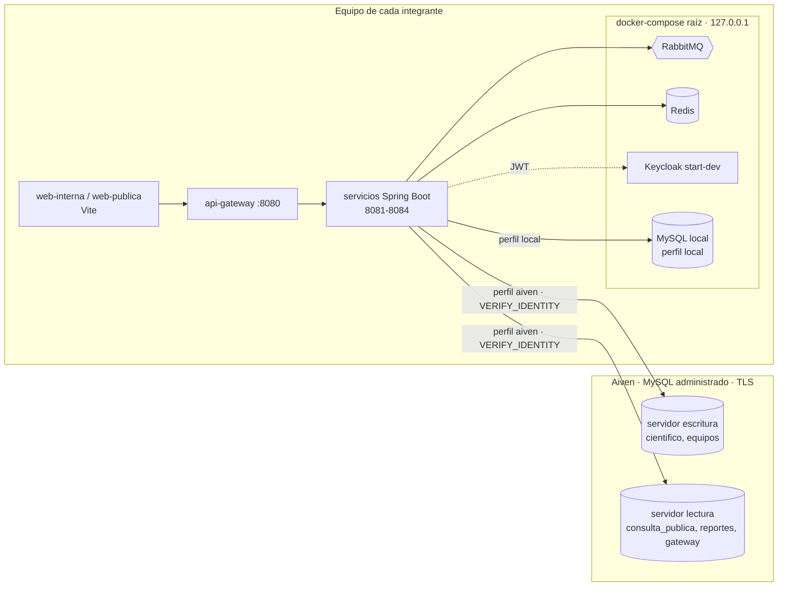
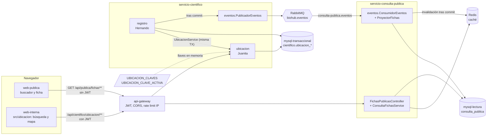
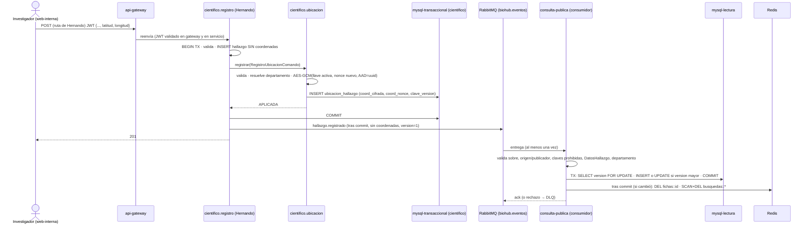
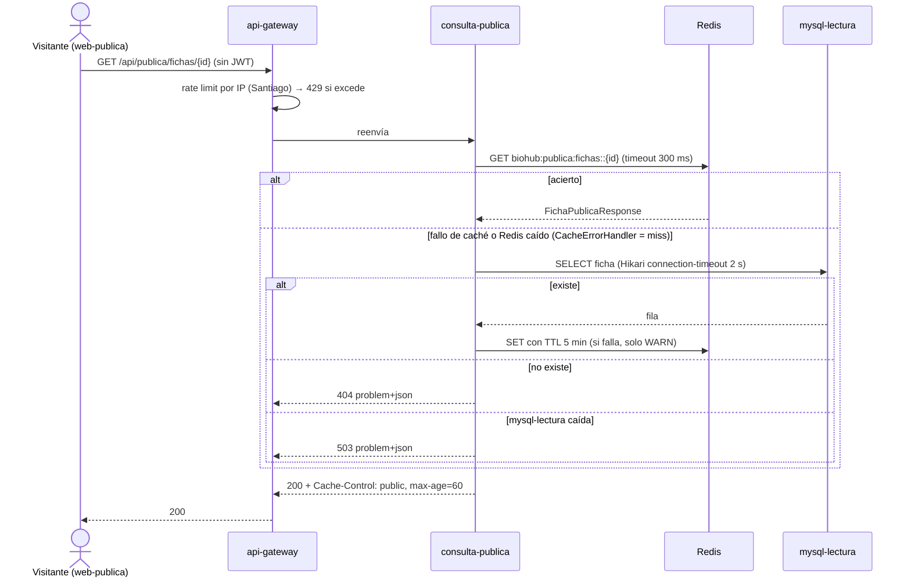
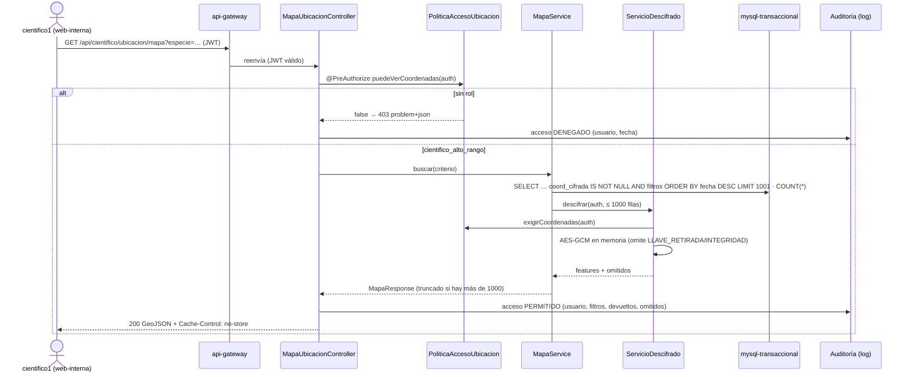

# 03 – Arquitectura

## Estilo (decidido por el equipo, no se cambia)
**Arquitectura basada en servicios + API Gateway + eventos asíncronos en topología broker.**

```
 web-interna (5173) ──┐  JWT (Keycloak, PKCE)
                      ├──► api-gateway (8080) ──► servicio-cientifico (8081) ──► mysql-transaccional:cientifico
 web-publica (5174) ──┘  sin login, límite por   ├► servicio-equipos (8082) ────► mysql-transaccional:equipos
 consumidor externo ──┘  IP / API Key + límite    ├► servicio-consulta-publica ──► mysql-lectura + redis (caché)
                                                 │   (8083)
                                                 └► servicio-reportes (8084) ───► mysql-analitica
          api-gateway ──► mysql-gateway (API Keys / límites)

 cientifico, consulta-publica, reportes ◄──► RabbitMQ (exchange topic "biohub.eventos")
 Keycloak (8180): realm "biohub" – emite JWT de 5 min con aud=biohub-api
```

## Componentes
| Componente | Responsabilidad | BD | Mensajería |
|---|---|---|---|
| api-gateway | Enrutar por prefijo `/api/<prefijo>/**`, validar JWT, control grueso por rol, CORS, API Keys, rate limiting y administración de usuarios contra Keycloak | mysql-gateway + redis (contadores y caché de credenciales) | – |
| servicio-cientifico | Módulo **registro** (hallazgos, fichas, historial) y módulo **ubicacion** (cifrado, llaves, mapa, búsqueda) | mysql-transaccional / `cientifico` | publica eventos |
| servicio-equipos | Equipos de trabajo | mysql-transaccional / `equipos` | – |
| servicio-consulta-publica | Lectura pública (modelo de lectura alimentado por eventos) | mysql-lectura | consume eventos; caché Redis |
| servicio-reportes | Reportes y analítica | mysql-analitica | consume eventos |

## Estructura de paquetes
`co.edu.unbosque.biohub.<servicio>.{controller, service, domain, infrastructure, config}`.
En servicio-cientifico: `cientifico.registro.{controller,service,domain,infrastructure}` y
`cientifico.ubicacion.{...}`; `cientifico.config` y `cientifico.controller` son compartidos.
**Regla:** un módulo no importa clases internas del otro; se comunican por una clase pública de `service` o por eventos.

## Seguridad
- Keycloak realm `biohub`. Roles de realm: investigador_campo, auditor_cientifico, cientifico_alto_rango, analista_ambiental, administrador.
- Clientes: `web-interna` (público, Authorization Code + PKCE S256, sin password grant);
  `biohub-pruebas` (público, SOLO password grant, **solo desarrollo** para obtener tokens por consola).
- Ambos clientes agregan `aud=biohub-api`. Todos los servicios validan firma, `iss`, `exp` y `aud`.
- El gateway valida el JWT y **cada servicio lo vuelve a validar** (defensa en profundidad).
- Roles → authorities `ROLE_<rol>` (conversor `KeycloakJwtAuthenticationConverter` en cada servicio).
- `/api/publica/**` (GET) no exige JWT: se limita por IP. La API para externos es `/api/v1/externa/fichas/**`, con API Key y límite por consumidor (D16, D45). Ambos se controlan en `ApiKeyRateLimitFilter`.
- Puertos de infraestructura publicados solo en 127.0.0.1. Contraseñas en `.env` (no versionado); las de los usuarios de prueba se inyectan al realm con el placeholder `${KEYCLOAK_TEST_USERS_PASSWORD}`.

## Persistencia
- Flyway en cada servicio, `V1__base.sql` vacía. Cada historia agrega `VAAAAMMDD_HHMM__descripcion.sql` (convención por fecha, `out-of-order`; D37). Hibernate `ddl-auto=validate`.
- Bases en MySQL local (perfil `local`) o en Aiven (perfil `aiven`), una base y un usuario por servicio (D35, D36).
- mysql-transaccional: un usuario por esquema con permisos solo sobre su esquema.

## Decisiones (ADR resumidos)
| # | Decisión | Motivo |
|---|---|---|
| D1 | Gateway con Spring MVC + RestClient (sin Spring Cloud Gateway) | Requisito del curso; control explícito del reenvío |
| D2 | Servicios se ejecutan en el host; Docker Compose solo para infraestructura | Ciclo de desarrollo más rápido; dockerizar servicios queda para devops |
| D3 | Los servicios leen `../.env` con `spring.config.import` | Un solo archivo de configuración local para Compose y Spring |
| D4 | Sin módulo Maven común: el conversor de JWT se duplica por servicio | Independencia entre servicios (estilo basado en servicios) |
| D5 | Spring Boot 3.5.16 (última 3.x estable), Java 21 | Requisito: Spring Boot 3.x |
| D6 | Cliente `biohub-pruebas` con password grant solo en local | Permite pruebas automatizadas por consola sin navegador |
| D7 | Servicios escuchan en 127.0.0.1 por defecto (`SERVER_ADDRESS`) | Obliga a pasar por el gateway (SEC-01) |
| D8 | El gateway lee el cuerpo con límite (10MB) y no lee cuerpo en GET/HEAD/OPTIONS/DELETE | Evita DoS por memoria (SEC-03) |
| D9 | BUG-01 de QA vs SEC-06 de seguridad (contradicción sobre path traversal): **decide Tech Lead** → era un falso positivo de curl; se añade igualmente validación de rutas en el proxy (400) | Defensa en profundidad |
| D10 | Pendientes de seguridad asignados a historias: usuarios RabbitMQ por servicio (SEC-04), API Key como ROLE_API_CLIENT (SEC-05), usuario Flyway vs aplicación (SEC-11), reglas por rol + `denyAll` por defecto (SEC-02) | Requieren modelo/endpoints que aún no existen |
| D11 | Despliegue on-premise del backend en máquinas virtuales. **Reemplazada por D34** | – |
| D12 | Primera implementación de D11 en VMs locales. **Reemplazada por D34** | – |
| D13 | Keycloak sin exigir SSL en el despliegue en VMs. **Reemplazada por D34** (Keycloak usa `sslRequired=external`) | – |
| D14 | **Ningún dato público lleva coordenadas exactas**, ni de especies en peligro ni de las que no lo están. El portal público, la API pública y el modelo de lectura de `consulta_publica` solo guardan y muestran departamento/región. Las coordenadas exactas solo las devuelve `servicio-cientifico` (módulo ubicacion) al rol `cientifico_alto_rango`. Decidida por Juanita (2026-10-26) | Publicar coordenadas de especies no amenazadas también facilita la caza; además reduce el riesgo de que un error de clasificación filtre una especie en peligro. Endurece RF11/RF12 |
| D15 | **Todas las coordenadas se cifran** con AES-256-GCM antes de persistirse (no solo las de especies en peligro). Llaves versionadas fuera de la BD (variables de entorno / `.env` del servicio, nunca en el repo ni en Aiven), con id de versión guardado junto al texto cifrado y rotación (re-cifrado). Es el "KMS equivalente" del prototipo (ASR6) | Evita decidir qué cifrar según el estado de conservación (que puede cambiar con una reclasificación). Sin infraestructura compartida nueva |
| D16 | **web-publica usa `GET /api/publica/**` sin API Key** (solo rate limit por IP en el gateway). Las API Keys de HU-08/HU-12 (Santiago) aplican a la API para externos, con prefijo propio (propuesto `/api/v1/externa/**`). Juanita lo coordina con Santiago | El portal lo usan visitantes sin cuenta; una key embebida en el navegador no protege nada |
| D17 | **Pantallas internas de Juanita** (mapa HU-07 y búsqueda interna HU-13) viven en una carpeta propia de `web-interna` (`src/ubicacion/`); Santiago solo monta la ruta y el enlace en su navegación/login | Respeta el reparto: Juanita no modifica el login ni la navegación de Santiago |
| D18 | **Límite con Hernando:** Juanita define contratos (evento `hallazgo.registrado`/`hallazgo.reclasificado`, interfaz `UbicacionService`) e implementa solo su lado. No se implementa código del módulo registro | Pedido explícito de Juanita |
| D19 | **Cifrado directo con llave versionada (sin cifrado de sobre/DEK por registro):** AES-256-GCM con la llave activa; nonce aleatorio de 12 bytes por cifrado en `coord_nonce`; AAD = UUID canónico del hallazgo; `clave_version` en columna propia (formato físico de `05-modelo-datos.md` §3.1). Detalle en "Parte de Juanita" §J3 | Cumple D15 y ASR6 con el mínimo de piezas. El cifrado de sobre (recomendación 2 de `08`) solo aporta con un KMS real: si la KEK está en una variable de entorno, envolver una DEK por fila no añade protección. Re-cifrar 10.000 filas tarda segundos. Se revisa si se adopta un KMS (P4) |
| D20 | **Llaves en dos variables:** `UBICACION_CLAVES=v1:<base64>,v2:<base64>` y `UBICACION_CLAVE_ACTIVA=v2`. El servicio **no arranca** si falta la activa, si alguna llave no mide 32 bytes o si hay ids repetidos. Rotación: añadir `vN+1`, activarla, reiniciar y lanzar el re-cifrado (`POST /api/cientifico/ubicacion/recifrado`, rol `administrador`) | Una sola variable con la lista evita descubrir nombres dinámicos (`UBICACION_CLAVES_<v>`), que no funciona con el `.env` cargado como propiedades de Spring (D3). El administrador re-cifra sin ver coordenadas: descifrar y volver a cifrar ocurre dentro del cifrador |
| D21 | **Validación de rol centralizada (RF13):** un único componente `PoliticaAccesoUbicacion` decide si una autenticación puede ver coordenadas exactas (solo `ROLE_cientifico_alto_rango`), y el único punto de descifrado (`ServicioDescifrado`) lo vuelve a exigir. **Ningún otro rol recibe coordenadas, ni siquiera de especies no amenazadas** (anula S1, el escenario "Hallazgo no amenazado" de HU-13.1 y la frase equivalente de `05` §7.2) | RF13 y HU-07 ("centralizada… en cada petición"). Doble barrera: `@PreAuthorize` en el endpoint y comprobación antes de descifrar. Coherente con D14/D15 y con la regla "solo `cientifico_alto_rango` recibe coordenadas exactas" |
| D22 | **Índice propio de ubicación** (`ubicacion_hallazgo` en el esquema `cientifico`, dueño: módulo ubicacion). Se alimenta **de forma síncrona** desde `UbicacionService`, en la misma transacción que registro, y no por eventos. La búsqueda interna y el mapa solo leen esta tabla y el catálogo `ubicacion_departamento` | El módulo registro no expone sus tablas (regla de módulos). Al compartir transacción no hay ventana de inconsistencia entre hallazgo y ubicación |
| D23 | **Eventos `hallazgo.*` = snapshot completo con `version` por hallazgo.** El consumidor aplica "gana la versión mayor" con la columna `version` de `ficha_publica` (**sin tabla de eventos procesados**, como `05` §8). El `id` del evento sirve para trazar en el log. También acepta `hallazgo.actualizado` (mismo esquema) para ediciones de datos públicos. Incompatibilidades futuras = tipo nuevo (`hallazgo.registrado.v2`), no un campo de versión de esquema | Un reenvío del mismo evento trae la misma `version` y se ignora, así que la idempotencia por id queda cubierta sin una tabla que crece sin límite. Snapshot = tolerante al desorden |
| D24 | **El consumidor rechaza a la DLQ** cualquier `hallazgo.*` cuyo `datos` contenga claves de coordenadas (en cualquier nivel), cuyo `origen` no sea `servicio-cientifico` o, cuando se active, cuyo `user_id` AMQP no sea el usuario publicador configurado (SEC-D-03) | Defensa en profundidad para D14 e integridad de los eventos |
| D25 | **Caché pública:** Spring Cache sobre Redis. `fichas` (TTL 5 min, invalidación por id al aplicar un evento) y `busquedas` (TTL 60 s, se vacía con SCAN en cada evento aplicado). Invalidación **después del commit** (`transactionAware`). Un `CacheErrorHandler` convierte cualquier fallo de Redis en "miss" y registra WARN; timeouts de Redis de 300 ms; Redis fuera de los grupos de salud | RNF1/RNF5: Redis no es fuente de verdad ni punto único de fallo. Vaciar las búsquedas es barato con el volumen de eventos del prototipo |
| D26 | **Búsqueda:** la pública usa el FULLTEXT de `05` (`MATCH … AGAINST` en modo booleano, `+palabra*` por cada palabra de 3 o más letras) y `LIKE 'q%'` si no queda ninguna palabra de 3 letras. La interna usa `LIKE 'especie%'` e igualdades sobre índices B-tree. Collation `utf8mb4_0900_ai_ci` (sin distinguir mayúsculas ni tildes). Paginación por offset, `page` **base 0**, límite `(page+1)*size <= 10.000` (igual que 04; D33). Orden fijo: público por `nombreCientifico` ascendente; interno por `fechaRecoleccion` descendente | Alineado con el modelo de datos. El FULLTEXT protege el modelo público, que es el que recibe el tráfico x60. Los prefijos usan índice y bastan para buscar por género o especie |
| D27 | **La ficha pública es por hallazgo** (`id` = `hallazgoId`), con departamento y región, y `ubicacionProtegida: true` siempre (D14). La web elige el texto del aviso según `estadoConservacion` (`02-diseno-ux.md` §6) | Una sola clave de identidad de punta a punta, sin campos redundantes |
| D28 | **Auditoría de accesos a coordenadas (HU-07.3) en log estructurado dedicado** (logger `biohub.auditoria.ubicacion`): usuario, endpoint, filtros, cantidad devuelta y omitidos; también los 403. Sin coordenadas. La tabla `ubicacion_acceso_log` de `05` queda como Could | Cubre la recomendación 3 de seguridad con el mínimo de piezas. La tabla se añade sin cambiar el contrato |
| D29 | **Errores de los endpoints de Juanita:** `application/problem+json` con dos extensiones, `codigo` (estable, para la lógica del frontend) y `errores[]` (por campo). El 401 lo emite Spring Security **sin cuerpo** (`WWW-Authenticate: Bearer`), como en el resto de servicios; el 429 lo emite el gateway | El frontend decide por estado HTTP + `codigo`, nunca por el texto. No hay que tocar el `SecurityConfig` compartido |
| D30 | **Pruebas sin efectos en los entornos compartidos:** las pruebas automáticas usan Testcontainers (MySQL 8.4, RabbitMQ 4, Redis 7.4) o mocks; **prohibido** apuntar a las bases de Aiven o a un broker/Redis compartido y publicar `hallazgo.*` en ellos. La carga x60 corre en un entorno Compose efímero (`down -v` al terminar). Ver D38 | Requisito de Juanita. Un `hallazgo.*` de prueba en un broker compartido llegaría a la cola real y crearía fichas públicas |
| D31 | **Frontend:** web-publica usa `react-router` con las rutas `/` y `/especies/:id` (`02-diseno-ux.md`). Las pantallas internas se exportan como componentes que no dependen del router de Santiago (rutas propuestas `/ubicacion/busqueda` y `/ubicacion/mapa`). Mapa con `leaflet` + `react-leaflet`, teselas OpenStreetMap y `maxZoom: 12`. Los departamentos se muestran en una lista estática en el frontend (33, mismos códigos DANE que el catálogo) y no hay endpoint de catálogos | URLs compartibles en el pico viral (caché HTTP y Redis más efectivas). Leaflet no necesita llave de API. Sin endpoints que la UI no usa |
| D32 | **Resolución de choques de diseño (Tech Lead, 2026-10-26):** P-J1: solo `cientifico_alto_rango` recibe coordenadas, de cualquier especie (se corrige 05 §7.2). P-J2: `UbicacionService` rechaza `estadoConservacion` ausente (400/validación); el consumidor manda a la DLQ un evento sin estado y guarda `EN_PELIGRO` si el valor es desconocido. P-J3: llaves en `UBICACION_CLAVES=v1:<b64>,...` + `UBICACION_CLAVE_ACTIVA` (formato del contrato; se corrige 05). P-J4: `eliminado_en` existe en el DDL pero queda siempre NULL en el MVP; sin endpoint de desactivación. P-J5: las preguntas de 02 quedan resueltas por 04 (`page` base 0). UX: la celda de coordenadas en web-interna muestra "Restringido" a todo rol que no sea alto rango; el color de foco de web-interna es de Santiago y no se cambia | Coherencia entre 02, 03, 04 y 05 |
| D33 | **Ajustes tras el plan de pruebas (Tech Lead):** límite de paginación `(page+1)*size <= 10.000` (manda 04). En `LIKE` se escapan `%`, `_` y `\`. La prueba de carga x60 se mide directo contra `servicio-consulta-publica` (o con el rate limit del gateway elevado en el entorno de carga), no contra el limitador. Las criterios de 01 §3 contradichos por D14/D15/D21/D32 quedan anulados (01 §9 prevalece) | Riesgos RQ-1, RQ-4, RQ-5, RQ-6 de 06 |
| D34 | **Retiro de la red privada y de las VMs locales (iteración 15, 2026-11-03).** Reemplaza D11, D12 y D13. No hay despliegue on-premise: RabbitMQ, Redis y Keycloak corren en Docker con el `docker-compose.yml` de la raíz (puertos solo en `127.0.0.1`) y los servicios en el host (D2). En CI, los mismos componentes son contenedores (D38). Keycloak sigue en `start-dev` con `sslRequired=external`. Se eliminan del repo los scripts de VMs, la política de red y su guía. **Alternativas descartadas:** mantener las VMs con la red privada (dependía de que el portátil de Juanita estuviera encendido y de configuración manual por integrante); publicar el backend con un túnel (expone servicios sin rate limit, ASR8 ausente). **Consecuencias:** desaparece la "red privada" que el SAD §5.2 usa como protección en tránsito para la base: la base de datos queda en internet (D35) y se protege con TLS verificado, usuario por servicio y lista de IPs. Ya no existe un entorno compartido del backend: cada integrante levanta el suyo | Decidido por Juanita (00-plan, iteración 15). Simplifica el arranque y quita la dependencia de una sola máquina |
| D35 | **MySQL administrado en Aiven** (MySQL 8, SSL obligatorio). Una **base y un usuario por servicio** (`cientifico`, `equipos`, `consulta_publica`, `reportes`, `gateway`); `avnadmin` solo para administración, nunca en una aplicación. Conexión con `sslMode=VERIFY_IDENTITY` (mínimo `VERIFY_CA`) y el CA del proyecto de Aiven en un truststore PKCS12; nunca `REQUIRED`/`PREFERRED`. Host, puerto, base y credenciales salen de variables por servicio, de modo que cada servicio puede apuntar a un servidor distinto sin tocar código. **Topología:** se arranca con un servicio de Aiven (D-I15-2) y se recomienda separar en dos (escritura: `cientifico`, `equipos`; lectura: `consulta_publica`, `reportes`, `gateway`), ver P-A1 y `10-verificacion-sad.md` §8. Presupuesto de conexiones del plan gratuito (`max_connections` = 76): pool de 5 por instancia en el perfil `aiven` y `MAX_USER_CONNECTIONS` por usuario. Las llaves de cifrado (D20) **nunca** van a Aiven: la base solo recibe texto cifrado. **Alternativas descartadas:** seguir con MySQL en Docker como único entorno (no hay base compartida para la demo); otra base administrada no compatible con MySQL (obliga a reescribir el FULLTEXT y las migraciones). **Consecuencias:** latencia por internet en cada consulta (medir la ida y vuelta; ver presupuesto en `10` §8.3); dependencia de un proveedor con protocolo estándar (portable, ASR9); el plan gratuito puede apagarse por inactividad y cambiar de región sin aviso | Base compartida para la demo sin operar servidores. MySQL estándar: el código y las migraciones no cambian |
| D36 | **Perfiles Spring `local` y `aiven`.** `local` arma la URL hacia el MySQL del compose de la raíz; `aiven` arma la URL con SSL verificado, timeouts de conexión y socket, y el pool acotado. Solo cambia el `datasource`: RabbitMQ, Redis, Keycloak, Flyway y la lógica son iguales en ambos. Sin perfil, el servicio exige la URL completa por variable (no hay valor por defecto que apunte a ningún servidor). En los dos perfiles la sesión JDBC usa UTC (`connectionTimeZone=UTC&forceConnectionTimeZoneToSession=true`), porque el MySQL local corre con `TZ=America/Bogota` y Aiven en UTC, y las columnas `DEFAULT CURRENT_TIMESTAMP(3)` darían horas distintas. Variables documentadas en el `.env.example` de cada servicio | Un solo código para los dos entornos; el cambio de servidor es configuración (ASR9) |
| D37 | **Flyway igual en todos los entornos:** convención por fecha (`V1__base.sql`, `VAAAAMMDD_HHMM__descripcion.sql`), `out-of-order: true`, Hibernate `ddl-auto=validate` (D-I15-1). Las bases de Aiven nacen vacías: sin `baseline`. Reglas para que una migración funcione en Aiven: toda tabla con clave primaria (Aiven activa `sql_require_primary_key`); sin `DEFINER`, `SET GLOBAL` ni nada que pida `SUPER`; sin triggers ni funciones que exijan `log_bin_trust_function_creators`. **Usuario de migración separado** del de ejecución (SEC-11) obligatorio en `aiven` para `cientifico`: Flyway usa `<SERVICIO>_MIGR_USER` (DDL sobre su base) y la aplicación un usuario con DML; para el historial de registro (ASR7) ese usuario solo tendrá `INSERT, SELECT`. Una migración publicada no se edita: se corrige con otra | Mismo esquema verificable en local, CI y Aiven. El usuario de migración es lo que permite cumplir "la inmutabilidad no depende solo del código" (SAD §5.2) |
| D38 | **CI con GitHub Actions:** compila y prueba con `mvn -B verify` (Testcontainers levanta MySQL 8.4, RabbitMQ 4 y Redis 7.4 como contenedores), construye y prueba web-publica (`npm ci`, `npm test`, `npm run build`) y ejecuta las colecciones Bruno contra un entorno Compose efímero levantado en el mismo job. **CI nunca se conecta a Aiven** y no tiene sus secretos; las llaves de cifrado de CI se generan en el job. Las pruebas de carga x60 (etiqueta `rendimiento`) quedan fuera del pipeline por defecto | D30: ninguna prueba deja datos en un entorno compartido. CI reproducible y sin secretos de producción |
| D39 | **Dos servicios MySQL en Aiven** (resuelve P-A1 y ARQ-05): escritura (`cientifico`, `equipos`) y lectura (`consulta_publica`, `reportes`, `gateway`); el segundo en la cuenta de otro integrante (plan gratuito: un MySQL por organización). Solo cambian variables `*_DB_HOST/PORT` | SAD §4.7 (ASR2) y SRS ASR3 piden instancias físicas separadas; un pico público no debe degradar el registro. Decidido por Juanita (2026-11-03) |
| D40 | **El código de `ubicacion` se ajusta a los patrones del SAD §6** (resuelve P-A2 y P-A3): Strategy `EstrategiaVisibilidadUbicacion` (ARQ-09), Decorator sobre `RepositorioUbicaciones` (ARQ-10, opción A), `ProveedorDeLlavesKeyStore` PKCS12 como adaptador alternativo elegido por propiedad (ARQ-11, resuelve A2) y `ObservadorUbicacion` con `@EventListener` sobre eventos de dominio de `cientifico.eventos.domain` (ARQ-08; Hernando publicará con `ApplicationEventPublisher`) | El evaluador contrasta SAD y código; los patrones se documentaron como tácticas de RF13 y ASR6. Decidido por Juanita (2026-11-03) |
| D41 | **Ambigüedades del SRS (A1, A3, A7):** se cifran y ocultan las coordenadas de **todos** los hallazgos (superconjunto seguro de RF11/RNF9); "ubicación generalizada" = departamento y región; la búsqueda interna (HU-13) la usan investigador y alto rango, y solo `cientifico_alto_rango` ve coordenadas exactas (RF12) | Falla segura; sin contradicción con RF12. Debe reflejarse en el SAD (texto en `10-verificacion-sad.md` §9). Decidido por Juanita (2026-11-03) |
| D42 | **Criterio de evidencia de carga para ASR1 y ASR4 (arquitecto, 15h, 2026-11-04).** Una corrida de k6 cuenta como evidencia solo si: (1) el JSON registra N, multiplicador, réplicas, CPU por réplica, commit y red de k6 (`parametros`); (2) el éxito se calcula como 200 / (peticiones + iteraciones descartadas), es decir, la carga que k6 no pudo emitir cuenta como fallo; (3) la estabilización es la de `consulta-publica-pico.js` (ventanas de 15 s con p95 < 2 s desde el fin de la rampa); (4) corre en el Compose efímero, nunca contra Aiven (D30); (5) los archivos con prefijo `descartado-` documentan fallos del banco de pruebas y no cuentan. Para declarar ASR1 demostrado se exigen además una corrida en la que la degradación se active y se cuenten las respuestas `modoDegradado: true`, y una comparación de 1 y 2 réplicas en un punto donde una réplica sola no alcance. ASR4 exige el par `CIENTIFICA=0`/`CIENTIFICA=1`. **Alternativas descartadas:** aceptar cualquier corrida que pase los umbrales de k6 (no distingue la caché del escalado ni de la degradación); medir contra Aiven (viola D30 y depende del plan gratuito). **Consecuencias:** las corridas de 15h (`asr1-*-n60`, `limite-2replicas-n100`) cumplen el umbral, pero ASR1 queda Parcial hasta completar ARQ-30 y ARQ-31 (`10-verificacion-sad.md` §15h) | Que los números que lleguen al SAD y a `07` sean reproducibles y demuestren las tácticas que el SAD declara, no solo la caché |
| D43 | **El re-cifrado es la única excepción a la cadena del Decorator (arquitecto, 15h, 2026-11-04).** `RecifradoService` puede usar `EntityManager` y `CifradorCoordenadas` directamente, porque opera de texto cifrado a texto cifrado (`recifrar` nunca devuelve texto plano), necesita `FOR UPDATE SKIP LOCKED` por lotes y deja auditoría por ejecución. Ninguna otra clase fuera de `ubicacion.infrastructure` puede depender de `CifradorCoordenadas`, `EntityManager` o `UbicacionHallazgoRepository`, y se verifica con ArchUnit (ARQ-27). **Alternativas descartadas:** añadir `recifrarLote` a `RepositorioUbicaciones` (mete una operación de mantenimiento en el puerto de dominio y obliga a que los decoradores la conozcan); dejarlo como convención sin regla (un servicio nuevo podría descifrar sin auditoría ni segunda barrera). **Consecuencias:** la garantía del SAD §6.3.2 ("los servicios no pueden saltarse el cifrado ni la auditoría") pasa a estar verificada en el build, con una excepción documentada y acotada | Cierra el hueco entre el texto del SAD y el código sin rediseñar el re-cifrado (ARQ-12 ya lo optimizó) |
| D45 | **"API pública" de HU-08/HU-12 = `/api/v1/externa/fichas/**` (concreta D16, Santiago, 2026-11-05).** El portal sigue en `GET /api/publica/**` sin key y con 120 peticiones por minuto por IP. La API externa exige `X-API-Key`, cuenta 60 por minuto por consumidor (configurable) y se reescribe solo hacia `/api/publica/fichas/**`, así que `/api/publica/eventos/**` no queda expuesto. **Alternativa descartada:** una key dentro de `web-publica` (todo lo que llega al navegador es público). **Consecuencia aceptada:** un script sin key puede usar la ruta del portal, con el cupo por IP. Se declara en la sustentación | Mantiene el portal sin cuenta y da a los externos una URL estable (ASR9) y un límite por consumidor (ASR8) |
| D46 | **Límite con ventana fija en Redis y respaldo en memoria.** Los contadores viven en Redis con scripts Lua atómicos y prefijo `biohub:gateway:rl:`, compartidos entre instancias. Si Redis falla, `LimitadorConRespaldo` cuenta en memoria y deja de reintentar 5 s. El filtro va después de CORS y antes del JWT, y la API externa falla cerrado: solo pasa con `ROLE_API_CLIENT`. La IP sale de `getRemoteAddr()`. **Alternativas descartadas:** Bucket4j (dependencia nueva para un contador); ventana deslizante (más difícil de explicar y de calcular `Retry-After`). **Consecuencia aceptada:** en el cambio de ventana pueden pasar hasta el doble del límite en pocos segundos | Simple de sustentar y cumple ASR8. El portal no cae por Redis (D25) ni queda sin límite (SEC-05) |
| D47 | **Credenciales de API Key.** Se guarda SHA-256 de la key completa y un `prefijo` no secreto para buscarla; se compara en tiempo constante. La key tiene 32 bytes aleatorios, por eso no hace falta un hash lento ni *pepper*. La credencial se cachea 60 s en Redis (el hash, nunca la key). Revocar deja una marca en la caché y el llenado usa `setIfAbsent`: una lectura tardía no puede revivir una key revocada. Sin BD, la API externa responde 503 | HU-12 c.2 exige rechazo inmediato, y cada consulta a Aiven cruza internet |
| D48 | **Control grueso en el gateway y fino en cada servicio (SEC-02).** El gateway exige uno de los 5 roles para los prefijos internos, `administrador` para su administración, y deniega lo demás. No replica las reglas por endpoint. El 403 lleva `ROL_INSUFICIENTE`. **Alternativa descartada:** todas las reglas en el gateway (cada endpoint nuevo lo obligaría a cambiar y las reglas podrían contradecirse con las del servicio). Matriz: `11-seguridad-y-acceso.md` | Cumple HU-10 c.2 y conserva RF13 dentro de `ubicacion` |
| D49 | **Usuarios por el gateway contra Keycloak (HU-10, RF19).** `/api/gateway/usuarios/**` usa la API de administración con la cuenta de servicio `biohub-gateway`. Garantiza exactamente un rol del catálogo. Un cambio de rol marca al usuario en Redis y `RevocacionTokenFilter` rechaza sus tokens anteriores; además se cierran sus sesiones. Un administrador no puede modificarse a sí mismo. Si Redis no responde en esa comprobación, se deja pasar el token: el peor caso vuelve a ser el vencimiento a los 5 minutos. **Alternativa descartada:** usar la consola de Keycloak (no garantiza un rol ni la aplicación inmediata). **Consecuencia:** el gateway también aloja esta administración, porque no hay un servicio de usuarios | Cumple HU-10 c.1 y c.3 sin introspección en cada petición |
| D50 | **Usuarios RabbitMQ por servicio con una tarea de Compose (SEC-04).** `rabbitmq-usuarios` crea `cientifico_mq`, `consulta_mq` y `reportes_mq` por la API de administración, con los permisos de SEC-D-03 y una corrección: los consumidores sí necesitan `write` sobre `biohub.eventos.dlx`, porque RabbitMQ lo exige para declarar una cola con DLX (comprobado: sin él, `servicio-consulta-publica` no arranca). `biohub.eventos` sigue protegido: un consumidor recibe `ACCESS_REFUSED` al publicar. Es idempotente y omite a quien no tenga contraseña, así que cada servicio migra cuando pueda, solo cambiando su `.env`. **Alternativa descartada:** `definitions.json` (obliga a versionar hashes de contraseñas) | Cierra SEC-04 sin romper el entorno del equipo ni tocar código ajeno |
| D51 | **El proxy no interpreta multipart.** `spring.servlet.multipart.enabled=false`: con el valor por defecto, Spring consume el cuerpo y los adjuntos llegan vacíos al servicio (comprobado con una prueba de integración) | Necesario para HU-01 |
| D52 | **Circuit breaker por servicio destino en el gateway (ARQ-20, SAD §5.1).** `CircuitoServicios` abre el circuito de un servicio tras 5 fallos de conexión o de tiempo seguidos, y durante 10 s responde 503 `SERVICIO_NO_DISPONIBLE` con `Retry-After` sin intentar la conexión. Después deja pasar una sola petición de prueba. Un 4xx o 5xx del servicio no cuenta: es una respuesta, no una caída. **Alternativa descartada:** Resilience4j (dependencia y configuración extra para un solo uso). Patrones del gateway que el SAD §6 puede citar: Circuit Breaker (`CircuitoServicios`), Strategy (`LimitadorPeticiones`), Decorator (`LimitadorConRespaldo`, `AlmacenCredencialesEnCache`), Adapter (`KeycloakAdminAdapter`) y Chain of Responsibility (filtros de Spring Security) | Un servicio colgado ya no ocupa los hilos del gateway durante 30 s por petición ni arrastra a los demás |
| D44 | **El control de rol para coordenadas exactas se garantiza con ArchUnit, no dentro de la cadena del Decorator (Tech Lead, 15h, 2026-11-04; resuelve SEC-J-10 punto 1).** `ServicioDescifrado` es el único que puede llamar `obtenerUbicacionExacta` y está obligado a invocar `PoliticaAccesoUbicacion.exigirCoordenadas`; los eslabones de la cadena son package-private y solo `ConfiguracionUbicacion` los construye; las reglas abarcan todo `co.edu.unbosque.biohub.cientifico` (incluido `registro`). **Alternativa descartada:** pasar `Authentication` a `RepositorioUbicaciones`/`DecoradorAuditoriaAcceso` (acopla el puerto de dominio a Spring Security y cambia su firma pública). **Consecuencias:** la barrera es estática (falla el build), no en tiempo de ejecución; si se agrega un segundo llamador legítimo, se revisa esta decisión con ciberseguridad | Mismo nivel de garantía verificable sin contaminar el dominio |

### Topología de ejecución (D34–D38)



- Mientras no se resuelva P-A1, `AE` y `AL` son el mismo servicio de Aiven con bases distintas.
- CI (D38): todo lo de la caja "Docker" más MySQL como contenedores; sin Aiven.
- Detalle operativo (alta de bases y usuarios en Aiven, truststore, variables): `09-despliegue.md`, a cargo de devops.

**Pendientes de arquitectura para el tech lead (iteración 15)**
| # | Tema | Propuesta del arquitecto |
|---|---|---|
| P-A1 | 1 o 2 servicios MySQL en Aiven (D-I15-2 dice uno) | **Dos**: escritura (`cientifico`, `equipos`) y lectura (`consulta_publica`, `reportes`, `gateway`). Con uno, la consulta pública y los reportes compiten por la misma CPU, memoria y las 76 conexiones que usa el registro, que es lo que ASR2/ASR3/ASR4 prohíben. El plan gratuito admite un MySQL por organización: el segundo va en la organización de otro integrante, sin costo. Si se mantiene uno, aplicar las mitigaciones de `10` §8.4 y declararlo en SAD §5.3 |
| P-A2 | Patrones del SAD §6 en el módulo ubicacion (Strategy, Decorator, Observer) no están en el código con la forma que describe el SAD | Implementar Strategy y el observador de ubicación (esfuerzo S) y ajustar el SAD en Decorator y en el almacén de llaves. Detalle en `10` ARQ-08 a ARQ-11 |
| P-A3 | SAD §2.5/§7.1: registro y ubicacion "solo se comunican por el módulo eventos"; D18/D22 y el contrato 04 hacen que registro llame a `UbicacionService` | Añadir `ObservadorUbicacion` (`@EventListener` síncrono, misma transacción) que escucha los eventos de dominio de `cientifico.eventos` y llama a `UbicacionService`. Hernando publica el evento de dominio en lugar de llamar al servicio; `UbicacionService` se conserva como API interna (sigue con `MANDATORY`) |

---

## Parte de Juanita: ubicación y consulta pública

Fecha: 2026-10-26. Requisitos: `01-requisitos.md` (su sección 9 prevalece). Contrato: `04-contrato-api.md`, sección "Parte de Juanita". Decisiones: D14–D18 (dadas) y D19–D31 (tabla de arriba).
Coordinación: el esquema físico es el de `05-modelo-datos.md` (tablas, columnas, índices, DDL) y las pantallas son las de `02-diseno-ux.md`. Esta sección define el comportamiento. Los choques que encontré están en §J12.

### J1. Visión y componentes



Reglas que no se rompen:
1. Las coordenadas existen en claro **solo en memoria** de `servicio-cientifico`: al recibirlas de registro (para cifrarlas) y al descifrarlas para `cientifico_alto_rango`. Nunca en BD, eventos, Redis, logs, `mysql-lectura` ni respuestas públicas (D14, D15).
2. `servicio-consulta-publica` no llama a `servicio-cientifico`: solo eventos → `mysql-lectura` → Redis.
3. `registro` solo importa los tipos públicos de `cientifico.ubicacion.service` listados en §J2.1.

### J2. Paquetes

#### J2.1 `servicio-cientifico` → `co.edu.unbosque.biohub.cientifico.ubicacion`

| Paquete | Clases (nombres propuestos) | Visibilidad |
|---|---|---|
| `ubicacion.service` (**API pública del módulo**) | `UbicacionService` (interfaz), `RegistroUbicacionComando`, `ActualizacionUbicacionComando`, `ResultadoUbicacion`, `EstadoConservacion`, `UbicacionInvalidaException`, `UbicacionNoEncontradaException` | `public`: es lo único que puede importar `registro` |
| `ubicacion.service` (interno) | `UbicacionServiceImpl`, `BusquedaHallazgosService`, `MapaService`, `RecifradoService`, `PoliticaAccesoUbicacion` (bean `politicaUbicacion`), `ServicioDescifrado`, `AuditoriaAccesoUbicacion`, `CriterioBusquedaInterna`, `CatalogoDepartamentos` | Package-private cuando Spring lo permita. `PoliticaAccesoUbicacion` es `public` porque la usa SpEL en `@PreAuthorize` |
| `ubicacion.domain` | `UbicacionHallazgo` (entidad JPA sobre `ubicacion_hallazgo`), `Departamento` y `Region` (entidades de solo lectura sobre el catálogo), `Coordenadas` (value object: finitas, rangos; `toString()` = `Coordenadas[***]`), `CoordenadasCifradas` (texto cifrado, nonce y `claveVersion`; `toString()` enmascarado), puertos `CifradorCoordenadas`, `ProveedorDeLlaves`, `UbicacionHallazgoRepository`, `DepartamentoRepository` | interno |
| `ubicacion.infrastructure` | `CifradorAesGcm`, `ProveedorDeLlavesEntorno`, `PropiedadesCifrado` (`@ConfigurationProperties("biohub.ubicacion.cifrado")`), `ConfiguracionUbicacion` (`@Configuration` del módulo) | interno |
| `ubicacion.controller` | `BusquedaHallazgosController`, `MapaUbicacionController`, `RecifradoController`, DTOs (`HallazgoUbicacionResponse`, `PaginaHallazgosResponse`, `MapaResponse`, `FeatureResponse`, `RecifradoResponse`), `UbicacionExceptionHandler` (`@RestControllerAdvice(basePackages = "co.edu.unbosque.biohub.cientifico.ubicacion.controller")`) | interno |

- **No se toca `cientifico.config/`** (zona compartida): la configuración propia del módulo vive en `ubicacion.infrastructure.ConfiguracionUbicacion`. Lo único compartido que hay que cambiar es `application.yml`, donde se añade el bloque `biohub.ubicacion.*` (§J3.3) y `hibernate.jdbc.time_zone: UTC` (`05` §3). Se avisa antes de abrir el PR.
- Prueba de arquitectura (ArchUnit, solo en test): `..registro..` no depende de `..ubicacion.domain..`, `..ubicacion.infrastructure..` ni `..ubicacion.controller..`.

#### J2.2 `servicio-consulta-publica` → `co.edu.unbosque.biohub.consultapublica`

| Paquete | Clases nuevas o modificadas |
|---|---|
| `controller` | `FichasPublicasController` (`GET /api/publica/fichas`, `GET /api/publica/fichas/{id}`), DTOs `FichaPublicaResponse`, `FichaResumenResponse`, `PaginaFichasResponse`, `ConsultaPublicaExceptionHandler` |
| `service` | `ConsultaFichasService` (lecturas con `@Cacheable`), `CriterioBusquedaPublica` (normaliza, arma la expresión FULLTEXT y la clave de caché), `ProyectorFichas` (aplica un evento al modelo de lectura en una transacción), `CatalogoDepartamentos` (resuelve nombre o código DANE) |
| `domain` | `FichaPublica` (entidad), `Departamento` (entidad de solo lectura), `EstadoConservacion`, `FichaPublicaRepository`, `DepartamentoRepository` |
| `infrastructure` | `CacheErrorHandlerTolerante` (implementa `CacheErrorHandler`), `BusquedaFichasJdbc` (SQL dinámico con `JdbcClient` y parámetros enlazados, porque `MATCH … AGAINST` no se expresa en JPQL) |
| `eventos.domain` | `DatosHallazgo` (record del `datos` de `hallazgo.*`, con Bean Validation) |
| `eventos.service` | `ConsumidorEventos` (se modifica: `TIPOS_CONOCIDOS` += `hallazgo.reclasificado`, `hallazgo.actualizado`; valida el publicador; despacha a `ProyectorFichas`), `ValidadorDatosHallazgo` (claves prohibidas, Bean Validation) |
| `config` | `CacheConfig` (se modifica: TTL por caché, `transactionAware()`, `BatchStrategies.scan(1000)`, `CacheErrorHandler`). `SecurityConfig` no cambia: `GET /api/publica/**` ya es `permitAll` |

#### J2.3 Frontend (componentes y textos: `02-diseno-ux.md` §3, §5 y §6)

```
web-publica/src/
├── api/cliente.js        # se amplía: lanza ErrorApi {status, codigo} leyendo el problem+json
├── api/fichas.js         # buscarFichas(params), obtenerFicha(id) + adaptador de lista blanca (02 §9.1)
├── paginas/              # PaginaInicio (ruta "/"), PaginaFicha ("/especies/:id"), PaginaNoEncontrada ("*")
├── components/           # los de 02 §3.1–3.3 y §5 (Buscador, TarjetaEspecie, AvisoUbicacionProtegida, Paginacion…)
└── datos/departamentos.js  # 33 departamentos {codigo, nombre}, mismos códigos DANE que el catálogo de 05

web-interna/src/ubicacion/   # D17: carpeta de Juanita; Santiago solo la monta
├── index.js              # export { PaginaBusquedaHallazgos, PaginaMapa, rutasUbicacion }
├── api/ubicacionApi.js   # usa el token de ../auth/keycloak.js; maneja 401 (login), 403 y problem+json con status
├── PaginaBusquedaHallazgos.jsx  # I1
├── PaginaMapa.jsx               # I2: solo cientifico_alto_rango (no llama si falta el rol)
├── componentes/          # los de 02 §3.4–3.6
└── ubicacion.css
```
- `rutasUbicacion = [{ ruta: '/ubicacion/busqueda', componente: PaginaBusquedaHallazgos, roles: [los 5 roles internos] }, { ruta: '/ubicacion/mapa', componente: PaginaMapa, roles: ['cientifico_alto_rango'] }]`. Santiago las monta con su router y muestra el enlace del mapa solo a ese rol. Los componentes leen la URL con `window.location`/`URLSearchParams` y no importan el router.
- **Coordenadas en el navegador:** solo en el estado de React del componente. Nunca en `localStorage`/`sessionStorage`, URL, `console.*` ni en el estado global. Se descartan al desmontar el componente o al recibir 401/403 (`02` §4.2).
- Dependencias nuevas: web-publica, `react-router`. web-interna, `leaflet` y `react-leaflet`: **avisar a Santiago**, porque `package.json` de web-interna es suyo.

### J3. Diseño del cifrado (D15, D19, D20)

#### J3.1 Algoritmo y formato (columnas de `05` §3.1)
- **AES-256-GCM** (`Cipher.getInstance("AES/GCM/NoPadding")`), tag de 128 bits, llave de 32 bytes.
- **Texto plano (16 bytes):** `double latitud` ‖ `double longitud`, IEEE-754 big-endian (`ByteBuffer.putDouble`). Se rechazan NaN e infinitos antes de cifrar.
- **Nonce/IV:** 12 bytes de `SecureRandom` **en cada cifrado** (también al re-cifrar), guardado en `coord_nonce`. No se deriva del id ni se reutiliza. El `UNIQUE (clave_version, coord_nonce)` de `05` detecta una repetición; si salta, se reintenta una vez con otro nonce.
- **`coord_cifrada`:** texto cifrado (16 B) ‖ tag (16 B) = 32 bytes.
- **`clave_version`:** id de la llave usada (p. ej. `v2`). **`cifrado_en`:** instante UTC del cifrado.
- **AAD:** el UUID del hallazgo en forma canónica (minúsculas, 36 caracteres, UTF-8). Copiar el valor cifrado a otra fila hace fallar el tag (`AEADBadTagException`). Cambiar `clave_version` elige otra llave, y el tag también falla.
- **Hallazgo sin coordenadas:** las cuatro columnas de cifrado en NULL (CHECK de grupo de `05`). **No hay columnas de latitud/longitud en claro** (D15 anula el escenario "Especie no en peligro" de HU-UBI-01).

#### J3.2 Puertos
```java
// ubicacion.domain
public interface CifradorCoordenadas {
    CoordenadasCifradas cifrar(UUID hallazgoId, Coordenadas coordenadas);          // con la llave activa
    Coordenadas descifrar(UUID hallazgoId, CoordenadasCifradas cifradas);          // CoordenadasNoDescifrablesException
    CoordenadasCifradas recifrar(UUID hallazgoId, CoordenadasCifradas cifradas);   // el texto plano no sale del método
}
public interface ProveedorDeLlaves {
    String versionActiva();
    Optional<SecretKey> llave(String version);
}
```
`CoordenadasNoDescifrablesException(motivo = LLAVE_RETIRADA | INTEGRIDAD)` no lleva datos sensibles. `ServicioDescifrado` y `RecifradoService` son los únicos que llaman a `descifrar`/`recifrar`. `UbicacionServiceImpl` solo llama a `cifrar`.

#### J3.3 Carga de llaves
| Variable | Formato | Ejemplo (NO real) |
|---|---|---|
| `UBICACION_CLAVES` | lista `id:base64` separada por comas. `id` cumple `^v[1-9][0-9]{0,3}$` (cabe en el CHECK de `05`). Base64 estándar (RFC 4648 §4) de **exactamente 32 bytes** | `v1:AAAA…=,v2:BBBB…=` (generar cada una con `openssl rand -base64 32`) |
| `UBICACION_CLAVE_ACTIVA` | un `id` presente en `UBICACION_CLAVES` | `v2` |

- Bloque nuevo en `application.yml`:
  ```yaml
  biohub:
    ubicacion:
      cifrado:
        claves: ${UBICACION_CLAVES:}
        clave-activa: ${UBICACION_CLAVE_ACTIVA:}
  ```
- `ProveedorDeLlavesEntorno` valida **al arrancar** (`@PostConstruct`). Si algo falla lanza `IllegalStateException`, que impide el arranque, con un mensaje que nombra la variable y la regla, **nunca el valor**:
  - activa vacía o ausente de la lista → `"UBICACION_CLAVE_ACTIVA no está configurada o no existe en UBICACION_CLAVES"`;
  - llave que no decodifica a 32 bytes, id inválido o repetido → `"UBICACION_CLAVES: la llave 'v1' no es válida (se esperan 32 bytes en base64)"`.
- Aplica en **todos los perfiles**. Las pruebas definen sus propias llaves en `src/test/resources/application-test.yml` (generadas para test, nunca reutilizadas en despliegue). En local, cada persona genera las suyas en su `.env`. `.env.example` lleva las dos variables **vacías** con el comentario de cómo generarlas.
- Las llaves se guardan como `SecretKeySpec` en un `Map` inmutable. `PropiedadesCifrado.toString()` no expone valores. Solo `health,info` están expuestos en actuator.

#### J3.4 Fallos
| Situación | Comportamiento |
|---|---|
| Falta la llave activa / llave inválida | El servicio no arranca (HU-UBI-02) |
| Fila con `clave_version` ya retirada | `LLAVE_RETIRADA`: mapa → se omite y cuenta en `omitidos`. Búsqueda → la fila sale con `estadoCoordenadas = NO_DISPONIBLES` y cuenta en `omitidos`. Log ERROR con `hallazgoId` y versión. Respuesta 200 |
| Tag inválido (dato alterado o copiado) | `INTEGRIDAD`: igual que la anterior, log ERROR `"Integridad de ubicación fallida hallazgoId=…"` |
| Error al cifrar en `registrar` | `IllegalStateException` → se revierte la transacción de registro (no se guarda nada) |

#### J3.5 Rotación y re-cifrado (Should)
1. Generar `v2`, añadirla a `UBICACION_CLAVES` (manteniendo `v1`) y poner `UBICACION_CLAVE_ACTIVA=v2`. Reiniciar `servicio-cientifico`: lo nuevo se cifra con `v2` y lo antiguo se sigue leyendo con `v1`.
2. `POST /api/cientifico/ubicacion/recifrado` (rol `administrador`). Ejecuta el procedimiento de `05` §12: lotes de 500 con `clave_version <> activa`, paginación por clave, `FOR UPDATE SKIP LOCKED`, `UPDATE` optimista por `version`, una transacción por lote y nonce nuevo por fila. Es idempotente y reanudable. Si ya hay uno en curso (un `AtomicBoolean` por instancia) → 409. Devuelve los conteos por versión.
3. Cuando el conteo de `v1` llega a 0 (y ningún respaldo vigente depende de `v1`, `05` §12.6), quitar `v1` de `UBICACION_CLAVES` y reiniciar.

### J4. Contrato con registro (Hernando): `UbicacionService`
La firma exacta está en `04-contrato-api.md` §"Interfaz `UbicacionService`". Comportamiento:
- `registrar(...)`: alta. `@Transactional(propagation = MANDATORY)`: **exige** la transacción de registro y falla con `IllegalTransactionStateException` si no la hay. Valida, resuelve el departamento en el catálogo, cifra y hace INSERT. Si el `hallazgoId` ya existe, devuelve `IGNORADA_DUPLICADA` y no cambia nada (reintento seguro).
- `actualizar(...)`: reclasificación o edición de los campos indexados (`nombreCientifico`, `fechaRecoleccion`, `departamento`, `estadoConservacion`). **No** cambia coordenadas ni investigador. Gana la versión mayor: si `version <=` la guardada, devuelve `IGNORADA_VERSION_ANTIGUA`. Si no existe, lanza `UbicacionNoEncontradaException`.
- Una ubicación cifrada **nunca** vuelve a claro (no existen columnas en claro).
- Las excepciones son `RuntimeException` y revierten **toda** la transacción de registro (hallazgo incluido). Hernando las traduce a 400 (o 404) en su controlador. Sus mensajes se pueden mostrar al usuario: nunca incluyen valores de coordenadas.
- Fuera del MVP: `desactivar(hallazgoId)` (borrado lógico de `05` §9). Se añadirá junto con un evento `hallazgo.anulado` si Hernando implementa la anulación. Mientras tanto `eliminado_en` queda siempre en NULL, y las consultas lo filtran igualmente.

### J5. Eventos y consumidor idempotente (D23, D24)
El esquema exacto está en `04-contrato-api.md` §"Eventos `hallazgo.*`". Algoritmo de `ConsumidorEventos` + `ProyectorFichas` para `hallazgo.*`:
1. Validación del sobre (ya existe: tamaño ≤ 64 KB, JSON, campos, tipo conocido, routing key = tipo).
2. `origen` debe ser `servicio-cientifico`. Si `biohub.eventos.verificar-publicador=true`, además `MessageProperties.getReceivedUserId()` debe ser igual a `biohub.eventos.publicador-cientifico` (en un broker con usuarios por servicio, `cientifico_mq`). Se activa cuando el publicador ponga `user_id` (§J12).
3. Recorrido recursivo del JSON crudo de `datos`. Si aparece cualquier clave (sin distinguir mayúsculas) de `{latitud, longitud, lat, lon, lng, coordenadas, coordinates, geometry, geom, ubicacionExacta}` → `EventoInvalidoException` (DLQ) y log WARN `"Evento con coordenadas rechazado id=…"`, **sin valores**.
4. Mapeo a `DatosHallazgo` (record, `FAIL_ON_UNKNOWN_PROPERTIES=false`: ignora los campos extra no prohibidos) + Bean Validation + resolución de `departamento` en el catálogo. Si algo falla → DLQ.
5. `estadoConservacion` con un valor desconocido → se guarda como `EN_PELIGRO` (falla segura, regla 2) + log WARN. Si **falta** → DLQ (campo obligatorio).
6. Transacción en `mysql-lectura` (variante "SELECT FOR UPDATE" de `05` §8):
   - `SELECT version FROM ficha_publica WHERE hallazgo_id = ? FOR UPDATE`;
   - si no existe → INSERT (vale también para `reclasificado`/`actualizado` que llegan antes que `registrado`, porque el snapshot es completo);
   - si `datos.version > version` → UPDATE de todos los campos;
   - si `datos.version <= version` → no hace nada (duplicado o evento antiguo), log DEBUG con el id del evento;
   - una carrera de INSERT duplicado (`DataIntegrityViolationException`) se reintenta con la política existente.
7. Solo si hubo INSERT o UPDATE, después del commit: `evict fichas::<hallazgoId>` y `clear busquedas` (caché `transactionAware`).
8. Nunca se guarda `usuario` del sobre ni ningún dato del investigador en `mysql-lectura`.

**Fallos transitorios** (mysql-lectura caída): los reintentos existentes (3) y después la DLQ. Como los eventos son snapshots versionados, **reenviar la DLQ es seguro**. Procedimiento: en el panel de RabbitMQ, "Move messages" de `consulta-publica.eventos.dlq` a `consulta-publica.eventos`. Devops lo documenta en `09-despliegue.md`.

### J6. Caché Redis (D25)
| Caché | Clave Redis | Valor | TTL | Invalidación |
|---|---|---|---|---|
| `fichas` | `biohub:publica:fichas::<uuid>` | `FichaPublicaResponse` (JSON) | 5 min | `evict` por id tras aplicar un evento |
| `busquedas` | `biohub:publica:busquedas::q=<q>\|f=<familia>\|d=<codigoDane>\|p=<page>\|s=<size>\|deg=<bool>` (q y familia recortados, en minúsculas y sin tildes) | `PaginaFichasResponse` | 60 s | `clear` (SCAN, lotes de 1000) tras aplicar un evento |

- `@Cacheable(sync = true)`: cuando expira una ficha viral, una sola consulta a MySQL por clave y por instancia (evita la estampida).
- No se cachean los 400/404 ni los errores (`disableCachingNullValues` ya existe; las excepciones no se cachean).
- **Redis caído:** `CacheErrorHandlerTolerante` trata un `get` fallido como miss; un `put`/`evict`/`clear` fallido solo deja un WARN (como mucho uno cada 30 s). `spring.data.redis.timeout=300ms` y `connect-timeout=300ms`. Lettuce reconecta solo: al volver Redis se usa sin reiniciar. Si un `evict` falló con Redis caído, el dato viejo vive como máximo un TTL (riesgo aceptado).
- `management.health.redis.enabled=false`: Redis caído **no** marca el servicio como no sano.
- Contenido: solo DTOs públicos (sin coordenadas, sin usuario). El prefijo `biohub:publica:` separa estas claves de las del rate limit del gateway, que comparte el Redis.
- **Caché HTTP** (además de Redis): ficha `Cache-Control: public, max-age=60`; listado `public, max-age=30`; errores `no-store`. Endpoints internos de ubicación: **siempre** `Cache-Control: no-store`.

### J7. Búsqueda (D26)
- **Pública** (`ficha_publica`, SQL de `05` §7.1): `q` se recorta y se parte en palabras. Se quitan los operadores de FULLTEXT (`+ - < > ( ) ~ * " @`) y se descartan las palabras de menos de 3 letras. Si queda alguna → `MATCH(nombre_cientifico, nombre_comun) AGAINST ('+pal1* +pal2*' IN BOOLEAN MODE)`. Si no queda ninguna → `nombre_cientifico LIKE 'q%'` (con `\`, `%` y `_` escapados). `familia` → igualdad (`ai_ci`). `departamento` → `departamento_codigo = ?` tras resolverlo en el catálogo; si no existe → 400. El SQL se arma dinámicamente solo con los filtros recibidos (nunca `(? IS NULL OR …)`) y siempre con parámetros enlazados.
- **Interna** (`ubicacion_hallazgo` + catálogo, SQL de `05` §7.2): `especie` → `nombre_cientifico LIKE 'especie%'`; `desde`/`hasta` → rango sobre `fecha_recoleccion`; `investigador` → igualdad; `departamento` → código resuelto. Las columnas `coord_*` **solo se seleccionan** si `puedeVerCoordenadas` (minimización: para los demás roles el texto cifrado ni siquiera sale de la BD).
- **Paginación:** `page` base 0 y `size`. Se cuenta con `SELECT COUNT(*)` usando el mismo `WHERE`. El orden es fijo y desempata por `hallazgo_id`. 400 si `(page+1)*size > 10.000` (D33).
- **Descifrado limitado a la página** (HU-13.2): como máximo `size` (≤ 100) descifrados por petición.
- **Mapa:** SQL de `05` §7.3 (`coord_cifrada IS NOT NULL`, `LIMIT 1001` para detectar `truncado`) + `COUNT(*)` para `total`.
- **`bbox`** (Could): sin implementar en el MVP. Si llega el parámetro, un rol sin permiso recibe 403 y `cientifico_alto_rango` recibe 400 `NO_SOPORTADO`. Cuando se implemente, el algoritmo es el de `05` §7.3 (descifrar en streaming y filtrar en memoria).
- **Modo degradado** (Should, RNF1): `biohub.publica.modo-degradado=${CONSULTA_MODO_DEGRADADO:false}`. Si está activo, `familia` y `departamento` se ignoran y la respuesta lleva `modoDegradado: true` y `filtrosIgnorados`. La búsqueda por `q`, la paginación y la ficha siguen funcionando.

### J8. Autorización centralizada (RF13, D21)
```java
@Component("politicaUbicacion")
public class PoliticaAccesoUbicacion {
    public static final String ROL_COORDENADAS = "ROLE_cientifico_alto_rango";
    public boolean puedeVerCoordenadas(Authentication a) { /* autenticada y con ROL_COORDENADAS */ }
    public void exigirCoordenadas(Authentication a)      { /* si no: AccessDeniedException */ }
}
```
| Punto | Regla |
|---|---|
| `GET /api/cientifico/ubicacion/mapa` | `@PreAuthorize("@politicaUbicacion.puedeVerCoordenadas(authentication)")` |
| `GET /api/cientifico/ubicacion/hallazgos` | `@PreAuthorize("hasAnyRole('investigador_campo','auditor_cientifico','cientifico_alto_rango','analista_ambiental','administrador')")`. La proyección de coordenadas la decide `puedeVerCoordenadas` |
| `bbox` en la búsqueda | Si no `puedeVerCoordenadas` → 403 |
| `POST /api/cientifico/ubicacion/recifrado` | `@PreAuthorize("hasRole('administrador')")` |
| `ServicioDescifrado.descifrar(auth, filas)` | Llama a `exigirCoordenadas(auth)` **antes** de tocar el cifrador (segunda barrera) |

- Las authorities salen del JWT validado en **cada petición**, sin sesión ni caché de permisos. Un cambio de rol se nota con el siguiente token (≤ 5 min; riesgo R4).
- Un usuario autenticado sin ninguno de los 5 roles recibe 403 en todo `/ubicacion/**` (HU-10 criterio 2).
- `UbicacionExceptionHandler` captura los `AccessDeniedException` de `@PreAuthorize`, responde problem+json (`codigo = ROL_INSUFICIENTE`) y registra el intento en la auditoría (D28).

### J9. Secuencias

**(a) Registro → ubicación → evento → modelo de lectura**


**(b) Consulta pública con caché**


**(c) Mapa con descifrado**


### J10. Errores, logs y configuración
- Errores: D29; formato en `04-contrato-api.md`. `server.error.include-*: never` ya está. Los handlers devuelven `detail` en español, sin trazas, SQL ni valores de coordenadas.
- Logs: nunca coordenadas, llaves, texto cifrado, nonce ni `Authorization`. `Coordenadas` y `CoordenadasCifradas` enmascaran su `toString()`. Un test captura la salida (`OutputCaptureExtension`) y busca los valores de prueba.
- Configuración nueva por entorno:

| Variable / propiedad | Servicio | Por defecto | Nota |
|---|---|---|---|
| `UBICACION_CLAVES`, `UBICACION_CLAVE_ACTIVA` | cientifico | (vacío → no arranca) | Secretas: `.env` del servicio (`servicio-cientifico/.env`), nunca en el repo ni en Aiven |
| `CONSULTA_MODO_DEGRADADO` | consulta-publica | `false` | RNF1 |
| `BIOHUB_EVENTOS_VERIFICAR_PUBLICADOR` | consulta-publica | `false` | `true` en cualquier broker compartido cuando el publicador ponga `user_id` |
| `BIOHUB_EVENTOS_PUBLICADOR_CIENTIFICO` | consulta-publica | `cientifico_mq` | Usuario AMQP esperado en `user_id` |
| `spring.data.redis.timeout` / `connect-timeout` | consulta-publica | `300ms` | – |
| `spring.datasource.hikari.connection-timeout` | consulta-publica | `2000` | Devuelve 503 rápido en vez de colgarse |
| `spring.cache.redis.time-to-live` | consulta-publica | se sustituye por TTL por caché | – |
| `spring.jpa.properties.hibernate.jdbc.time_zone` | ambos | `UTC` | `05` §3 |

### J11. Requisitos no funcionales: cómo se cumplen
| RNF | Mecanismo |
|---|---|
| RNF1/ASR1 (x60) | Ficha viral servida desde Redis con `sync=true`; caché HTTP 60 s; rate limit por IP en el gateway; modo degradado; Redis caído → MySQL; consulta-publica aislada de cientifico (BD y proceso) |
| RNF5/ASR4 (≤ 2 s) | Modelo de lectura propio en `mysql-lectura` (no compite con `mysql-transaccional`); FULLTEXT e índices; timeouts cortos (Redis 300 ms, Hikari 2 s) |
| RNF7 | `AvisoUbicacionProtegida` siempre visible, con el texto de `02` §6 según `estadoConservacion` |
| RNF9/ASR6 | §J3; ninguna columna en claro; evento sin coordenadas, con rechazo en el consumidor |
| RF12/RF13 | §J8 |
| HU-13 (< 3 s) | Índices de `05`; descifrado limitado a la página (≤ 100 por petición) |
| RNF13 | React 19 + Vite sin APIs experimentales; matriz manual de 4 navegadores (`02` §8) |

### J12. Pendientes y coordinación
**Santiago (gateway, Keycloak, infraestructura)**
1. Confirmar que `/api/cientifico/**` (incluye `/ubicacion/**`) sigue exigiendo JWT y que `GET /api/publica/**` sigue sin JWT ni API Key (D16). Rate limit por IP para `/api/publica/**` (propuesta: 120 peticiones/min por IP) con 429 problem+json y `Retry-After`.
2. CORS: añadir el origen público de web-publica cuando se publique y `Access-Control-Expose-Headers: Retry-After`.
3. No filtrar `Cache-Control` en el proxy (hoy pasa; confirmar que seguirá así).
4. Si se crea la API externa `/api/v1/externa/fichas/**` (D16), debe reescribir la ruta a `/api/publica/fichas/**` de consulta-publica: el proxy actual reenvía la ruta completa y no hay servicio para el prefijo `v1`.
5. Detrás de un reverse proxy, `request.getRemoteAddr()` será la IP del proxy: el rate limit por IP necesita confiar en `X-Forwarded-For` **solo** del proxy propio (`08`, rate limiting, punto 2).
6. Variables nuevas en el `.env.example` de cada servicio (§J10, D36).
7. SEC-D-03: permisos `write` mínimos para `consulta_mq`/`reportes_mq` y `setUserId` en `PublicadorEventos` (paquete `cientifico.eventos`, compartido). Después, activar `BIOHUB_EVENTOS_VERIFICAR_PUBLICADOR=true` (o cambiar su valor por defecto, SEC-J-01).
8. Montar `rutasUbicacion` en web-interna y aceptar las dependencias `leaflet`/`react-leaflet`.
9. Recomendado (`08`): MFA para `cientifico_alto_rango`.

**Hernando (registro)**: todo está en `04-contrato-api.md` §"Contrato con registro". En resumen: llamar a `UbicacionService` en su transacción; no persistir ni registrar coordenadas; publicar los eventos tras el commit con `version` creciente (outbox recomendado); UUID `BINARY(16)` como id del hallazgo; departamento como nombre oficial o código DANE; traducir su clasificación al enum de 3 valores.

**Choques con documentos en paralelo (decisiones pendientes para el tech-lead)**
| # | Documento | Choque | Propuesta del arquitecto |
|---|---|---|---|
| P-J1 | `05` §7.2 | Dice que "un hallazgo no amenazado muestra coordenadas a los roles internos" | Aplicar D21 (solo alto rango; es la regla dada por Juanita). Ajustar el texto de `05` (no cambia el DDL) |
| P-J2 | `05` §6.5 / regla 2 | `05` normaliza un estado ausente a `EN_PELIGRO` en `UbicacionService`; HU-UBI-03 pide excepción de validación | En `UbicacionService` el estado es un enum obligatorio (null → `UbicacionInvalidaException`). En el consumidor, un valor desconocido → `EN_PELIGRO` y ausente → DLQ (§J5) |
| P-J3 | `05` §10 y §12 | Nombres de variables `UBICACION_CLAVES_<version>` | Usar `UBICACION_CLAVES` (lista) + `UBICACION_CLAVE_ACTIVA` (D20). Solo cambia el texto de `05` |
| P-J4 | `05` §9 | Propone `UbicacionService.desactivar` y `eliminado_en` | Fuera del MVP (no hay historia de anulación ni evento de baja). La columna se mantiene y siempre vale NULL |
| P-J5 | `02` §4 | Pide confirmar `page` (0 o 1), `size` interno, `investigador`/`estadoConservacion` en el mapa | Confirmado en `04`: `page` base 0; `size` interno 1–100; el mapa trae ambos campos. Además `02` usa `latitud`/`longitud` al primer nivel: el contrato lo adopta |

### J13. Pruebas (D30)
**Regla:** las pruebas **nunca** dejan datos en las bases de Aiven ni en colas o Redis compartidos (D30, D38). Nada de `@SpringBootTest` con el perfil `aiven`. No se publican `hallazgo.*` en un broker compartido. Las semillas de demostración solo se cargan en un perfil `local-demo` que no se activa con `aiven` (`05` §13).

| Nivel | Qué | Herramienta |
|---|---|---|
| Unitarias (cientifico) | `CifradorAesGcm`: ida y vuelta, nonce distinto con la misma entrada, AAD de otro hallazgo falla, versión cambiada falla, byte alterado falla, llave retirada. `ProveedorDeLlavesEntorno`: falta la activa, llave de 31/33 bytes, id inválido o repetido, mensaje sin valores. `Coordenadas`: rangos, NaN, "ambas o ninguna". `UbicacionServiceImpl`: duplicado, versión antigua, no encontrado, departamento desconocido, `MANDATORY` sin transacción. `PoliticaAccesoUbicacion` | JUnit 5, AssertJ, Mockito |
| Slice web (cientifico) | Matriz 5 roles + "sin rol" × 3 endpoints (401 sin token, 403, 200). JSON sin `latitud`/`longitud` para roles sin permiso. `bbox` → 403/400. Validaciones 400. `Cache-Control: no-store`. Logs sin coordenadas | `@WebMvcTest` + `spring-security-test` (`jwt()`) |
| Integración (cientifico) | Flyway (migraciones de `05`) + JPA en MySQL 8.4 real. Tras guardar, la consulta SQL directa de `05` §10 no encuentra los valores de prueba. Existen los índices. Re-cifrado v1→v2 con conteos y coordenadas idénticas. Transacción revertida en cada test | Testcontainers `mysql:8.4` |
| Unitarias (consulta-publica) | `ValidadorDatosHallazgo` (claves prohibidas anidadas, obligatorios, estado desconocido → `EN_PELIGRO`), `ProyectorFichas` (insertar, versión mayor, menor, igual, desorden), `CriterioBusquedaPublica` (expresión FULLTEXT sin operadores, palabras < 3 letras, escape de `%`/`_`, clave de caché) | JUnit 5 |
| Integración (consulta-publica) | Evento → ficha → `GET`. Duplicado. Desorden. DLQ (coordenadas, origen, JSON roto, departamento desconocido). Invalidación de caché tras evento. **Redis detenido** (`container.stop()`) → 200. MySQL detenido con ficha fuera de caché → 503 y con ficha en caché → 200. `q="' OR '1'='1"` → 200 vacío. Búsqueda sin distinguir tildes | Testcontainers `rabbitmq:4-management`, `mysql:8.4`, `redis:7.4-alpine` (GenericContainer) |
| Rendimiento (etiqueta `rendimiento`, fuera de `mvn test`) | 10.000 filas (20 % en peligro): búsqueda interna p95 < 3 s con descifrado; pública en frío p95 ≤ 2 s | Testcontainers + generador de `05` §13 |
| Web | web-publica: estados de `02` §3, lista blanca (`02` §9.1), ninguna coordenada en el DOM aunque la respuesta simulada la traiga. web-interna/ubicacion: no llama al mapa sin el rol, 403 → I3, aviso de `truncado`/`omitidos`, celda "Restringido" | Vitest + Testing Library, `fetch` simulado |
| Carga x60 | Línea base N y pico 60N sobre una ficha durante 2 min, con y sin Redis | k6 en `pruebas-carga/`, contra un Compose **efímero** (`-p biohub-carga`, `down -v` al terminar), nunca contra Aiven |

### J14. Riesgos técnicos
| # | Riesgo | Mitigación |
|---|---|---|
| R1 | Pérdida de la llave = pérdida de todas las coordenadas | Copia de `UBICACION_CLAVES` fuera del equipo donde corre el servicio (custodia de Juanita); no retirar una versión con filas pendientes o con respaldos vigentes (`05` §12) |
| R2 | Evento no publicado tras el commit → portal desactualizado | Outbox recomendado a Hernando; los snapshots permiten reenviar sin daño |
| R3 | DLQ acumulada si mysql-lectura cae | Procedimiento de reenvío (§J5); revisión manual de la DLQ en el panel |
| R4 | Un rol revocado sigue válido hasta 5 min (vida del token) | Aceptado; si RF19 exige inmediatez real, Santiago debe bajar la vida del token o usar introspección |
| R5 | Rate limit por IP inútil detrás del proxy (todas las peticiones llegan con la misma IP) | Pendiente 5 de Santiago |
| R6 | Las teselas OSM revelan al proveedor la zona que mira el científico (no los marcadores) | `maxZoom: 12` (`02` §7.3); alternativa: servidor de teselas propio |
| R7 | Desajustes entre `02`/`04`/`05` | Tabla de choques de §J12; manda `04` para nombres de campo y `05` para nombres físicos |
| R8 | El `clear` de `busquedas` en cada evento baja el acierto de caché si hay ráfagas de registros durante un pico | El TTL de 60 s ya lo acota. Si se mide un problema, cambiar a una clave con "generación" (contador INCR) sin cambiar el contrato |
| R9 | Un `hallazgo.*` falsificado por otro servicio comprometido (SEC-D-03) | D24 + pendiente 7 de Santiago |
