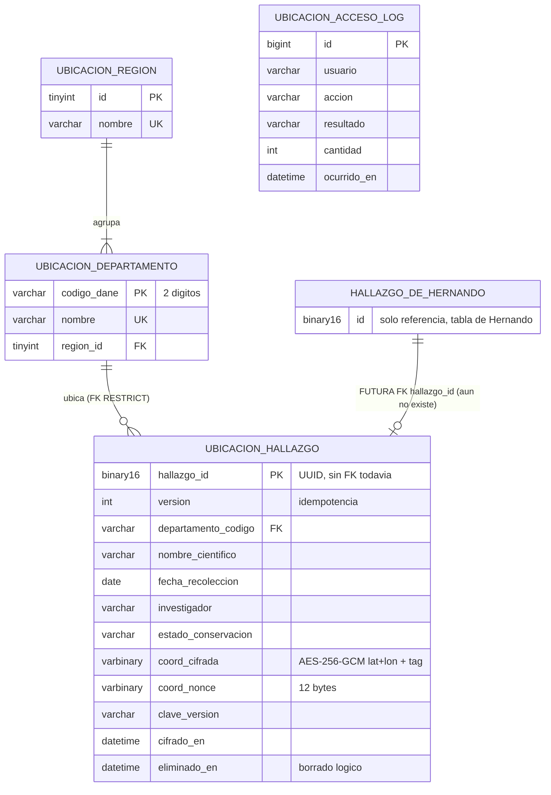
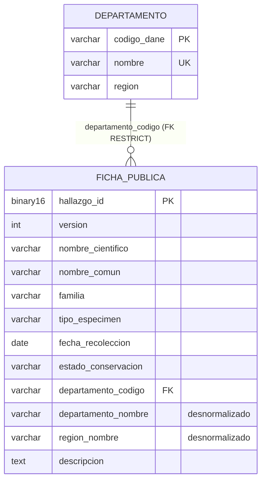

# 05 – Modelo de datos: parte de Juanita Mejía (ubicación y consulta pública)

Fecha: 2026-10-26 (actualizado 2026-11-03: sección 16, MySQL en Aiven). Motor: MySQL 8 (8.4 en Docker local y en las pruebas con Testcontainers; MySQL administrado de Aiven en el despliegue, sección 16), InnoDB, `utf8mb4` / `utf8mb4_0900_ai_ci` (sin distinción de mayúsculas ni tildes, que es lo que exige HU-06.2 y sirve igual para HU-13).
Fuentes que mandan: `01-requisitos.md` sección 9, `03-arquitectura.md` (D14, D15, D18) y `README.md` sección 9 (Flyway).

Alcance (D18): solo tablas del módulo **ubicacion** en el esquema compartido `cientifico` (todas con prefijo `ubicacion_`) y el modelo de lectura en `consulta_publica`. **No se diseña ninguna tabla de Hernando** (hallazgos, fichas, historial). La referencia a su hallazgo es `hallazgo_id` sin FK por ahora (sección 6).

---

## 1. Resumen

| Esquema (instancia) | Tabla | Para qué |
|---|---|---|
| `cientifico` (mysql-transaccional) | `ubicacion_region` | Catálogo de regiones naturales (6) |
| `cientifico` | `ubicacion_departamento` | Catálogo de departamentos (33 códigos DANE) |
| `cientifico` | `ubicacion_hallazgo` | Índice de búsqueda interno + coordenadas **cifradas** por hallazgo |
| `cientifico` | `ubicacion_acceso_log` | (Could, HU-07.3) auditoría de accesos a coordenadas, sin coordenadas |
| `consulta_publica` (mysql-lectura) | `departamento` | Catálogo de departamentos y región (desnormalizado) |
| `consulta_publica` | `ficha_publica` | Modelo de lectura público, **sin ninguna columna de coordenadas** (D14) |

Decisiones clave:
1. **No existe ninguna columna de latitud/longitud en claro, ni redondeada, ni en ninguna tabla** (D14, D15). Esto simplifica HU-UBI-01: ya no hay "columnas en claro en NULL"; todas las coordenadas viven solo en `coord_cifrada`.
2. Lo único indexable sin revelar la coordenada es lo que ya es público o interno no sensible: departamento (y su región), especie, fecha, investigador. Un filtro por rectángulo (bbox) no puede usar índice; se resuelve descifrando en memoria (sección 7.3).
3. Idempotencia por columna `version` en cada fila (no hay tabla de eventos procesados): ver sección 8.
4. `hallazgo_id` es **UUID almacenado como `BINARY(16)`** en todo el sistema.

---

## 2. Diagrama entidad-relación





Las dos instancias MySQL son independientes: no hay FK ni consultas entre `cientifico` y `consulta_publica`; solo se comunican por eventos.

---

## 3. Migraciones propuestas (DDL completo, listo para copiar)

Convención: `V<AAAAMMDD_HHMM>__descripcion.sql` en `src/main/resources/db/migration/`. Flyway convierte `_` en `.` dentro de la versión (`20261026.1000`), así que el orden es numérico por fecha/hora. Con `out-of-order: true` las migraciones de Hernando en el mismo esquema pueden intercalarse. **Ninguna migración inserta datos de prueba**: los únicos `INSERT` son los catálogos de regiones y departamentos (dato de referencia, no de prueba).

Notas de compatibilidad con `ddl-auto: validate` (Hibernate 6 / Spring Boot 3.5), ya consideradas en el DDL:
- Códigos de 2 caracteres como `VARCHAR(2)`, no `CHAR(2)` (un `CHAR` no valida contra `String`).
- `version` es `INT` con `CHECK >= 1`, no `INT UNSIGNED` (entidad `Integer`).
- Nonce y texto cifrado son `VARBINARY` (entidad `byte[]`), no `BINARY`.
- `hallazgo_id` `BINARY(16)` mapea con `java.util.UUID` en Hibernate 6 sobre MySQL.
- `DATETIME(3)` en UTC (la aplicación fija `hibernate.jdbc.time_zone=UTC`) para `Instant`.

### 3.1 Esquema `cientifico` (servicio-cientifico)

#### `V20261026_1000__ubicacion_catalogo_departamentos.sql`

```sql
-- Catalogo de referencia (NO es dato de prueba). Regiones naturales y departamentos de Colombia.
-- Codigos DANE de 2 digitos. Bogota D.C. se incluye como entidad territorial (11).
-- La asignacion de region es la predominante (p. ej. Cauca figura en Pacifica).

CREATE TABLE ubicacion_region (
  id      TINYINT UNSIGNED NOT NULL,
  nombre  VARCHAR(40)      NOT NULL,
  CONSTRAINT pk_ubicacion_region PRIMARY KEY (id),
  CONSTRAINT uq_ubicacion_region_nombre UNIQUE (nombre)
) ENGINE=InnoDB DEFAULT CHARSET=utf8mb4 COLLATE=utf8mb4_0900_ai_ci;

CREATE TABLE ubicacion_departamento (
  codigo_dane VARCHAR(2)       NOT NULL,
  nombre      VARCHAR(60)      NOT NULL,
  region_id   TINYINT UNSIGNED NOT NULL,
  CONSTRAINT pk_ubicacion_departamento PRIMARY KEY (codigo_dane),
  CONSTRAINT uq_ubicacion_departamento_nombre UNIQUE (nombre),
  CONSTRAINT fk_ubicacion_departamento_region FOREIGN KEY (region_id)
    REFERENCES ubicacion_region (id) ON DELETE RESTRICT ON UPDATE RESTRICT,
  CONSTRAINT ck_ubicacion_departamento_codigo CHECK (codigo_dane REGEXP '^[0-9]{2}$')
) ENGINE=InnoDB DEFAULT CHARSET=utf8mb4 COLLATE=utf8mb4_0900_ai_ci;

CREATE INDEX idx_ubicacion_departamento_region ON ubicacion_departamento (region_id);

INSERT INTO ubicacion_region (id, nombre) VALUES
  (1, 'Andina'), (2, 'Caribe'), (3, 'Pacífica'),
  (4, 'Orinoquía'), (5, 'Amazonía'), (6, 'Insular');

INSERT INTO ubicacion_departamento (codigo_dane, nombre, region_id) VALUES
  ('05', 'Antioquia', 1),
  ('08', 'Atlántico', 2),
  ('11', 'Bogotá D.C.', 1),
  ('13', 'Bolívar', 2),
  ('15', 'Boyacá', 1),
  ('17', 'Caldas', 1),
  ('18', 'Caquetá', 5),
  ('19', 'Cauca', 3),
  ('20', 'Cesar', 2),
  ('23', 'Córdoba', 2),
  ('25', 'Cundinamarca', 1),
  ('27', 'Chocó', 3),
  ('41', 'Huila', 1),
  ('44', 'La Guajira', 2),
  ('47', 'Magdalena', 2),
  ('50', 'Meta', 4),
  ('52', 'Nariño', 3),
  ('54', 'Norte de Santander', 1),
  ('63', 'Quindío', 1),
  ('66', 'Risaralda', 1),
  ('68', 'Santander', 1),
  ('70', 'Sucre', 2),
  ('73', 'Tolima', 1),
  ('76', 'Valle del Cauca', 3),
  ('81', 'Arauca', 4),
  ('85', 'Casanare', 4),
  ('86', 'Putumayo', 5),
  ('88', 'San Andrés y Providencia', 6),
  ('91', 'Amazonas', 5),
  ('94', 'Guainía', 5),
  ('95', 'Guaviare', 5),
  ('97', 'Vaupés', 5),
  ('99', 'Vichada', 4);
```

Reparto: Andina 11, Caribe 7, Pacífica 4, Orinoquía 4, Amazonía 6, Insular 1 = 33.

#### `V20261026_1010__ubicacion_hallazgo.sql`

```sql
-- Indice de busqueda interno y almacen de coordenadas CIFRADAS (D15) por hallazgo.
-- hallazgo_id = UUID del hallazgo de Hernando (BINARY(16)). SIN FK todavia: ver doc 05, seccion 6.
-- NO hay columnas de latitud/longitud (ni en claro ni redondeadas): solo coord_cifrada.

CREATE TABLE ubicacion_hallazgo (
  hallazgo_id         BINARY(16)   NOT NULL,
  version             INT          NOT NULL,
  departamento_codigo VARCHAR(2)   NOT NULL,
  nombre_cientifico   VARCHAR(150) NOT NULL,
  fecha_recoleccion   DATE         NOT NULL,
  investigador        VARCHAR(100) NOT NULL,
  estado_conservacion VARCHAR(20)  NOT NULL,
  -- Cifrado AES-256-GCM. Payload = latitud y longitud como 2 doubles IEEE-754 big-endian (16 bytes);
  -- coord_cifrada = texto cifrado (16 B) || etiqueta GCM (16 B) = 32 B. AAD = UUID canonico (minusculas, 36 chars UTF-8).
  coord_cifrada       VARBINARY(64) NULL,
  coord_nonce         VARBINARY(12) NULL,
  clave_version       VARCHAR(16)   NULL,
  cifrado_en          DATETIME(3)   NULL,
  eliminado_en        DATETIME(3)   NULL,
  creado_en           DATETIME(3)   NOT NULL DEFAULT CURRENT_TIMESTAMP(3),
  actualizado_en      DATETIME(3)   NOT NULL DEFAULT CURRENT_TIMESTAMP(3) ON UPDATE CURRENT_TIMESTAMP(3),

  CONSTRAINT pk_ubicacion_hallazgo PRIMARY KEY (hallazgo_id),
  CONSTRAINT fk_ubicacion_hallazgo_departamento FOREIGN KEY (departamento_codigo)
    REFERENCES ubicacion_departamento (codigo_dane) ON DELETE RESTRICT ON UPDATE RESTRICT,
  CONSTRAINT ck_ubicacion_hallazgo_version CHECK (version >= 1),
  CONSTRAINT ck_ubicacion_hallazgo_estado CHECK (estado_conservacion IN ('EN_PELIGRO','NO_AMENAZADA','SIN_EVALUAR')),
  CONSTRAINT ck_ubicacion_hallazgo_nombre CHECK (CHAR_LENGTH(TRIM(nombre_cientifico)) > 0),
  CONSTRAINT ck_ubicacion_hallazgo_investigador CHECK (CHAR_LENGTH(TRIM(investigador)) > 0),
  -- Las 4 columnas de cifrado van juntas o ninguna (hallazgo sin coordenadas)
  CONSTRAINT ck_ubicacion_hallazgo_cifrado_completo CHECK (
    (coord_cifrada IS NULL AND coord_nonce IS NULL AND clave_version IS NULL AND cifrado_en IS NULL)
    OR
    (coord_cifrada IS NOT NULL AND coord_nonce IS NOT NULL AND clave_version IS NOT NULL AND cifrado_en IS NOT NULL)),
  CONSTRAINT ck_ubicacion_hallazgo_nonce_len CHECK (coord_nonce IS NULL OR LENGTH(coord_nonce) = 12),
  CONSTRAINT ck_ubicacion_hallazgo_cifrado_len CHECK (coord_cifrada IS NULL OR LENGTH(coord_cifrada) BETWEEN 17 AND 64),
  CONSTRAINT ck_ubicacion_hallazgo_clave CHECK (clave_version IS NULL OR clave_version REGEXP '^[A-Za-z0-9_-]{1,16}$'),

  -- Un (llave, nonce) repetido en GCM rompe la confidencialidad: el UNIQUE lo detecta si el aleatorio fallara.
  -- Su prefijo (clave_version) tambien sirve para contar/seleccionar registros por version en la rotacion.
  CONSTRAINT uq_ubicacion_hallazgo_clave_nonce UNIQUE (clave_version, coord_nonce)
) ENGINE=InnoDB DEFAULT CHARSET=utf8mb4 COLLATE=utf8mb4_0900_ai_ci;

-- Busqueda interna (HU-13): cada filtro combinable lleva la fecha como segunda columna,
-- porque el orden por defecto es fecha_recoleccion DESC y el rango de fechas es el filtro mas comun.
CREATE INDEX idx_ubicacion_hallazgo_fecha         ON ubicacion_hallazgo (fecha_recoleccion, hallazgo_id);
CREATE INDEX idx_ubicacion_hallazgo_especie_fecha ON ubicacion_hallazgo (nombre_cientifico, fecha_recoleccion);
CREATE INDEX idx_ubicacion_hallazgo_invest_fecha  ON ubicacion_hallazgo (investigador, fecha_recoleccion);
CREATE INDEX idx_ubicacion_hallazgo_depto_fecha   ON ubicacion_hallazgo (departamento_codigo, fecha_recoleccion);
```

#### `V20261026_1020__ubicacion_acceso_log.sql` (Could, HU-07.3: el backend la crea solo si toma esa historia)

```sql
-- Auditoria de accesos a coordenadas exactas. Nunca guarda coordenadas ni texto cifrado.
-- Sin FK: es un registro historico que debe sobrevivir a cualquier cambio de otras tablas.
CREATE TABLE ubicacion_acceso_log (
  id          BIGINT       NOT NULL AUTO_INCREMENT,
  usuario     VARCHAR(100) NOT NULL,                -- preferred_username del JWT
  accion      VARCHAR(20)  NOT NULL,                -- MAPA | BUSQUEDA
  resultado   VARCHAR(10)  NOT NULL,                -- PERMITIDO | DENEGADO
  filtros     VARCHAR(500) NULL,                    -- filtros solicitados, ya saneados (sin bbox exacto si se decide)
  cantidad    INT          NOT NULL DEFAULT 0,      -- registros devueltos
  ocurrido_en DATETIME(3)  NOT NULL DEFAULT CURRENT_TIMESTAMP(3),
  CONSTRAINT pk_ubicacion_acceso_log PRIMARY KEY (id),
  CONSTRAINT ck_ubicacion_acceso_accion CHECK (accion IN ('MAPA','BUSQUEDA')),
  CONSTRAINT ck_ubicacion_acceso_resultado CHECK (resultado IN ('PERMITIDO','DENEGADO')),
  CONSTRAINT ck_ubicacion_acceso_cantidad CHECK (cantidad >= 0)
) ENGINE=InnoDB DEFAULT CHARSET=utf8mb4 COLLATE=utf8mb4_0900_ai_ci;

CREATE INDEX idx_ubicacion_acceso_fecha   ON ubicacion_acceso_log (ocurrido_en);
CREATE INDEX idx_ubicacion_acceso_usuario ON ubicacion_acceso_log (usuario, ocurrido_en);
```

### 3.2 Esquema `consulta_publica` (servicio-consulta-publica)

#### `V20261026_1000__catalogo_departamentos.sql`

```sql
-- Catalogo de referencia (NO es dato de prueba). Copia propia del servicio: no se comparte BD con cientifico.
-- Region desnormalizada como texto: el catalogo es pequeno, inmutable y solo se lee.
CREATE TABLE departamento (
  codigo_dane VARCHAR(2)  NOT NULL,
  nombre      VARCHAR(60) NOT NULL,
  region      VARCHAR(40) NOT NULL,
  CONSTRAINT pk_departamento PRIMARY KEY (codigo_dane),
  CONSTRAINT uq_departamento_nombre UNIQUE (nombre),
  CONSTRAINT ck_departamento_codigo CHECK (codigo_dane REGEXP '^[0-9]{2}$')
) ENGINE=InnoDB DEFAULT CHARSET=utf8mb4 COLLATE=utf8mb4_0900_ai_ci;

INSERT INTO departamento (codigo_dane, nombre, region) VALUES
  ('05','Antioquia','Andina'), ('08','Atlántico','Caribe'), ('11','Bogotá D.C.','Andina'),
  ('13','Bolívar','Caribe'), ('15','Boyacá','Andina'), ('17','Caldas','Andina'),
  ('18','Caquetá','Amazonía'), ('19','Cauca','Pacífica'), ('20','Cesar','Caribe'),
  ('23','Córdoba','Caribe'), ('25','Cundinamarca','Andina'), ('27','Chocó','Pacífica'),
  ('41','Huila','Andina'), ('44','La Guajira','Caribe'), ('47','Magdalena','Caribe'),
  ('50','Meta','Orinoquía'), ('52','Nariño','Pacífica'), ('54','Norte de Santander','Andina'),
  ('63','Quindío','Andina'), ('66','Risaralda','Andina'), ('68','Santander','Andina'),
  ('70','Sucre','Caribe'), ('73','Tolima','Andina'), ('76','Valle del Cauca','Pacífica'),
  ('81','Arauca','Orinoquía'), ('85','Casanare','Orinoquía'), ('86','Putumayo','Amazonía'),
  ('88','San Andrés y Providencia','Insular'), ('91','Amazonas','Amazonía'),
  ('94','Guainía','Amazonía'), ('95','Guaviare','Amazonía'), ('97','Vaupés','Amazonía'),
  ('99','Vichada','Orinoquía');
```

#### `V20261026_1010__ficha_publica.sql`

```sql
-- Modelo de lectura publico. D14: NO existe ninguna columna de coordenadas (ni de ninguna especie).
-- El estado "ubicacionProtegida" no se guarda: con D14 es siempre true y se calcula en el servicio.
-- No se guarda investigador ni usuario del evento (HU-06.1, ultimo escenario).

CREATE TABLE ficha_publica (
  hallazgo_id         BINARY(16)   NOT NULL,
  version             INT          NOT NULL,
  nombre_cientifico   VARCHAR(150) NOT NULL,
  nombre_comun        VARCHAR(150) NULL,
  familia             VARCHAR(100) NOT NULL,
  tipo_especimen      VARCHAR(80)  NULL,
  fecha_recoleccion   DATE         NOT NULL,
  estado_conservacion VARCHAR(20)  NOT NULL,
  departamento_codigo VARCHAR(2)   NOT NULL,
  departamento_nombre VARCHAR(60)  NOT NULL,   -- desnormalizado (se muestra tal cual)
  region_nombre       VARCHAR(40)  NOT NULL,   -- desnormalizado
  descripcion         TEXT         NULL,       -- texto publico; el servicio limita a 5000 caracteres
  creado_en           DATETIME(3)  NOT NULL DEFAULT CURRENT_TIMESTAMP(3),
  actualizado_en      DATETIME(3)  NOT NULL DEFAULT CURRENT_TIMESTAMP(3) ON UPDATE CURRENT_TIMESTAMP(3),

  CONSTRAINT pk_ficha_publica PRIMARY KEY (hallazgo_id),
  CONSTRAINT fk_ficha_publica_departamento FOREIGN KEY (departamento_codigo)
    REFERENCES departamento (codigo_dane) ON DELETE RESTRICT ON UPDATE RESTRICT,
  CONSTRAINT ck_ficha_publica_version CHECK (version >= 1),
  CONSTRAINT ck_ficha_publica_estado CHECK (estado_conservacion IN ('EN_PELIGRO','NO_AMENAZADA','SIN_EVALUAR')),
  CONSTRAINT ck_ficha_publica_nombre CHECK (CHAR_LENGTH(TRIM(nombre_cientifico)) > 0),
  CONSTRAINT ck_ficha_publica_familia CHECK (CHAR_LENGTH(TRIM(familia)) > 0)
) ENGINE=InnoDB DEFAULT CHARSET=utf8mb4 COLLATE=utf8mb4_0900_ai_ci;

-- Busqueda por q (HU-06.2): palabras de nombre cientifico y nombre comun
CREATE FULLTEXT INDEX ft_ficha_publica_nombres ON ficha_publica (nombre_cientifico, nombre_comun);
-- Listado sin filtros ordenado por nombre cientifico, y q de 1-2 letras con LIKE 'xx%'
CREATE INDEX idx_ficha_publica_nombre         ON ficha_publica (nombre_cientifico);
-- Filtros por familia y por departamento, ya ordenados por nombre
CREATE INDEX idx_ficha_publica_familia_nombre ON ficha_publica (familia, nombre_cientifico);
CREATE INDEX idx_ficha_publica_depto_nombre   ON ficha_publica (departamento_codigo, nombre_cientifico);
```

---

## 4. Índices: qué consulta acelera cada uno

| Tabla | Índice | Consulta que sirve | Por qué |
|---|---|---|---|
| `ubicacion_hallazgo` | PK `hallazgo_id` | Upsert por `UbicacionService`, lectura por id | Acceso directo; `BINARY(16)` mantiene el índice compacto (16 B frente a 36 B de texto) |
| | `idx_..._fecha (fecha_recoleccion, hallazgo_id)` | Búsqueda sin filtros o solo con rango de fechas; orden por defecto `fecha_recoleccion DESC` | Recorre el índice al revés sin `filesort`; `hallazgo_id` desempata de forma estable para paginar |
| | `idx_..._especie_fecha (nombre_cientifico, fecha_recoleccion)` | `nombre_cientifico LIKE 'Atelopus%'` (+ fechas) | Prefijo sargable con la colación `ai_ci` (insensible a tildes). Búsqueda "contiene" (`%x%`) no usaría índice; con 10.000 filas un barrido son milisegundos y no justifica FULLTEXT interno |
| | `idx_..._invest_fecha (investigador, fecha_recoleccion)` | `investigador = ?` (+ fechas) | Igualdad exacta (el filtro es un identificador, no texto libre) y rango de fechas sobre el mismo índice |
| | `idx_..._depto_fecha (departamento_codigo, fecha_recoleccion)` | `departamento_codigo = ?` (+ fechas); preselección del mapa | Igualdad + rango; es el único criterio geográfico indexable sin revelar la coordenada |
| | `uq_..._clave_nonce (clave_version, coord_nonce)` | (a) detecta reutilización de nonce; (b) `WHERE clave_version IN (...)` y `COUNT` por versión en el re-cifrado | Un solo índice cumple integridad criptográfica y operación de rotación |
| `ubicacion_departamento` | `idx_..._region` | Unir/filtrar por región | Requerido por la FK; catálogo de 33 filas |
| `ubicacion_acceso_log` | `(ocurrido_en)`, `(usuario, ocurrido_en)` | Revisión de auditoría por periodo o por usuario | Solo si se crea (Could) |
| `ficha_publica` | PK `hallazgo_id` | `GET /fichas/{id}` y upsert por evento | Acceso directo |
| | `ft_..._nombres (nombre_cientifico, nombre_comun)` FULLTEXT | `q` por nombre científico o común | Busca por palabra y por prefijo de palabra (`atel*`), ignorando tildes y mayúsculas por la colación; evita `LIKE '%q%'` sobre todo el modelo público, que es el que recibe el tráfico x60 |
| | `idx_..._nombre (nombre_cientifico)` | Listado sin filtros ordenado; `q` de menos de 3 letras con `LIKE 'xx%'` | FULLTEXT de InnoDB no indexa palabras de menos de 3 caracteres (`innodb_ft_min_token_size=3`); no se cambia ese parámetro del servidor |
| | `idx_..._familia_nombre (familia, nombre_cientifico)` | `familia = ?` ordenado por nombre | Igualdad + orden sin `filesort` |
| | `idx_..._depto_nombre (departamento_codigo, nombre_cientifico)` | `departamento_codigo = ?` ordenado por nombre | Igual |

Cuando se combinan familia y departamento MySQL elige uno de los dos índices y filtra el resto: con decenas de miles de filas es suficiente y el resultado se cachea 60 s (regla 9). No se crea un compuesto de tres columnas porque el costo de escritura y espacio no se justifica.

No se indexa ninguna coordenada, ni redondeada ni en rejilla: una coordenada aproximada en claro sigue revelando la ubicación de una especie amenazada (una rejilla de 0,1° son unos 11 km) y contradice D15. El `eliminado_en IS NULL` se evalúa como filtro sobre las filas ya localizadas (los borrados lógicos son una fracción mínima); no se añade a los índices.

Volumen estimado: unos 250-400 B por fila de `ubicacion_hallazgo` y 0,5-1 KB por `ficha_publica`; 10.000 filas son pocos MB, caben enteras en el buffer pool de MySQL.

---

## 5. Normalización y desnormalización

**`cientifico`**
- `ubicacion_region` → `ubicacion_departamento`: la región depende del departamento y no del hallazgo, por eso está en el catálogo y el hallazgo guarda solo `departamento_codigo` (3FN: sin dependencias transitivas hallazgo → departamento → región).
- `ubicacion_hallazgo`: todos los atributos dependen de `hallazgo_id`. El grupo de cifrado (`coord_cifrada`, `coord_nonce`, `clave_version`, `cifrado_en`) describe una sola cosa (las coordenadas de ese hallazgo) y va en la misma fila porque es 1:1; separarlo en otra tabla solo añadiría un JOIN a cada búsqueda.
- **Desnormalización justificada (S3 de los requisitos):** `nombre_cientifico`, `fecha_recoleccion`, `investigador` y `estado_conservacion` son **copia** de datos de Hernando. Se guardan aquí porque la búsqueda interna debe filtrar y ordenar con índices propios, sin importar clases ni tablas del módulo `registro` (regla de módulos de la arquitectura) y sin una tabla de Hernando que aún no existe. La fuente de verdad es registro; la copia se refresca en cada llamada a `UbicacionService` (gana la `version` mayor). Cuando exista la tabla de Hernando se puede evaluar sustituir la copia por un JOIN; hoy no se decide por él.

**`consulta_publica`** es un modelo de lectura: está desnormalizado a propósito (CQRS alimentado por eventos). `departamento_nombre` y `region_nombre` duplican el catálogo para listar sin JOIN; `departamento_codigo` + FK garantiza que el filtro por departamento es consistente aunque el evento llegue con "Boyaca" o "BOYACÁ". La ficha es una sola tabla porque no hay relaciones 1:N públicas en el MVP (atributos flexibles, adjuntos y equipos quedan fuera).

Ambas cumplen 1FN (sin listas en columnas) y 3FN, salvo las desnormalizaciones indicadas.

---

## 6. Referencia a `hallazgo_id` y supuestos para Hernando

Como la tabla de hallazgos no existe, `ubicacion_hallazgo.hallazgo_id` **no tiene FK todavía**. Supuestos que Hernando debe respetar (de lo contrario hay que cambiar mi DDL):

1. El identificador del hallazgo es un **UUID generado por la aplicación** (se recomienda UUID v7 o v4; v7 mejora la localidad del índice) y se almacena como **`BINARY(16)`**, con entidad `java.util.UUID`. No `CHAR(36)`, no `BIGINT` autoincremental. Es el mismo `hallazgoId` del evento (`datos.hallazgoId`).
2. En su tabla debe ser **PK** (o UNIQUE), `ENGINE=InnoDB`, para poder referenciarla. Se sugiere llamarla `hallazgo` con PK `id BINARY(16)` (el nombre no lo impongo: el ALTER se ajusta).
3. **Orden de operaciones:** registro inserta el hallazgo primero y llama a `UbicacionService` después, **en la misma transacción** (HU-UBI-03). Si el INSERT del hallazgo fuera posterior, la FK fallaría.
4. Un hallazgo no se borra físicamente si tiene fila en `ubicacion_hallazgo` (la FK será `RESTRICT`). Si registro anula un hallazgo, lo marca con su propio estado y avisa a ubicación (sección 9); esto mantiene intacto su historial.
5. Valores de `estadoConservacion`: `EN_PELIGRO`, `NO_AMENAZADA`, `SIN_EVALUAR` (sección 4.1 de requisitos). Ubicación normaliza antes de guardar: `UbicacionService` rechaza un estado ausente con error de validación; en el consumidor de eventos, un valor desconocido se guarda como `EN_PELIGRO` y uno ausente va a la DLQ (D32). Si Hernando usa otras categorías, se cambia el `CHECK` con una migración nueva.
6. `departamento` llega como **nombre oficial** (se compara con `ai_ci`, así que no importan tildes ni mayúsculas) o como código DANE. Si no coincide con ninguno de los 33 del catálogo, ubicación lo rechaza con error de validación (no guarda nada) y el consumidor envía el evento a la DLQ.
7. `investigador` es el `preferred_username` del JWT (hasta 100 caracteres) y es el mismo valor por el que filtra la búsqueda interna; debe ser estable entre llamadas.
8. `fechaRecoleccion` es una fecha (`DATE`), sin hora.

**FK futura** (migración que añade quien cree la tabla de hallazgos, o Juanita cuando exista; no se ejecuta hoy). Fallará si hubiera filas huérfanas, lo cual no ocurre mientras las bases no tengan datos:

```sql
-- V<fecha>__ubicacion_fk_hallazgo.sql  (SOLO cuando exista hallazgo(id) BINARY(16) PK)
ALTER TABLE ubicacion_hallazgo
  ADD CONSTRAINT fk_ubicacion_hallazgo_hallazgo FOREIGN KEY (hallazgo_id)
  REFERENCES hallazgo (id) ON DELETE RESTRICT ON UPDATE RESTRICT;
```

---

## 7. Consultas clave

Parámetros siempre enlazados (`?`), nunca concatenados. Las consultas se arman **dinámicamente** (solo con los filtros recibidos, por ejemplo con `Specification` o `JdbcClient`); el patrón `(? IS NULL OR col = ?)` impide usar los índices y no debe usarse.

### 7.1 Búsqueda pública (consulta_publica)

```sql
-- q con palabra(s) de 3+ letras: cada palabra saneada (se quitan + - < > ( ) ~ * " @) y enviada como +palabra*
SELECT hallazgo_id, nombre_cientifico, nombre_comun, familia, fecha_recoleccion,
       estado_conservacion, departamento_nombre, region_nombre
FROM ficha_publica
WHERE MATCH(nombre_cientifico, nombre_comun) AGAINST (? IN BOOLEAN MODE)   -- '+atelopus* +ebeno*'
  AND familia = ?                    -- opcional
  AND departamento_codigo = ?        -- opcional; el servicio resuelve "Boyacá" -> '15' en el catálogo
ORDER BY nombre_cientifico, hallazgo_id
LIMIT ? OFFSET ?;                    -- size <= 50

-- q de menos de 3 letras (el FULLTEXT no las indexa)
WHERE nombre_cientifico LIKE CONCAT(?, '%')   -- con % y _ escapados

-- Sin q: solo filtros; usa idx_..._nombre, idx_..._familia_nombre o idx_..._depto_nombre
-- Total para la paginación: el mismo WHERE con SELECT COUNT(*)
-- Ficha: SELECT ... FROM ficha_publica WHERE hallazgo_id = ?
```

Con `q` presente, MySQL ordena los pocos resultados del FULLTEXT en memoria; con 10.000+ fichas es inmediato y la respuesta se cachea (5 min ficha, 60 s listado). El mapeo de `q` inyectado (`' OR '1'='1`) es inofensivo: va enlazado y, tras sanear, queda como palabras literales.

### 7.2 Búsqueda interna con filtros combinables (cientifico)

```sql
SELECT h.hallazgo_id, h.nombre_cientifico, h.fecha_recoleccion, h.investigador,
       h.estado_conservacion, d.nombre AS departamento, r.nombre AS region
       -- solo si el rol puede ver coordenadas de ese registro:
       , h.coord_cifrada, h.coord_nonce, h.clave_version
FROM ubicacion_hallazgo h
JOIN ubicacion_departamento d ON d.codigo_dane = h.departamento_codigo
JOIN ubicacion_region r       ON r.id = d.region_id
WHERE h.eliminado_en IS NULL
  AND h.nombre_cientifico LIKE CONCAT(?, '%')            -- opcional
  AND h.fecha_recoleccion >= ? AND h.fecha_recoleccion <= ?   -- opcional
  AND h.investigador = ?                                  -- opcional
  AND h.departamento_codigo = ?                           -- opcional
ORDER BY h.fecha_recoleccion DESC, h.hallazgo_id
LIMIT ? OFFSET ?;                                         -- size <= 100
```

Reglas de aplicación: el SQL no devuelve `coord_*` cuando el rol no es `cientifico_alto_rango`, sea cual sea el estado de conservación (D21/D32) (minimización: ni cifrado sale de la BD). Para alto rango se descifra solo la página (máx. 100, HU-13.2). Ningún otro rol interno recibe coordenadas, tampoco de hallazgos no amenazados (D21/D32; anula HU-13.1 en ese punto). Total de páginas: `SELECT COUNT(*)` con el mismo `WHERE`. Para 10.000 filas, incluso un barrido completo es de decenas de milisegundos, muy por debajo del objetivo de 3 s; los índices garantizan que siga así al crecer. Revisar con `EXPLAIN` en la prueba de carga.

### 7.3 Mapa por departamento y por rectángulo

```sql
-- Mapa (HU-07.1): solo alto rango. Se pide LIMIT 1001 para detectar "truncado".
SELECT h.hallazgo_id, h.nombre_cientifico, h.fecha_recoleccion,
       h.coord_cifrada, h.coord_nonce, h.clave_version
FROM ubicacion_hallazgo h
WHERE h.eliminado_en IS NULL
  AND h.coord_cifrada IS NOT NULL
  AND h.nombre_cientifico LIKE CONCAT(?, '%')            -- especie, opcional
  AND h.departamento_codigo = ?                           -- departamento, opcional
  AND h.fecha_recoleccion BETWEEN ? AND ?                 -- opcional
ORDER BY h.fecha_recoleccion DESC
LIMIT 1001;
```

Rectángulo (bbox, Could, solo alto rango): **no puede indexarse** sin guardar coordenadas en claro. Estrategia: la consulta SQL filtra por los criterios indexables (especie, fechas, departamento), se recorre el resultado en streaming, se descifra en memoria y se descarta lo que cae fuera del rectángulo, hasta reunir 1001. Es viable porque descifrar AES-GCM de 32 bytes cuesta microsegundos (10.000 descifrados son una fracción de segundo). Las coordenadas descifradas nunca se escriben en BD, caché ni logs. Un bbox sin ningún otro filtro recorre toda la tabla: aceptable con decenas de miles de filas; si crece mucho, se puede preseleccionar departamentos cuyo rectángulo conocido (dato geográfico público, en configuración) se cruza con el bbox, sin tocar el esquema.

Registros que no se pueden descifrar (llave retirada o texto alterado) se omiten y se cuentan en `omitidos` (HU-07.1).

---

## 8. Integridad, idempotencia y concurrencia

**Idempotencia (columna `version`, sin tabla de eventos procesados).** Un hallazgo se identifica por `hallazgo_id` y gana la `version` mayor (regla 7). Eso cubre duplicados (misma versión) y desorden (versión menor) con una sola fila por hallazgo, y como el evento de reclasificación es un snapshot completo, no depende de eventos previos. Se descarta una tabla de eventos procesados porque crecería sin límite y no aporta más garantía aquí. Los eventos inválidos van a la DLQ y no dejan fila.

Upsert atómico en `ficha_publica` (y análogo en `ubicacion_hallazgo`): en `ON DUPLICATE KEY UPDATE` MySQL evalúa las asignaciones **de izquierda a derecha**, así que `version` debe asignarse **la última**, o las demás columnas compararían contra la versión ya actualizada:

```sql
INSERT INTO ficha_publica (hallazgo_id, version, nombre_cientifico, nombre_comun, familia, tipo_especimen,
    fecha_recoleccion, estado_conservacion, departamento_codigo, departamento_nombre, region_nombre, descripcion)
VALUES (?,?,?,?,?,?,?,?,?,?,?,?) AS nuevo
ON DUPLICATE KEY UPDATE
  nombre_cientifico   = IF(nuevo.version > ficha_publica.version, nuevo.nombre_cientifico,   ficha_publica.nombre_cientifico),
  nombre_comun        = IF(nuevo.version > ficha_publica.version, nuevo.nombre_comun,        ficha_publica.nombre_comun),
  familia             = IF(nuevo.version > ficha_publica.version, nuevo.familia,             ficha_publica.familia),
  -- ... el resto de columnas igual ...
  version             = IF(nuevo.version > ficha_publica.version, nuevo.version,             ficha_publica.version);
-- filas afectadas: 1 = insertada, 2 = actualizada, 0 = ignorada (duplicado/antigua); invalidar caché solo si > 0
```

Alternativa equivalente y más fácil de probar: en una transacción, `SELECT version ... FOR UPDATE`, comparar en Java y hacer `INSERT` o `UPDATE`.

**Transaccionalidad en `ubicacion`:** el alta/actualización de `ubicacion_hallazgo` ocurre en la transacción del llamador (`registro`), por lo que o se guardan hallazgo y ubicación, o ninguno. El cifrado ocurre antes del INSERT, en la aplicación.

**Nonce:** 12 bytes aleatorios de `SecureRandom` por cada cifrado (incluida cada re-escritura y cada re-cifrado); nunca derivado del id. El UNIQUE `(clave_version, coord_nonce)` es la red de seguridad.

**Integridad referencial:** FK de departamento `RESTRICT` (el catálogo no se borra). `DELETE` y `UPDATE` de claves primarias no se usan.

---

## 9. Estrategia de borrado

- **Las ubicaciones no se borran físicamente.** `ubicacion_hallazgo` se borra de forma lógica con `eliminado_en` (DATETIME NULL). Motivos: (1) el historial de Hernando (HU-05) referencia al hallazgo y no debe quedar con huecos ni forzar cascadas; (2) la FK futura es `RESTRICT`, de modo que un `DELETE` físico sería rechazado y ocultaría un error de diseño; (3) permite reactivar un hallazgo anulado por error y conserva la trazabilidad; (4) el usuario de aplicación no tendrá permiso `DELETE` (sección 11).
- Cuando registro anula un hallazgo llama a `UbicacionService.desactivar(hallazgoId)` → `UPDATE ... SET eliminado_en = CURRENT_TIMESTAMP(3)`. Todas las consultas de búsqueda y mapa filtran `eliminado_en IS NULL`. Reactivar pone `NULL`.
- El texto cifrado de un registro desactivado se conserva (sigue protegido por AES-GCM y se re-cifra en las rotaciones como cualquier otro). Si el Instituto exige borrar el dato personal, se haría una migración o rutina administrativa explícita que anule `coord_*` (el CHECK lo permite: las cuatro columnas a NULL), nunca un DELETE.
- `ficha_publica` no tiene borrado: el contrato no define un evento de baja. Si Hernando añade `hallazgo.anulado`, se añadiría una columna `publicada` por migración; no se anticipa.
- `ubicacion_acceso_log` es solo-inserción; se purga por política de retención (p. ej. 12 meses) con un job administrativo con credenciales distintas.

---

## 10. Datos sensibles

| Dato | Dónde | Protección |
|---|---|---|
| Latitud y longitud | `ubicacion_hallazgo.coord_cifrada` | AES-256-GCM, nonce aleatorio de 12 B por registro, AAD = UUID del hallazgo (impide copiar el cifrado a otra fila), `clave_version` junto al dato. Llaves **fuera de la BD** (`UBICACION_CLAVE_ACTIVA`, `UBICACION_CLAVES=v1:<b64>,v2:<b64>`), nunca en repo, logs ni respuestas. No hay copia en claro ni redondeada en ninguna tabla, caché, evento ni log. La etiqueta GCM detecta alteración |
| Coordenadas en el modelo público | – | No existen columnas (D14). Los eventos con coordenadas se rechazan antes de llegar a la tabla |
| `investigador` (nombre de usuario, dato personal) | `ubicacion_hallazgo` | Solo en `cientifico`, cuyo usuario de aplicación no puede leer `consulta_publica` y que en Aiven exige SSL y una lista de IP permitidas (sección 16). Se guarda en claro porque es el criterio de filtro y se muestra al personal interno; **no se replica** a `consulta_publica` ni al caché |
| `usuario` (JWT) | `ubicacion_acceso_log` | Solo en el log (Could); sin coordenadas |
| Contraseñas / tokens | – | Ninguna tabla de esta parte los guarda; la identidad es de Keycloak |
| Respaldos | `deploy/datos/backup` | Contienen solo texto cifrado. Las llaves no entran en el respaldo; hay que conservar de forma segura las llaves de cualquier versión que aún aparezca en un respaldo vigente |

Verificación automatizable (prueba de integración): ninguna tabla de los dos esquemas tiene una columna cuyo nombre coincida con `lat|lon|coord` salvo `coord_cifrada`/`coord_nonce`; y `SELECT ... WHERE CAST(coord_cifrada AS CHAR) LIKE '%4.6097%'` no devuelve filas tras un alta.

---

## 11. Permisos del usuario de aplicación

Estado vigente (Aiven, perfil `aiven`): **hay usuarios de aplicación y de migración separados** (SEC-11), creados por `deploy/aiven/01-escritura-bases-y-usuarios.sql.example` (cientifico, equipos) y `02-lectura-bases-y-usuarios.sql.example` (consulta_publica, reportes, gateway) (sección 16.3; D39). En Docker local sigue el usuario único con `ALL` sobre su esquema (`deploy/datos/init/*.sh`), válido solo para desarrollo.

| Usuario | Base | Privilegios | Lo usa |
|---|---|---|---|
| `cientifico_app` | `cientifico` | `SELECT, INSERT, UPDATE, DELETE` | el servicio en ejecución (`CIENTIFICO_DB_USER`) |
| `cientifico_migr` | `cientifico` | DML + `CREATE, ALTER, DROP, INDEX, REFERENCES` | solo Flyway (`CIENTIFICO_MIGR_USER`) |
| `consulta_app` | `consulta_publica` | `SELECT, INSERT, UPDATE, DELETE` | el servicio (`CONSULTA_DB_USER`) |
| `consulta_migr` | `consulta_publica` | DML + DDL como arriba | solo Flyway (`CONSULTA_MIGR_USER`) |
| `equipos_app` / `equipos_migr` | `equipos` | DML / DML + DDL | `EQUIPOS_DB_USER` / `EQUIPOS_MIGR_USER` |
| `reportes_app` / `reportes_migr` | `reportes` | DML / DML + DDL | `REPORTES_DB_USER` / `REPORTES_MIGR_USER` |
| `gateway_app` / `gateway_migr` | `gateway` | DML / DML + DDL | `GATEWAY_DB_USER` / `GATEWAY_MIGR_USER` |

Ningún usuario tiene acceso a la base del otro servicio (aislamiento HU-06.1), ni `GRANT OPTION`, `FILE`, `PROCESS`, `SUPER`, `TRIGGER` ni rutinas. Los permisos son sobre la base completa, no por tabla: cubren las tablas que Hernando agregue a `cientifico` sin tocar el aprovisionamiento.

Endurecimiento posible (no aplicado): hoy el código no emite `DELETE` (los borrados son lógicos, `eliminado_en`), así que se podría quitar `DELETE` a `cientifico_app` y `consulta_app`. Se deja porque `DML` es el mínimo acordado y registro (Hernando) podría necesitarlo; quitarlo es un `REVOKE` y se vuelve a ejecutar el script.

Nota: la FULLTEXT de InnoDB y los `CHECK` no necesitan privilegios adicionales. Los `CHECK` requieren MySQL 8.0.16+.

---

## 12. Plan de re-cifrado por rotación de llave

Premisas: las llaves están en variables de entorno con identificador (`v1`, `v2`...); una es la activa; las anteriores siguen configuradas mientras queden registros con esa versión (HU-UBI-02).

1. **Preparar:** añadir la llave nueva a la lista `UBICACION_CLAVES` (`...,v2:<b64>`), poner `UBICACION_CLAVE_ACTIVA=v2` y **mantener `v1` configurada**. Reiniciar el servicio. Desde ese momento: los registros nuevos se cifran con `v2`, los antiguos se siguen descifrando con `v1` (lectura sin pérdida).
2. **Medir:** `SELECT clave_version, COUNT(*) FROM ubicacion_hallazgo WHERE coord_cifrada IS NOT NULL GROUP BY clave_version;` (usa `uq_..._clave_nonce`).
3. **Re-cifrar por lotes** (tarea administrativa, HU-UBI-02 Should; solo rol `administrador` técnico o comando de mantenimiento, sin endpoint público). En cada lote de 500, en su propia transacción y con paginación por clave (`hallazgo_id > último`):
   ```sql
   SELECT hallazgo_id, version, coord_cifrada, coord_nonce, clave_version
   FROM ubicacion_hallazgo
   WHERE clave_version IN ('v1') AND hallazgo_id > ?
   ORDER BY hallazgo_id LIMIT 500 FOR UPDATE SKIP LOCKED;
   ```
   Para cada fila: descifrar con la llave de su `clave_version` (AAD = UUID), cifrar con la activa y **un nonce nuevo**, y
   ```sql
   UPDATE ubicacion_hallazgo
      SET coord_cifrada = ?, coord_nonce = ?, clave_version = 'v2', cifrado_en = CURRENT_TIMESTAMP(3)
    WHERE hallazgo_id = ? AND clave_version = 'v1' AND version = ?;   -- optimista: si registro actualizó entre medias, 0 filas y se omite
   ```
   No se modifica la columna `version` (es la del hallazgo de Hernando). Un registro que no se pueda descifrar se omite y se registra su id (sin datos sensibles); no detiene el lote.
4. **Es idempotente y reanudable:** si se interrumpe, basta repetirlo; las filas ya en `v2` no se tocan. Los registros nuevos o modificados durante el proceso ya nacen en `v2`.
5. **Verificar:** el `COUNT` por versión da 0 para `v1`; el total coincide con el de antes; muestreo de N registros descifrados con `v2` idénticos a los del paso previo (comparar en prueba, nunca imprimir las coordenadas).
6. **Retirar `v1`** de la configuración solo cuando el conteo es 0 **y** ningún respaldo vigente que se quiera poder restaurar dependa de `v1` (guardar `v1` en custodia segura el tiempo que dure esa retención). Si se retira antes, esos registros quedarían ilegibles (se omiten y se registran, según HU-UBI-02).
7. **Recuperación ante llave comprometida:** el mismo procedimiento, pero tratando como comprometidos también los respaldos antiguos (cifrados con la llave expuesta).

El UNIQUE `(clave_version, coord_nonce)` permite que dos versiones usen el mismo nonce (llaves distintas), por lo que el re-cifrado nunca choca con él.

---

## 13. Migraciones y datos semilla

**Migraciones**
- Una carpeta por servicio, versiones con fecha, `out-of-order: true`, nunca se edita una migración aplicada (README sección 9). `V1__base.sql` queda vacía.
- Orden en `cientifico`: `V20261026_1000` (catálogos) → `V20261026_1010` (`ubicacion_hallazgo`) → `V20261026_1020` (log, opcional). Los nombres son de Juanita; Hernando usa sus propias fechas y el esquema compartido no se pisa.
- Nombres de tablas con prefijo `ubicacion_` y de constraints/índices con el nombre de tabla: no colisionan con las de Hernando (los nombres de constraint son únicos por esquema).
- Cambios futuros previsibles, cada uno en migración nueva: FK a la tabla de hallazgos (sección 6); columna `municipio_codigo` si registro la aporta; `publicada` en `ficha_publica` si hay evento de baja; (el usuario Flyway separado ya existe: sección 11).
- Las bases de Aiven son nuevas y vacías: las migraciones no transforman nada ni requieren baseline (D-I15-1). Se aplican con el arranque del servicio (Flyway) y `ddl-auto: validate` confirma que las entidades coinciden. La convención completa (nombre de archivo, no editar lo aplicado, `out-of-order`, historial, baseline) está en `servicio-cientifico/README.md` y `servicio-consulta-publica/README.md`.

**Datos semilla (regla de la usuaria: ninguna fila de prueba en las bases compartidas, ni locales ni de Aiven)**
- En `db/migration` solo van los catálogos de regiones y departamentos.
- Los datos de prueba no son SQL estático: las coordenadas hay que **cifrarlas** con la llave de prueba, así que se cargan desde código de test, por `UbicacionService` (o un helper de test) y no desde `.sql`. Viven en `src/test/java` y se ejecutan con **Testcontainers** (MySQL 8.4 efímero, perfil `test`, llaves de prueba que nunca se reutilizan en despliegue). Cada test usa transacción revertida o contenedor desechable.
- Generador de carga para HU-13.2 y HU-06.4: un `@TestConfiguration` (o clase de prueba `GeneradorDatosPrueba`) que inserta 10.000 hallazgos (20 % `EN_PELIGRO`) y 10.000 fichas **solo dentro del contenedor de test**. No se incluye en el jar de despliegue.
- Controles sugeridos en CI: (1) una prueba que lea `db/migration` y falle si hay `INSERT` a tablas distintas de `ubicacion_region`, `ubicacion_departamento` y `departamento`; (2) la verificación de columnas sin coordenadas en claro de la sección 10.
- Si se quiere una demo local, un perfil explícito `local-demo` que ningún despliegue activa.

---

## 14. Cobertura de reglas de negocio

| Regla / HU | Cómo la cubre el modelo |
|---|---|
| D15, HU-UBI-01 (todo cifrado) | Solo existe `coord_cifrada`; nonce único por registro; `clave_version`; AAD con el id |
| Cada cifrado con nonce distinto | `coord_nonce` + UNIQUE `(clave_version, coord_nonce)` |
| Hallazgo sin coordenadas | Las cuatro columnas de cifrado NULL (CHECK de grupo) |
| HU-UBI-02 versión de llave y rotación | `clave_version`, `cifrado_en`, plan de la sección 12 |
| Lat/lon válidas | Rango [-90,90] / [-180,180] y "ambas o ninguna" se validan **en la aplicación antes de cifrar**: la BD no puede comprobarlo sobre texto cifrado |
| Regla 2 (estado ausente = EN_PELIGRO) | La aplicación normaliza; `CHECK` de valores permitidos |
| Regla 7 (gana la `version` mayor) | Columna `version` y upsert condicional, ambos esquemas |
| D14 (público sin coordenadas) | `ficha_publica` sin columnas de coordenadas; prueba de columnas |
| HU-06.1 (no se guarda quién originó el evento) | `ficha_publica` no tiene `usuario` ni `investigador` |
| HU-06.2 (sin mayúsculas/tildes, < 2 s) | Colación `utf8mb4_0900_ai_ci`, FULLTEXT + índices compuestos + caché |
| HU-13 (4 filtros, < 3 s con 10.000+) | Cuatro índices compuestos con fecha, orden por defecto sin filesort |
| HU-07.1 (mapa, límite 1000, omitidos) | Consulta 7.3 con `LIMIT 1001`; descifrado en memoria |
| HU-07.3 (auditoría) | `ubicacion_acceso_log` (Could), sin coordenadas |
| Aislamiento de consulta pública | Otra instancia MySQL, otro usuario, sin FK ni vistas cruzadas |
| Reclasificación a otra especie (HU-06.5) | El snapshot actualiza `nombre_cientifico` y, por el FULLTEXT transaccional de InnoDB, la búsqueda por el nombre viejo deja de encontrarla al confirmar |

---

## 15. Preguntas / acuerdos pendientes (no bloquean la implementación)

1. Confirmar con Hernando los ocho supuestos de la sección 6, en particular UUID `BINARY(16)` y que `departamento` llega como nombre oficial o código DANE.
2. Si el Instituto quisiera `municipio`, se añade `municipio_codigo` (VARCHAR(5)) y un catálogo; hoy el evento no lo trae y no se inventa.
3. SEC-11 (usuario Flyway separado): resuelto para Aiven con `cientifico_migr` / `consulta_migr` (sección 16); devops debe cargar `*_MIGR_USER/PASSWORD` en el `.env` de cada servicio.

---

## 16. MySQL administrado en Aiven

Estado: revisado el 2026-11-03 (Iteración 15). Aplica a `cientifico` (módulo ubicacion de Juanita y módulo registro de Hernando) y a `consulta_publica`. Las bases de Aiven son nuevas y vacías: Flyway aplica todo desde `V1`, **sin baseline**. Las VMs locales anteriores se descartan, por lo que ninguna migración existente se aplicó en un entorno compartido que importe conservar.

### 16.1 Qué cambia respecto a un MySQL propio

| Característica de Aiven MySQL 8 | Efecto en las migraciones | Estado |
|---|---|---|
| `sql_require_primary_key=ON` | Toda `CREATE TABLE` necesita PK, también `flyway_schema_history` | Cumple: las 5 tablas del proyecto tienen PK; Flyway 11.7.2 crea su tabla con `PRIMARY KEY (installed_rank)` (verificado) |
| Sin privilegio `SUPER`; binlog activo | No se pueden crear triggers, funciones ni procedimientos (exigen `log_bin_trust_function_creators` = `SET GLOBAL`), ni usar `DEFINER=`, `SET GLOBAL`, `SET PERSIST` | Cumple: ninguna migración los usa |
| `avnadmin` crea bases y usuarios | `CREATE DATABASE`, `CREATE USER`, `GRANT` no deben estar en migraciones | Cumple: están solo en `deploy/aiven/01-escritura-bases-y-usuarios.sql.example` y `02-lectura-bases-y-usuarios.sql.example` |
| `sql_mode` estricto, posiblemente con `ANSI` (`ANSI_QUOTES`, `PIPES_AS_CONCAT`, `IGNORE_SPACE`) y `TRADITIONAL` | Texto solo con comilla simple; `||` no es OR; fechas inválidas rechazadas | Cumple (migraciones) y verificado también con la aplicación (16.4). Comprobar el valor real con `SELECT @@sql_mode` |
| Charset por defecto del servidor | `flyway_schema_history` y toda tabla sin charset heredan el de la base | Cumple: cada `CREATE TABLE` declara `utf8mb4` / `utf8mb4_0900_ai_ci`; el script crea las bases con el mismo charset |
| Zona horaria del servidor UTC | `DATETIME(3) DEFAULT CURRENT_TIMESTAMP(3)` queda en UTC; Hibernate escribe con `jdbc.time_zone=UTC` | Cumple. Recomendación a devops en 16.5 para no depender del valor del servidor |
| `lower_case_table_names=0` (Linux) | Los nombres distinguen mayúsculas | Cumple: todos los nombres de tablas, columnas, índices y constraints están en minúsculas |
| Eventos | `CREATE EVENT` no se administra sin `SUPER` | Cumple: ninguna migración los usa |
| TLS obligatorio | Los usuarios llevan `REQUIRE SSL`; las URL usan `sslMode=VERIFY_CA` | Lo cubren `application-aiven.yml` y el script |
| Versión del motor | Flyway 11.7.2 declara soporte hasta MySQL 8.1 y avisa (`Flyway upgrade recommended`) con 8.4; es solo una advertencia y los tests con 8.4 pasan | Sin acción. En Aiven conviene MySQL 8.0 si se puede elegir |

Constructos revisados archivo por archivo (`servicio-cientifico/.../V1__base.sql`, `V20261026_1000__...`, `V20261026_1010__...`; `servicio-consulta-publica/.../V1__base.sql`, `V20261026_1000__...`, `V20261026_1010__...`): `CREATE TABLE` con PK y `ENGINE=InnoDB`, `CREATE INDEX`, `FULLTEXT INDEX`, `FOREIGN KEY`, `CHECK` (incluye `REGEXP`, `CHAR_LENGTH`, `TRIM`, `LENGTH`), `DEFAULT CURRENT_TIMESTAMP(3)` y `ON UPDATE CURRENT_TIMESTAMP(3)`, `INSERT` de catálogos. **No hay hallazgos que corregir: no se modificó ninguna migración.** `V1__base.sql` solo trae comentarios y Flyway la registra con éxito.

Módulo registro (Hernando): su rama `feature/registro-cientifico` solo tiene `V1__base.sql` vacía; no hay migraciones suyas que revisar todavía. Cuando las suba, deben pasar `deploy/aiven/verificar-migraciones.sh`, que busca exactamente las incompatibilidades de la tabla anterior (tabla sin PK, triggers, funciones, `DEFINER`, `SET GLOBAL`, `CREATE DATABASE/USER`, `GRANT`, `CREATE TABLE ... SELECT`, `||`, comillas dobles). La revisión de su contenido y los cambios en sus archivos son de él.

### 16.2 ¿Corregir en sitio o con migración nueva?

No hizo falta corregir nada. Criterio para el futuro: una migración que **nunca** se aplicó fuera de tu máquina puede editarse en sitio (la base local se recrea); una que ya pasó por una base compartida o por Aiven **no se edita**, se corrige con una versión nueva. Hoy las únicas bases con estas migraciones son las VMs que se eliminan y bases locales desechables; Aiven está vacío.

### 16.3 Usuarios y aprovisionamiento

Hay **dos servicios de Aiven** (D39) y un script por servicio, cada uno se ejecuta **una vez** con el `avnadmin` de SU servicio (instrucciones y reemplazo de los marcadores `CAMBIAR_...` en el propio archivo; la copia con claves queda ignorada por git). Son idempotentes (repetirlos rota contraseñas y recalcula permisos) y no contienen `DROP` ni `TRUNCATE`:

| Script | Servicio de Aiven | Bases | Usuarios (todos `REQUIRE SSL`, sin `GRANT OPTION`) |
|---|---|---|---|
| `deploy/aiven/01-escritura-bases-y-usuarios.sql.example` | escritura | `cientifico`, `equipos` | `cientifico_app`, `cientifico_migr`, `equipos_app`, `equipos_migr` |
| `deploy/aiven/02-lectura-bases-y-usuarios.sql.example` | lectura | `consulta_publica`, `reportes`, `gateway` | `consulta_app`, `consulta_migr`, `reportes_app`, `reportes_migr`, `gateway_app`, `gateway_migr` |

- Bases con `utf8mb4` / `utf8mb4_0900_ai_ci`.
- Usuarios `'...'@'%' ... REQUIRE SSL` (Aiven no ofrece IP fija; el control de red es la lista *Allowed IP addresses* del servicio): `*_app` (DML) y `*_migr` (DML + `CREATE, ALTER, DROP, INDEX, REFERENCES`), cada uno solo sobre su base. Detalle y variables de entorno en la sección 11.

Para que Flyway use el usuario `*_migr`, el `.env` de cada servicio define `<SERVICIO>_MIGR_USER/PASSWORD` (`CIENTIFICO`, `EQUIPOS`, `CONSULTA`, `REPORTES`, `GATEWAY`; el `application.yml` ya los lee con respaldo al usuario de aplicación; sin ellos las migraciones fallan por falta de `CREATE`).

### 16.4 Cómo se verificó (reproducible)

1. Contenedores `mysql:8.0` y `mysql:8.4` con `--sql-require-primary-key=ON --sql-mode=ANSI,TRADITIONAL --character-set-server=utf8mb4 --default-time-zone=+00:00`. Se ejecutó el script de aprovisionamiento (dos veces: idempotente) y Flyway 11.7.2 con `cientifico_migr` / `consulta_migr` y `out-of-order`: las seis migraciones se aplican, `validate` pasa y una segunda ejecución no aplica nada. `consulta_app` inserta y busca con `MATCH ... AGAINST` pero recibe `CREATE command denied`; una tabla sin PK es rechazada por el servidor (error 3750).
2. Se repitió la suite de ambos servicios (sin `Qa*`) con una imagen `mysql:8.4` configurada con `sql_require_primary_key=ON` y `sql_mode=ANSI,TRADITIONAL`: Hibernate (`ddl-auto=validate`), el JDBC de búsqueda con FULLTEXT y las pruebas de migraciones pasan con esa configuración (cientifico 126 pruebas, consulta-publica 128, 0 fallos; sin `Qa*`).
3. `deploy/aiven/verificar-migraciones.sh` revisa de forma estática todos los `db/migration` del repo: 0 problemas.

Los tests existentes ya validan las migraciones contra un MySQL real: `MigracionesUbicacionTest` (Hibernate `validate` sobre Testcontainers `mysql:8.4`) y `MigracionesIntegracionTest` (Flyway de cero, idempotencia, constraints). `consulta_publica` no tiene entidades JPA para sus tablas (usa `JdbcClient`): el contrato con el esquema lo cubren esas pruebas y las de búsqueda, no `validate`.

### 16.5 Propiedades que debe tener el yml (devops)

Ya presentes: `spring.flyway.out-of-order=true`, `spring.flyway.user/password` desde `*_MIGR_USER/PASSWORD` con respaldo, `ddl-auto=validate`, `hibernate.jdbc.time_zone=UTC`, `sslMode=VERIFY_CA`. Recomendado añadir a la URL JDBC del perfil `aiven` (no es obligatorio para que funcione, endurece la zona horaria y el charset):

`&connectionTimeZone=UTC&forceConnectionTimeZoneToSession=true&characterEncoding=UTF-8`

Con eso la sesión queda en UTC y los `DEFAULT CURRENT_TIMESTAMP(3)` de la base coinciden con las fechas que escribe Hibernate aunque el servidor tuviera otra zona. No se debe activar `spring.flyway.baseline-on-migrate`.

### 16.6 Datos sensibles en Aiven

- Contraseñas de `avnadmin` y de los usuarios `*_app`/`*_migr`: solo en el `.env` de cada servicio (ignorado por git) o en un gestor de secretos; nunca en el repo ni en la copia del script (`deploy/aiven/.gitignore`). Se generan con `openssl rand -hex 24`.
- Aiven cifra el disco y los respaldos del servicio en reposo; las coordenadas siguen protegidas además con AES-256-GCM en la aplicación (sección 10), así que un respaldo o una lectura directa de la tabla no las revela. Las llaves `UBICACION_CLAVES` **no** se guardan en Aiven.
- `avnadmin` no se usa en las aplicaciones.

## 17. Base `gateway` (parte de Santiago)

Migración: `api-gateway/src/main/resources/db/migration/V20261105_1200__consumidores_y_api_keys.sql`. Decisiones: D45 a D47.

| Tabla | Para qué | Columnas clave |
|---|---|---|
| `consumidor_externo` | Universidad u ONG autorizada | `nombre` único; `limite_por_minuto`: `NULL` usa el valor por defecto (RNF11) |
| `api_key` | Credenciales de cada consumidor | `prefijo` único y no secreto; `hash_sha256`; `estado` (`ACTIVA`, `REVOCADA`); `expira_en`; `ultimo_uso_en` |

- Un consumidor tiene varias keys para poder rotarlas sin cortar el servicio. El límite es por consumidor.
- La key en claro nunca se guarda. Sin BD no se valida ninguna key: la API externa responde 503.
- Los contadores no están en esta base: viven en Redis y duran 60 segundos.
- Claves en Redis (todas vencen): `biohub:gateway:rl:*` (contadores), `biohub:gateway:key:<prefijo>` (caché de 60 s) y `biohub:gateway:revocado:<sub>` (6 minutos).
- Fechas en UTC (D36). La URL del perfil `local` del gateway ahora fija la zona de la sesión.
